# Geopro SH Asennusohje

A transcription of `SH rev002FI Asennusohje_vm-10-2004 Ouman säädin.pdf` (in this folder), the installation manual of the Geopro SH heat pump, revision 002. Each PDF page starts at an anchor `#sN`, where N is the PDF page index counted from 1; in the Asennusohje it equals the printed page number. [ADR 0006](../docs/adr/0006-manuals-are-markdown-transcriptions.md) sets the other conventions: figures, what's left out, and the **Repo note** blocks the repo adds. The wiring drawings on pp. 20–23 have no text layer, so each one's labels and connections are in its description.

---

## Sivu 1: GEOPRO SH-TULISTUS-MAALÄMPÖPUMPPU

**asennusohje**

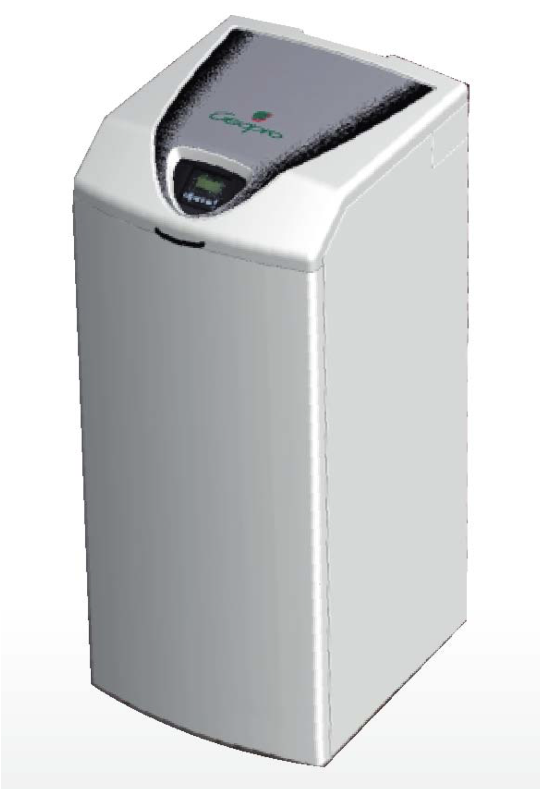

Kuvan kuvaus: piirroskuva maalämpöpumpusta viistosti edestä. Pumppu on valkoinen, kapea ja korkea kaappi. Kannen etuosan tummassa paneelissa on Geopro-logo ja sen alla säätimen näyttö. Etupaneelin yläreunassa on kahvasyvennys.

**Geopro Systems Oy**\
Metsä-Pietilänkatu 1\
PL 5, 15801 LAHTI\
Puh. (03) 857 6400\
Fax (03) 857 6499\
geopro@oilon.com\
www.geopro.fi

> **Repo note:** the page shows no model names. Its text layer lists GS 50, GS 60, GS 75, GS 90 and GS 110 under the cover picture, which hides them. The rest of the manual names the models SH 7 … SH 25 (p. 6, p. 17).

---

## Sivu 2: SISÄLLYSLUETTELO

- YLEISTÄ … 3
- GEOPRO MAALÄMPÖPUMPPUTOIMITUKSEN SISÄLTÖ … 4
- ASENNUKSEEN TARVITTAVAT LISÄTARVIKKEET … 4
- LÄMPÖPUMPUN YHTEET JA LIITOSKOOT … 5
- VARAAJAN LIITÄNNÄT JA SÄHKÖKYTKENNÄT … 6
- LÄMPÖPUMPUN TILANTARVE … 7
- MAAPUTKISTON ASENNUS … 8
- LÄMMÖNKERUUPUTKISTON ASENNUS PORAKAIVOON … 10
- LÄMMÖNKERUUPUTKISTON ASENNUS VESISTÖÖN … 12
- MAALÄMPÖPUMPUN YHDISTÄMINEN RAKENNUKSEN VIILENNYKSEEN … 14
- MAAPIIRIN JA LÄMMITYSJÄRJESTELMÄN TÄYTTÖ … 15
- LÄMPÖPUMPUN KÄYTTÖÖNOTTO … 16
- TEKNISET TIEDOT … 17

LIITTEET:

1. 4-tieventtiilin kytkentä, lämpöpumpun kytkentä vanhaan varaajaan
2. Öljy/puukattilan ja lämpöpumpun yhdistäminen
3. Säätimen liitännät
4. Kaapeleiden liityntäkaavio
5. Maalämpöpumppu päävirtakaavio
6. Maalämpöpumppu ohjauspiirikaavio

> **Repo note:** the list gives no pages for the appendices. LIITE 1–6 head pp. 18–23.

---

## Sivu 3: Yleistä:

Maalämpöpumpun kompressorikoneikon tuottama maksimi lämpötila on jopa yli 80 astetta. Hetkellisesti sähkövastuksen kytkeytymisen jälkeen lämpötila saattaa kohota varaajan yläosaan menevässä putkessa jopa 100 °C:een.

Sekä lämmitys- että maapiiripuolen paluuputkiin on aina asennettava roskanerotin. Maapiirin suodattimen molemmin puolin on asennettava sulkuventtiili, ellei käytössä ole ns. yhdistelmäventtiiliä.

Lämpöpumppu on kuljetettava ja varastoitava pystysuorassa asennossa. Pumppu on kuljetettava asennuspaikalle kuljetusalustallaan, tarvittaessa alusta voidaan poistaa ja käyttää ”nokkakärryjä” pumpun siirtämiseen. Nokkakärryjen käyttö on sallittu vain laitteen takaosasta. Tilapäisesti pumppu voidaan asettaa kyljelleen kuljetettaessa asennuspaikalle. Tilapäisesti pumppu voidaan asettaa kyljelleen kuljetettaessa asennuspaikalle.

Lämpöpumppu pyritään sijoittamaan tasaiselle alustalle. Pumpun pohjassa olevilla säätöjaloilla voidaan kuitenkin hienosäätää pumpun asentoa. Vältä pumpun asentamista ääniherkille seinille. Tilassa johon pumppu asennetaan on oltava lattiakaivo. Asennuksessa on noudatettava rakennusohjeita ja määräyksiä.

Ennen lämpöpumpun käyttöönottoa tulee lämmönkeruu- ja lämmitysjärjestelmän olla täytettyjä ja ilmattuja. Varmista, että järjestelmässä ei ole vuotoja.

> **Repo note:** the page prints the sentence "Tilapäisesti pumppu voidaan asettaa kyljelleen kuljetettaessa asennuspaikalle." twice.

---

## Sivu 4: Geopro-maalämpöpumpputoimituksen sisältö:

- Maapiirin paisunta-astia varoventtiileineen
- Ulkolämpötila-anturi, menovesianturi, 3 varaaja-anturia
- Käyttöohje (automatiikka)
- Asennusohje
- Käyttäjän manuaali
- Asennus-, käyttöönotto- ja takuupöytäkirja

### SH-pumpun asennuksessa tarvittavat lisätarvikkeet:

- Lämmityspiirin L1 kolmitieventtiili (myös L2-piirin, jos kytketty)
- Kolmitieventtiilien toimimoottorit\
  ( 24 V kolmitilaohjattu tai jänniteohjattu, esim. Joventa DAN 1N24, Belimo NRC24)
- Parikaapeli ulkolämpötila-anturille
- Kaapeli lämpöpumpulta toimimoottoreille
- Lämmitysjärjestelmän paisunta-astia
- Kiertovesipumppu L1- (ja L2) piireille
- Käyttöveden sekoitusventtiili
- Lämmitysjärjestelmän varoventtiili 1,5 bar
- Lämmitysjärjestelmän painemittari 0 – 4 bar
- Maakiertopiirin ja lämmityspiirin roskanerottimet
- Putket ja putkivarusteet

Jos maakiertopiirissä on 2 tai useampi rinnakkainen putkilenkki, asennetaan putkilenkkien menopuolelle linjasäätöventtiilit ja paluupuolelle lämpömittarit, jotta rinnakkaisten lenkkien virtausmäärät voidaan tasapainottaa.

Mikäli SH maalämpöpumppu liitetään vanhaan radiaattorilämmitysjärjestelmään, jonka maksimi mitoitusmenovesilämpötila on yli 50 astetta, on suositeltavaa korvata lämmitysjärjestelmän kolmitieventtiili nelitieventtiilillä. Tällöin varaajan yläosasta kytketään putki nelitieventtiilille (liite 1), jolloin päästään tarvittaessa jopa 60 °C:een menovesilämpötilaan. Nelitieventtiiliä voidaan ohjata samanlaisella toimimoottorilla kuin kolmitieventtiiliäkin.

SH maalämpöpumppu voidaan liittää myös vanhan öljy/puukattilan rinnalle. Liitteessä 2 on esimerkkinä kaksi vaihtoehtoista kytkentää.

---

## Sivu 5: Lämpöpumpun yhteet:

- Tulistin meno 3/4” UK
- Varaaja meno 1” UK
- Varaaja paluu 28 mm CU
- liuos paluu: 1” UK (7-11 kW) tai 11/4” UK (13 -18 kW)
- liuos meno: 28 (7-11 kW) tai 35 mm CU (13 -18 kW)

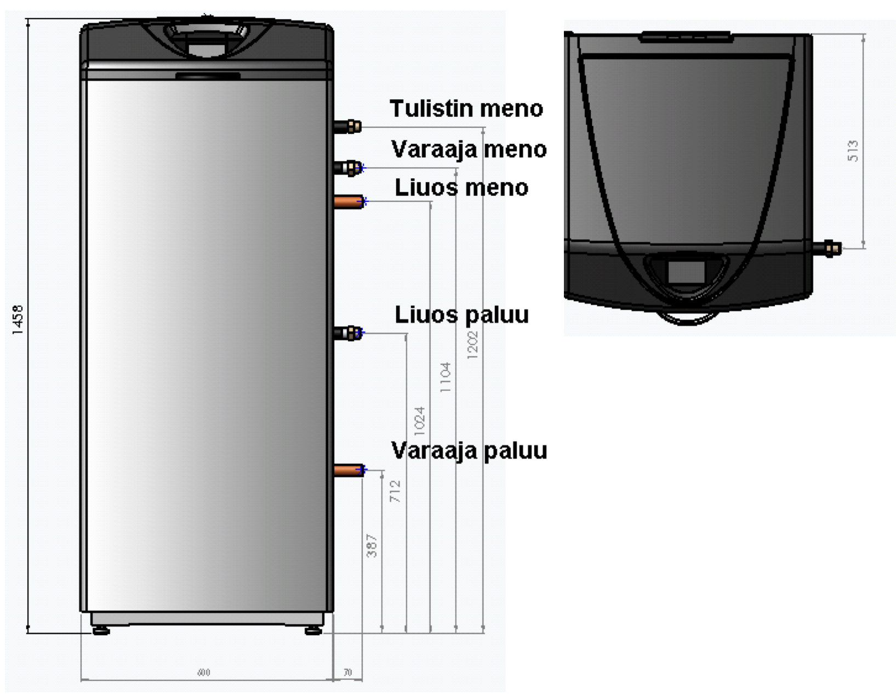

*Kuva 1. Geopro SH maalämpöpumpun yhteet ja mitat.*

Kuvan kuvaus: kaksi mittapiirrosta, mitat millimetreinä. Vasemmalla lämpöpumppu edestä: korkeus 1458 ja leveys 600, ja yhteet ulottuvat 70 kyljen ohi. Kaikki viisi yhdettä ovat oikeassa kyljessä, ja niiden korkeudet lattiasta ovat:

| Yhde | Korkeus |
|---|---|
| Tulistin meno | 1202 |
| Varaaja meno | 1104 |
| Liuos meno | 1024 |
| Liuos paluu | 712 |
| Varaaja paluu | 387 |

Oikealla lämpöpumppu ylhäältä, säätimen näyttö etureunassa: yhteet ovat 513 laitteen takareunasta.

> **Repo note:** "11/4”" is 1 1/4”. The drawing's height, 1458 mm, differs from the 1430 mm in the table on p. 17.

---

## Sivu 6: Varaaja yhteet

- Lämpöpumpulle ja lämmityspiiri: 1” SK
- Käyttövesi: 22 mm CU
- Varavastukset: 2” SK
- Mitta-anturit: 1/2” SK
- Tyhjennys ja ilmaus: 3/4” SK

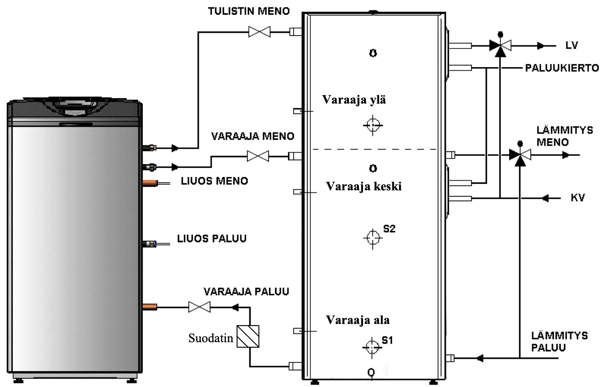

*Kuva 2. SH tulistusmaalämpöpumpun kytkentä SHB tulistusvaraajaan.*

Kuvan kuvaus: kytkentäkaavio, vasemmalla lämpöpumppu ja oikealla SHB-varaaja.

- Lämpöpumpun oikean kyljen yhteet ylhäältä alas: ylin (nuoli pumpusta poispäin) nousee sulkuventtiilin kautta varaajan vasemman kyljen ylimpään yhteeseen ("TULISTIN MENO"). Toinen (nuoli pumpusta poispäin) kulkee sulkuventtiilin kautta varaajan vasempaan kylkeen katkoviivan korkeudelle ("VARAAJA MENO"). "LIUOS MENO" ja "LIUOS PALUU" ovat kytkemättömiä yhteitä. Alin ("VARAAJA PALUU") tulee varaajan pohjan vasemmasta yhteestä suodattimen ("Suodatin") ja sulkuventtiilin kautta, nuoli pumppua kohti.
- Varaaja: vaakasuora katkoviiva rajaa yläosan VARAAJA MENO -yhteen korkeudella. Vasemmassa kyljessä on kolme anturiyhdettä, merkitty "Varaaja ylä", "Varaaja keski" ja "Varaaja ala". Varaajan sisällä on kolme ristikkomerkkiä: merkitsemätön yläosassa, "S2" keskellä ja "S1" alhaalla, sekä pienet ympyrät ("o") ylhäällä, katkoviivan alla ja pohjassa.
- Oikean kyljen yläosan yhteistä ylin kulkee sekoitusventtiilin (kolmitieventtiili, jossa toimilaite) kautta ulos ("LV"). Toinen on "PALUUKIERTO"; sen linjasta laskee pystylinja alempaan yhteeseen KV-yhteen yläpuolella.
- "KV" (nuoli varaajaa kohti) tulee alempaan yhteeseen, ja siitä nousee haara LV-sekoitusventtiilin alaporttiin.
- Katkoviivan korkeudella oikeassa kyljessä oleva yhde kulkee kolmitieventtiilin (toimilaite) kautta ulos ("LÄMMITYS MENO"). "LÄMMITYS PALUU" (nuoli varaajaa kohti) tulee varaajan pohjan oikeaan yhteeseen, ja siitä nousee haara lämmityksen kolmitieventtiilin alaporttiin.

### Sähkökytkennät

Syöttökaapeli kytketään kuvan *Kaapeleiden liityntäkaavio* (liite 4) mukaan pääkytkimelle -Q1 ja riviliittimelle -X0. Kaapelikoko malleissa SH 7 ... SH 11 on 6 mm² ja malleissa SH 13...SH 25 10 mm².

Lämpötila-anturit ja venttiiliohjaukset kytketään riviliittimelle -X3 kuvan *Säätimen liitännät* (liite 3) mukaan\
Asennusvaiheessa varaajaan on kytkettävä 3 lämpötila-anturia:

- Varaajan yläosaan
- Varaajan keskelle
- Varaajan alaosaan

Varaajan varalämpövastus (Oilon lämpöparoni 6 tai 9 kW) kytketään 2” yhteeseen S1. Varavastukselle on tehtävä oma erillinen sähkönsyöttö.

---

## Sivu 7: LÄMPÖPUMPUN TILANTARVE

Lämpöpumppu tulee sijoittaa siten, että laite on noin 100 mm etäisyydellä seinästä. Vakiotoimituksessa liuospiirin liitokset sijaitsevat pumpun oikealla puolella. Putket on myös mahdollista liittää vasemmalta, jolloin tilaa vasemmalle tarvitaan vähintään 500 mm.

Lämmitysverkoston liitännät sijaitsevat varaajan oikealla puolella. Oikealla sijaitsevat myös käyttövesiyhteet. SHB varaajan varalämpövastus asennetaan varaajan etuosan alaosaan.

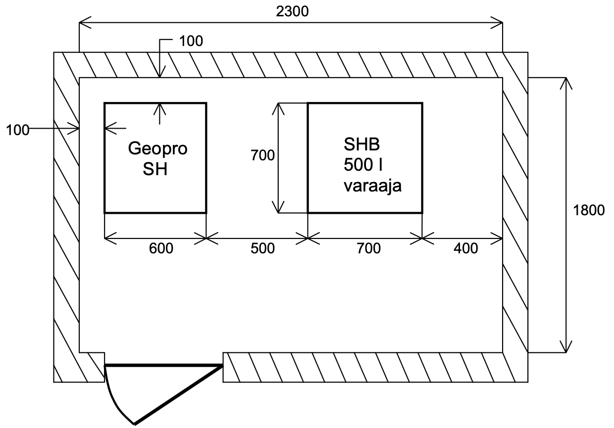

*Kuva 3. SH maalämpöpumpun ja varaajan sijoitus rakennuksen tekniseen tilaan.*

Kuvan kuvaus: pohjapiirros teknisestä tilasta, mitat millimetreinä. Huoneen sisämitat ovat 2300 (leveys) ja 1800 (syvyys). Takaseinän vierellä ovat vasemmalta oikealle "Geopro SH" ja "SHB 500 l varaaja". Vaakamitat vasemmasta seinästä: 100 seinään, Geopro SH 600, väli 500, varaaja 700 ja 400 oikeaan seinään. Molemmat laitteet ovat 100 takaseinästä, ja niiden syvyys on 700. Ovi on etuseinän vasemmassa päässä ja aukeaa ulospäin.

Geopro SH maalämpöpumppu on suositeltavaa sijoittaa erilliseen tekniseen tilaan. Teknisessä tilassa tulee olla myös lattiakaivo. Teknisen tilan on hyvä sijaita rakennuksessa siten, että makuuhuoneita ei ole teknisen tilan seinän ulkopuolella.

---

## Sivu 8: MAAPUTKISTON ASENNUSOHJEET

Maakeruuputkisto upotetaan etelä-suomessa noin 1,0 metrin syvyyteen ja pohjois-suomessa noin 1,2 metrin syvyyteen. Rinnakkaisten putkilenkkien etäisyys tulee olla vähintään 1,5 m. Maaputkisto on asennettava siten, että putkistoon ei pääse syntymään ilmapusseja, jolloin putkiston täyttövaiheessa ilmaus helpottuu huomattavasti. Putkena käytetään yleisimmin PELM 40/PN10 muoviputkea. Tarvittava putkipituus mitoitetaan jokaiseen kohteeseen erikseen.

Putkikaivanto tulee täyttää mahdollisimman kivettömällä maa-aineksella, jotta kivet eivät pääse rikkomaan putkea. Tien alituksissa putket tulee eristää (kuva 10.)

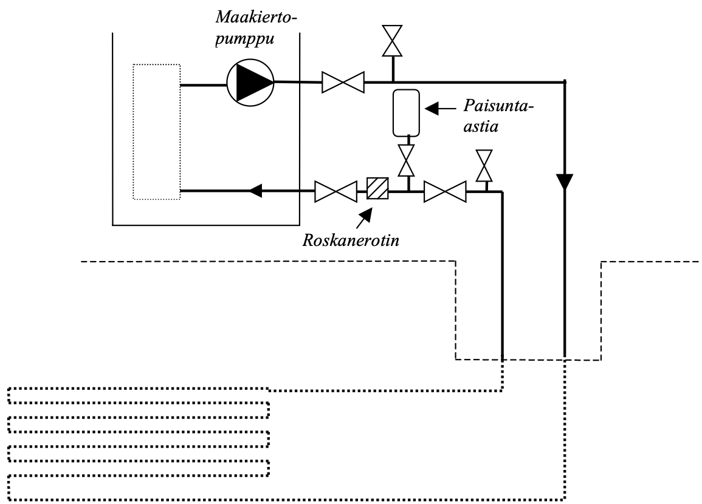

*Kuva 4. Maakeruuputkiston kytkentä.*

Kuvan kuvaus: periaatekuva. Vasemmalla lämpöpumppu, jonka sisällä on höyrystin (pisteviivalla piirretty suorakaide) ja maakiertopumppu ("Maakierto-pumppu").

- Menolinja: maakiertopumppu, sulkuventtiili ja T-haara, josta lähtee ylöspäin venttiili. Linja kääntyy oikealle ja laskee (nuoli alaspäin) maahan.
- Paluulinja maasta lämpöpumppuun: T-haara, josta lähtee ylöspäin venttiili, sulkuventtiili, T-haara, josta venttiilin kautta ylöspäin "Paisunta-astia", "Roskanerotin" ja sulkuventtiili. Nuoli osoittaa höyrystintä kohti.
- Katkoviiva kuvaa maanpintaa ja putkikaivantoa. Maan alla pisteviivalla piirretty keruuputkisto mutkittelee edestakaisin vaakasuorina lenkkeinä.

Jos maakiertopiirissä on 2 tai useampi rinnakkainen lenkki, on suositeltavaa laittaa putkistoon menopuolelle linjasäätöventtiilit ja paluupuolelle lämpömittarit. Tällöin voidaan linjasäätöventtiileillä säätää rinnakkaisten putkistojen paluulämpötilat yhtä suuriksi. Tällä varmistetaan, että molemmissa piireissä varmasti kiertää liuos. Jos keruuputkisto on yhtenä lenkkinä, ei linjasäätöventtiilejä ja lämpömittareita tarvita.

Jotta maaputkistoon asennusvaiheessa mahdollisesti jääneet epäpuhtaudet eivät pääse lämpöpumpun höyrystimelle asti, on maapiirin paluuputkeen ennen lämpöpumppua asennettava roskanerotin. Roskanerottimen molemmin puolin on asennettava sulkuventtiilit tai käytettävä yhdistelmäventtiiliä, jotta roskanerotin voidaan puhdistaa myös käytön aikana.

**Lämmönkeruuputkiston huolellinen asennus on erittäin tärkeää pumpun luotettavan toiminnan takaamiseksi.**

---

## Sivu 9: MAAPUTKISTON ASENNUSOHJEET

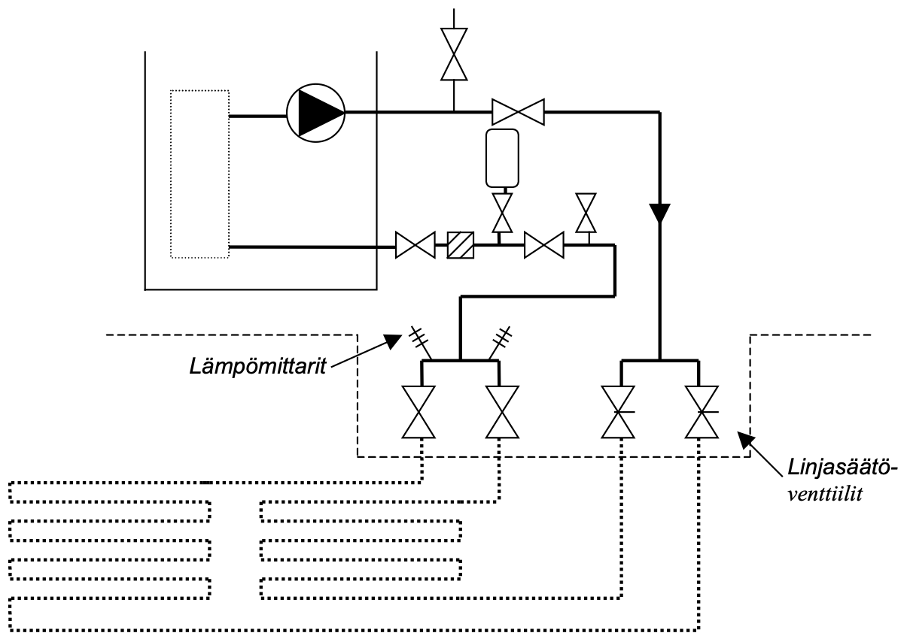

*Kuva 5. Maakeruuputkiston kahden rinnakkaisen piirin kytkentä.*

Kuvan kuvaus: kuvan 4 kytkentä kahdella rinnakkaisella keruuputkilenkillä. Lämpöpumpun puolella ovat samat osat kuin kuvassa 4 ilman nimiä, mutta menolinjassa ylöspäin lähtevä venttiili on ennen sulkuventtiiliä. Putkikaivannossa (katkoviiva) menolinja (nuoli alaspäin) jakautuu kahdeksi haaraksi, joissa kummassakin on linjasäätöventtiili ("Linjasäätö-venttiilit"). Paluulinja kootaan kahdesta haarasta, joissa kummassakin on sulkuventtiili ja sen yläpuolella lämpömittari ("Lämpömittarit"). Maan alla on kaksi pisteviivalla piirrettyä, edestakaisin mutkittelevaa lenkkiä.

---

## Sivu 10: LÄMMÖNKERUUPUTKISTON ASENNUS PORAKAIVOON

Porakaivoasennuksessa putkilenkkien käännöskohtaan asennetaan riittävän suuri paino, jonka avulla putki lasketaan kaivon pohjalle. Lämpökaivo on halkaisijaltaan 130 – 160 mm. Putkena käytetään PELM 40/PN6 muoviputkea. Käännöskohta tehdään erillisellä paluukulmalla, joka hitsataan putkeen kiinni.

Lämpökaivo on järkevintä sijoittaa mahdollisimman lähelle lämpöpumpun sijoituspaikkaa, jolloin siirtoputkien pituudet jäävät mahdollisimman lyhyiksi. Etäisyyttä rakennuksen sokkeliin tulee olla kuitenkin vähintään 2 metriä. Poraus on järkevintä suorittaa mahdollisimman aikaisessa vaiheessa, jolloin porauskalusto saadaan helposti paikalle ja porauksessa syntyvistä roiskeista ei ole haittaa.

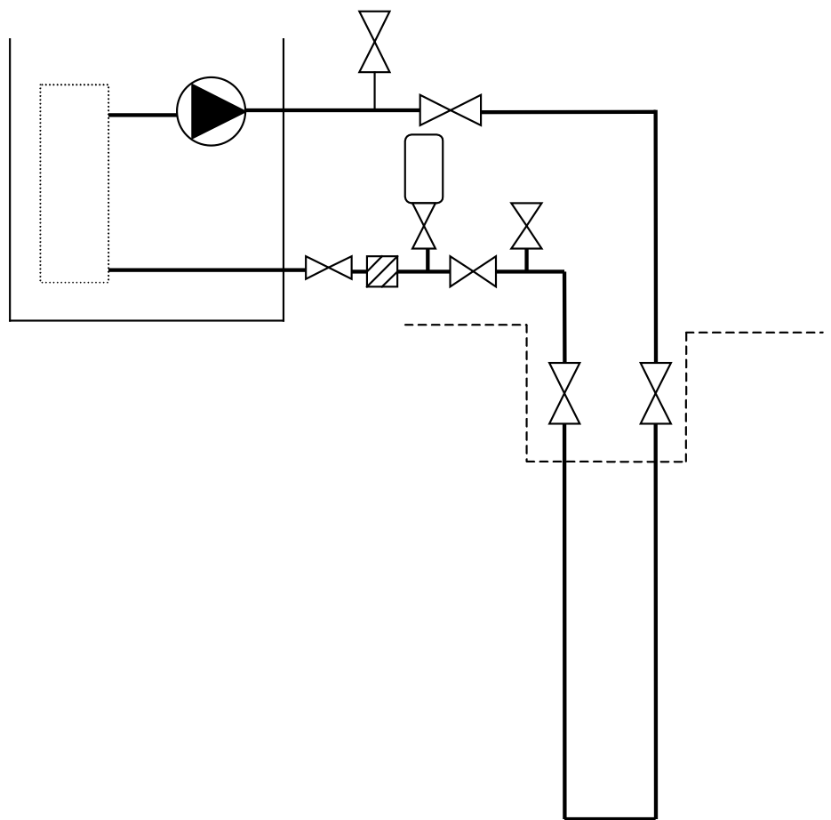

*Kuva 6. Lämpökaivon kytkentä.*

Kuvan kuvaus: lämpöpumpun puoli on piirretty kuten kuvassa 5. Meno- ja paluuputki laskeutuvat katkoviivalla merkittyyn huoltokaivoon, jossa kummassakin putkessa on sulkuventtiili, ja jatkuvat suoraan alas lämpökaivoon. Kaivon pohjalla putket yhdistyvät U-lenkiksi.

Lämpökaivon päälle tehdään noin metrin syvyinen huoltokaivo. Mikäli lämpökaivoja on 2 tai useampi rinnakkain, huoltokaivot yhdistetään eristetyillä putkilla yhteiseen kokoojakaivoon. Kokoojakaivosta liuos viedään kahdella eristetyllä putkella lämpöpumpulle. Asennustöiden jälkeen kaivot peitetään kannella ja voidaan halutessa piilottaa maan alle.

Lämpökaivosta voidaan kesäaikana ottaa kasteluvettä, mutta talviaikaan veden otto on kielletty. Runsas vedenotto talviaikaan saattaa aiheuttaa kaivon pinnankorkeuden laskemisen ja kaivon jäätymisen. Kasteluveden otto tulee suorittaa kaivon ulkopuolisella pumpulla ja imuputkella. Uppopumpun käyttö lämpökaivossa saattaa aiheuttaa liuosputkien vaurioitumisen.

**Lämmönkeruuputkiston huolellinen asennus on erittäin tärkeää pumpun luotettavan toiminnan takaamiseksi.**

---

## Sivu 11: LÄMMÖNKERUUPUTKISTON ASENNUS PORAKAIVOON

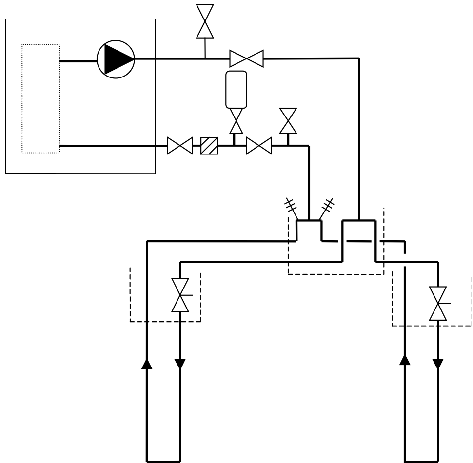

*Kuva 7. Kahden rinnakkaisen lämpökaivon kytkentä. Rinnakkaisilla kaivoilla tulee olla etäisyyttä vähintään 15 m. Rinnakkaisiin piireihin on suositeltavaa asentaa linjasäätöventtiilit sekä paluupuolelle lämpömittarit, jotta virtausmäärät rinnakkaisissa putkissa voidaan tasata.*

Kuvan kuvaus: lämpöpumpun puoli on piirretty kuten kuvassa 6. Meno- ja paluulinja laskeutuvat katkoviivalla merkittyyn kokoojakaivoon. Siellä menolinja jakautuu kahdeksi haaraksi, jotka kulkevat kumpikin oman lämpökaivonsa huoltokaivoon (katkoviiva), sen linjasäätöventtiilin kautta ja alas kaivoon (nuoli alaspäin). Kaivoista nousevat putket (nuoli ylöspäin) palaavat kokoojakaivoon ja yhdistyvät paluulinjaan. Kummassakin paluuhaarassa on lämpömittari. Kaivot on piirretty U-lenkkeinä.

---

## Sivu 12: LÄMMÖNKERUUPUTKISTON ASENNUS VESISTÖÖN

Vesistö soveltuu lämmönlähteeksi kohteissa, joissa vesistö (järvi, lampi, meri) on vähintään 2 m syvä jo rannan läheisyydessä. Lisäksi rakennuksen tulee olla riittävän lähellä rantaa (alle 50 m), jotta siirtoputken rakentaminen talolta rantaan on kannattavaa. Emme suosittele keruuputkiston asentamista virtaavaan jokeen.

Putkiston asennukseen tarvitaan vesialueen omistajan lupa. Putkiston vaikutus vesistön ekologiaan on kuitenkin hyvin vähäinen, joten yleensä luvan saannille ei ole esteitä.

Keruuputkena käytetään samanlaista muoviputkea kuin maa-asennuksessakin. Putket tulee ankkuroida betonipainojen avulla vesistön pohjaan, jotta putkien ympärille mahdollisesti muodostuva jääkerros ei nosta putkea ylös pohjasta. Betonipainot (5 – 15 kg) asennetaan putkeen noin 2 m välein (painosta riippuen) ja kiinnitetään järeillä muovi/nylon nippusiteillä tiukasti putkeen kiinni.

Mikäli vesistö on rannan läheltä alle 2 m syvä, täytyy putket kaivaa vesistön pohjaan, kunnes riittävä syvyys saavutetaan. On huomioitava, että putken ympärille muodostuu jäätä joka voi jäätyä kiinni vesistön jääkanteen ja keväinen veden nousu repii putket mukanaan.

Lämpöpumpulta vesistöön tuleva putki voidaan hyödyntää lämmön keruussa, mutta lämpöpumpulle palaava putki on eristettävä, jotta vesistössä lämmenneellä liuoksella ei talviaikaan turhaan lämmitetä maaperää

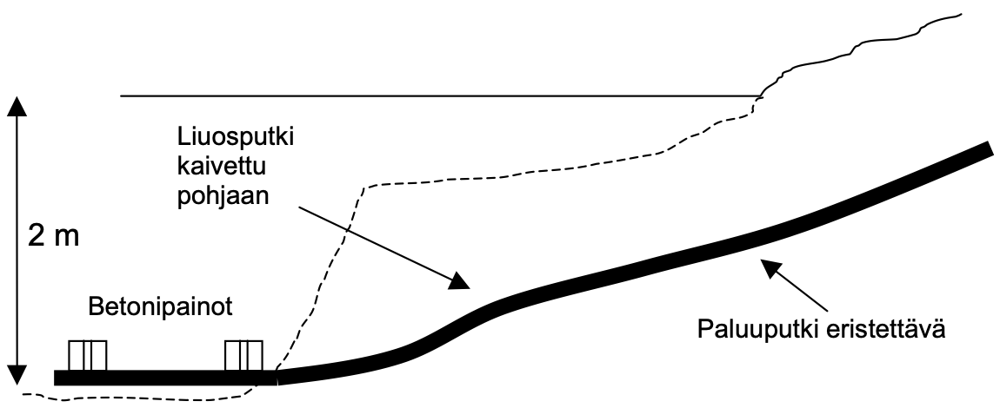

*Kuva 8. Lämmönkeruuputkiston asennus vesistöön.*

Kuvan kuvaus: leikkauskuva rannasta. Oikealla ranta nousee vedestä, ja vedenpinta on vaakaviiva. Pohja (katkoviiva) laskee rannasta vasemmalle 2 m:n syvyyteen (pystymitta "2 m" vedenpinnasta pohjaan). Paksu viiva on putki. Rannan lähellä se kulkee pohjan alla ("Liuosputki kaivettu pohjaan") ja nousee rannalle; teksti "Paluuputki eristettävä" osoittaa rannanpuoleista osaa. 2 m:n syvyydessä putki lepää pohjalla, ja siihen on kiinnitetty kaksi betonipainoa ("Betonipainot").

Vesistöputki kytketään lämpöpumpulle samalla tavoin kuin maakeruuputkisto.

**Lämmönkeruuputkiston huolellinen asennus on erittäin tärkeää pumpun luotettavan toiminnan takaamiseksi.**

---

## Sivu 13: LÄMMÖNKERUUPUTKISTON ASENNUS VESISTÖÖN

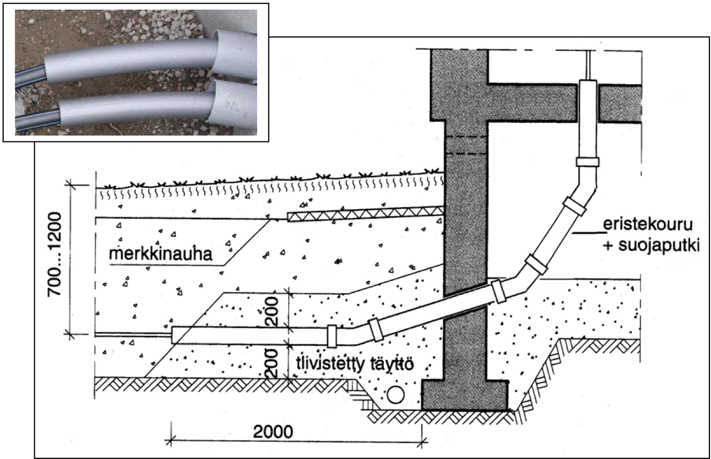

*Kuva 9. Lämmönkeruuputkiston ja suojaputken läpivienti.*

Kuvan kuvaus: leikkauskuva putkien viennistä rakennuksen perustuksen läpi, mitat millimetreinä. Vasemmassa yläkulmassa on valokuva, jossa kaksi mustaa muoviputkea kulkee harmaiden eristekourujen sisällä. Piirroksessa:

- Putki kulkee kaivannossa 700...1200 syvyydellä maanpinnasta. Putken ylä- ja alapuolella on 200 tiivistettyä täyttöä ("tiivistetty täyttö"). Kaivannon täytössä putken yläpuolella on merkkinauha ("merkkinauha").
- Putki kulkee suojaputken sisällä viimeiset 2000 ennen perustuksen anturaa.
- Anturan yläpuolella putki nousee vinosti sokkelin läpi ja kulmayhteiden kautta pystysuoraan lattialaatan läpi sisätiloihin ("eristekouru + suojaputki").
- Sokkelin vierellä lähellä maanpintaa on vaakasuora eristelevy, ja anturan ulkopuolella on pyöreä putki.

Seinän ja anturan läpivienti esim. kahdella 110 mm viemäriputkella.

Eristeenä pumpusta putkiojan pohjalle käytetään esim. solukumityyppistä eristettä tai maalevyjä.

Pienin taivutussäde on 1 metri. Jyrkemmissä kulmissa käytetään kulmayhteitä. Tavallisesti käytetään aina kulmayhteitä läpiviennin ja lämpöpumpun välillä. Joissakin tapauksissa on hyvä käyttää kulmayhteitä myös läpiviennin ja maaputkiston välillä.

Läpivienti voidaan tehdä myös yhdellä taivutettavalla suojaputkella (esim. Upotel).

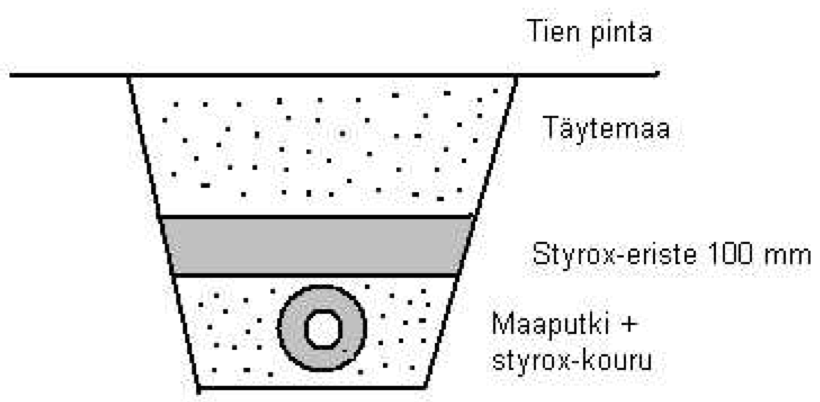

*Kuva 10. Tien alituksen eristäminen.*

Kuvan kuvaus: poikkileikkaus tien alituksesta. Ylhäällä on "Tien pinta", ja kaivanto levenee ylöspäin. Ylimpänä on "Täytemaa", sen alla vaakasuora "Styrox-eriste 100 mm" ja alimpana "Maaputki + styrox-kouru": putki eristekourun sisällä täytemaan keskellä.

---

## Sivu 14: MAALÄMPÖPUMPUN YHDISTÄMINEN RAKENNUKSEN VIILENNYKSEEN

Mikäli maalämpöpumpun lämmönlähteenä käytetään porakaivoa, voidaan liuoskiertoa hyödyntää kesäaikana rakennuksen viilennyksessä. Maapiirin paluupuolelta otetaan erillinen haara, joka johdetaan ilmastointikoneeseen integroituun jäähdytyspatteriin tai tuloilmakanavaan sijoitettuun erilliseen viilennyspatteriin.

Viilennyspatterille tulee asentaa erillinen kiertopiiri omalla kiertopumpulla ja kolmitieventtiilillä.

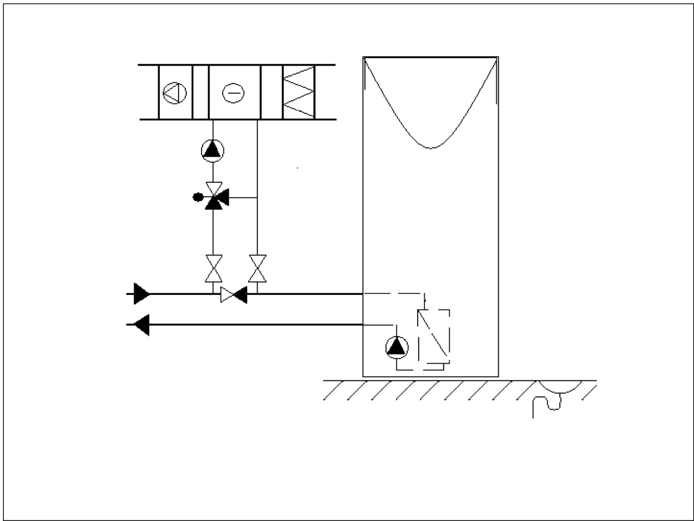

*Kuva 11.Maapirin kytkentä rakennuksen viilennykseen.*

Kuvan kuvaus: periaatekuva. Oikealla lämpöpumppu lattialla lattiakaivon vieressä. Sen alaosassa on höyrystin (katkoviivalla piirretty lämmönsiirrin) ja liuospumppu. Vasemmalle lähtee kaksi maapiirin putkea: ylempi (nuoli lämpöpumppua kohti) tulee maasta höyrystimelle, alempi (nuoli lämpöpumpusta poispäin) lähtee liuospumpulta maahan. Vasemmassa yläkulmassa on ilmastointikone, jossa on puhallin, patteri ja suodatin. Ylemmästä putkesta lähtee kaksi pystyhaaraa patterille, kummassakin sulkuventtiili; haarojen välissä ylemmässä putkessa on venttiili. Vasemmassa haarassa on kolmitieventtiili (toimilaite) ja sen yläpuolella kiertopumppu, joka pumppaa patterille. Kolmitieventtiilin kolmas portti on yhdistetty oikeaan haaraan, joka palauttaa liuoksen patterilta ylempään putkeen.

Mikäli lämmönkeruujärjestelmänä on vaakaputkitus pintamaassa tai vesistö, ei viilennysjärjestelmää kannata asentaa. Kesäaikaan maaperän ja vesistön lämpötila nousee yleensä niin korkeaksi, että viilennystehoa ei juurikaan saada.

---

## Sivu 15: MAAPIIRIN JA LÄMMITYSVERKOSTON TÄYTTÖ

***Lämmitysverkosto ja maapiiri on täytettävä huolellisesti ja aina ennen pumpun käynnistämistä. Ilma lämmitysverkostossa tai maapiirissä aiheuttaa ongelmia. Muista täyttää myös varaaja ennen käynnistystä ja varmista, että sulkuventtiilit varaajan ja lämpöpumpun välillä ovat auki, jotta vesi pääsee myös lämpöpumpulle. Varaaja ilmataan varaajan päällä olevasta ilmausyhteestä. Lämmitysjärjestelmällä on aina oltava oma paisuntasäiliönsä.***

### Lämmitysverkoston täyttö:

Täytä varaaja ja lämmitysjärjestelmä. Jos talossa on lattialämmitys tee lämmitysjärjestelmän täyttö huolella piiri kerrallaan ja muista ilmata lopuksi runkoputket. Tarkista lopuksi, että paine järjestelmässä on oikea (n. 1 – 1,3 bar). Lämmitysjärjestelmän ilmaus on tehtävä erityisen huolella, sillä jo pienikin ilmamäärä voi aiheuttaa putkistoissa ilmapussin, joka estää veden virtauksen ja näin ollen huonetila ei lämpiä (lattialämmitystalot).

### Maapiirin täyttö:

Maaputkisto (tai kallio- tai vesistöputkisto) on täytettävä sekoituksella, jossa on puolet 60 % teollisuusalkoholia ja loput vettä. Tällöin saavutetaan noin –15 asteen pakkaskestävyys.

Täyttö tapahtuu seuraavasti:

- Liitä kaksi letkua ja täyttöpumppu kuvan 1 mukaan venttiileihin 1 ja 2. Pumpun tuoton on oltava vähintään 4 m3/h (esim. Grundfos JP6).
- Molemmat letkut laitetaan astiaan, jonka tilavuus on vähintään 100 l. Astia täytetään maalämpöliuoksella.
- Avaa venttiilit 1 ja 2, sulje venttiili 3. Käynnistä täyttöpumppu, jolloin putkisto täyttyy liuoksella.
- Kun järjestelmä on täyttynyt eikä paluuputkesta tule enää ilmaa, sulje venttiilit 1 ja 2.
- Irrota letkut.
- Asenna paisuntasäiliö ja täytä noin puoleen.
- Asenna paisuntasäiliön varoventtiili ja avaa venttiilit 2 ja 3.
- Lämpöpumpun liuoskiertopumppua voidaan käyttää erillisellä kytkimellä ennen lämpöpumpun käynnistämistä (jos sähkökytkennät on tehty). Kun sähkökytkennät on tehty varmista, että käyttökytkin S1 on asennossa ” 0 ”. Kytke pääkytkin Q1, ohjaussulake F3 sekä maakiertopumpun sulake F6 ja käynnistä liuoskiertopumppu käsikytkimellä S2. Varmista, että pumppu alkaa kierrättää liuosta. **Varmista, että järjestelmässä ei ole ilmaa.**

  On suositeltavaa kierrättää liuoskiertopumppua ennen lämpöpumpun käynnistämistä. Tällöin nähdään laskeeko paisuntasäiliön pinta ja liuosta voidaan tarvittaessa lisätä. Mikäli paisuntasäiliön pinta laskeliuoskiertopumpun käynnistyessä, järjestelmässä on vielä ilmaa.

**HUOM! Käytä täyttöpumpun imuputkessa tehokasta suodatinta, jotta putkistosta tulevat roskat jäävät**

> **Repo note:** the HUOM box cuts off its own last line: only the tops of the letters print, and the text layer holds the fragments "tä ttö ti".

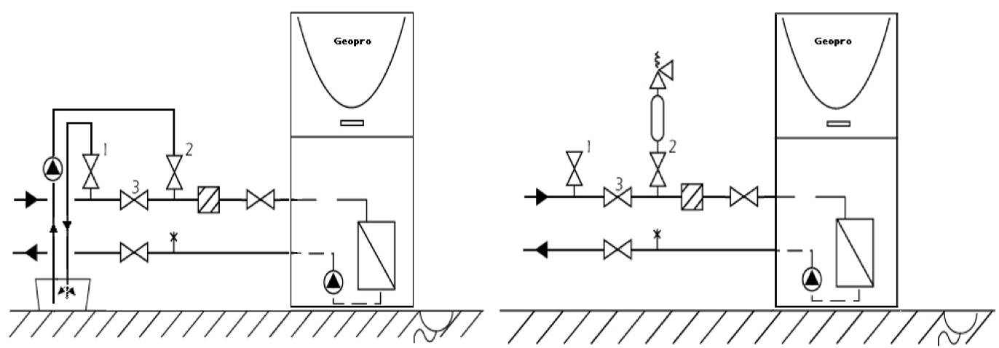

*Kuva 11. Maapiirin täyttö.*

Kuvan kuvaus: kaksi osakuvaa, vasemmalla "Täyttövaihe:" ja "kuva 1", oikealla "Käynnistysvaihe:" ja "kuva 2". Kummassakin lämpöpumppu ("Geopro") on oikealla lattiakaivon vieressä, ja sen sisällä ovat höyrystin ja liuoskiertopumppu. Maapiirin kaksi putkea tulevat vasemmalta. Ylempi (nuoli lämpöpumppua kohti) tulee maasta, ja siinä ovat lämpöpumppua kohti järjestyksessä venttiilin 1 haara ylöspäin, sulkuventtiili 3, venttiilin 2 haara ylöspäin, roskanerotin ja sulkuventtiili. Alempi (nuoli lämpöpumpusta poispäin) lähtee liuoskiertopumpulta; siinä on sulkuventtiili ja pieni ylöspäin lähtevä haara, jonka päässä on tähtimerkki.

- Täyttövaihe: täyttöpumppu imee lattialla olevasta astiasta (nuoli ylöspäin) ja painaa liuoksen letkulla venttiiliin 2. Venttiililtä 1 letku palaa astiaan (nuoli alaspäin). Imuletkun pää on astian pohjalla.
- Käynnistysvaihe: letkut on irrotettu. Venttiilin 2 päällä on paisuntasäiliö ja sen päällä varoventtiili.

> **Repo note:** this figure and the one on p. 14 are both numbered Kuva 11. The first step's "kuvan 1" is this figure's left half, "Täyttövaihe: kuva 1", not Kuva 1 on p. 5.

---

## Sivu 16: KÄYTTÖÖNOTTO

***Toimenpiteet sähkö- ja putkikytkentöjen ja täytön jälkeen. Varmista, että tarvittavat lämpötila-anturit ja venttiilit on kytketty. Tutustu säätimen ohjeeseen ennen käynnistämistä; tärkeät kohdat: Asetusarvot, Säätökäyrien asetukset, Ohjaustavat ja Starttitoiminta.***

Geopro SH lämpöpumpussa käytetään Geopro 202S –säädintä. Säätimellä voidaan ohjata kahta eri lämmityspiiriä , L1 ja L2. Säätimen kolmas ohjauspiiri ML hyödynnetään lämpöpumpun sisäisessä ohjauksessa. Siten käyttöveden lämpötilasäätöön on käytettävä erillistä sekoitusventtiiliä.

1. Varmista, että käyttökytkin S1 on asennossa ”0”
2. Kytke pääkytkin Q1 ja ohjaussulake F3 päälle, sekä kytke kompressorin ylivirtasuoja F1 pois päältä, jotta kompressori ei käynnisty välittömästi.
3. Käännä käyttökytkin S1 asentoon ”1”.
4. Säädin käynnistyy ja hälyttää kompressorin ylivirtasuojasta, kuittaa hälytys painamalla ”OK”
5. Suorita käyttöohjeen mukainen ”Starttitoiminta” (kts. s. 15. automatiikan käyttöohje)
6. Valitse ohjaustapa L1 (ja L2): Valinta - Ohjaustavat - Käsiajo sähköinen ja tarkista venttiilimoottorien toiminta ja ajosuunta. Muuta tarvittaessa venttiilien kytkentää. Palauta ohjaustapa asentoon Autom. säätö

> **Repo note:** the steps go from 6 to 8; the page has no step 7.

8. Valitse ML Valinta - Ohjaustapa - Kompressori.
9. Aseta lämmitysjärjestelmän L1 (ja L2) säätökäyrät: L1 (L2) Valinta - Säätökäyrien as.
10. Käynnistä kompressori kytkemällä kompressorin ylivirtasuoja F1 päälle.
11. **VARMISTA KOMPRESSORIN PYÖRIMISSUUNTA**

    **joko**

    1. kiinnitä imu- ja lauhtumispainemittarit neulaventtiileihin ja tarkkaile paineita imupaineen pitäisi laskea ja lauhtumispaineen nousta nopeasti. Jos merkittävää paineenmuutosta ei tapahdu, vaihda kaksi vaihejohtoa keskenään kompressorin kytkentäkotelosta, tai virransyöttö riviliittimeltä.

    **tai**

    2. mittaa paineputken lämpötilaa esim. kädellä, lämpötilan pitäisi nousta nopeasti. Jos lämpötila ei muutu 10..15 sekunnin aikana, pysäytä kompressori ja vaihda kaksi vaihejohtoa keskenään kompressorin kytkentäkotelosta, tai virransyötöstä pääkytkimelle Q1.\
       Muista katkaista laitteen virransyöttö ennen muutostöitä.\
       Vältä kompressorin pyörittämistä väärinpäin.

12. Kytke sähkövastuksen sulake F2 päälle
13. Muuta ML valikosta ohjaustavaksi Kompr. + sähköv.
14. Seuraa laitteen toimintaa mittausvalikosta: menovesilämpötila, maaliuoksen lämpötila, varaajan lämpötilat ja yläosatulo –lämpötila.

Käyttöönottovaiheessa on ehkä tarpeellista muuttaa kesäsulkulämpötilaa. Tehdasasetuksena on +19 °C, eli jos ulkolämpötila on korkeampi, ajaa automatiikka lämmitysjärjestelmän säätöventtiilin L1 kiinni. Muuta kesäsulkulämpötila valikosta L1 Valinta - Asetusarvot - Vent. Kesäsulk. ( k.s. automatiikan käyttöohje s. 6-7.)

***Täytä lopuksi asennuspöytäkirja!***

> **Repo note:** the page numbers this page gives for the controller manual ("automatiikan käyttöohje") don't fit the Käsikirja in this folder. The Käsikirja has Starttitoiminta on p. 17, not p. 15, and Vent.kesäsulk on pp. 8–9, not pp. 6–7. It also gives Vent.kesäsulk a factory value of 30 °C (pp. 9 and 29), not +19 °C.

---

## Sivu 17: Tekniset tiedot

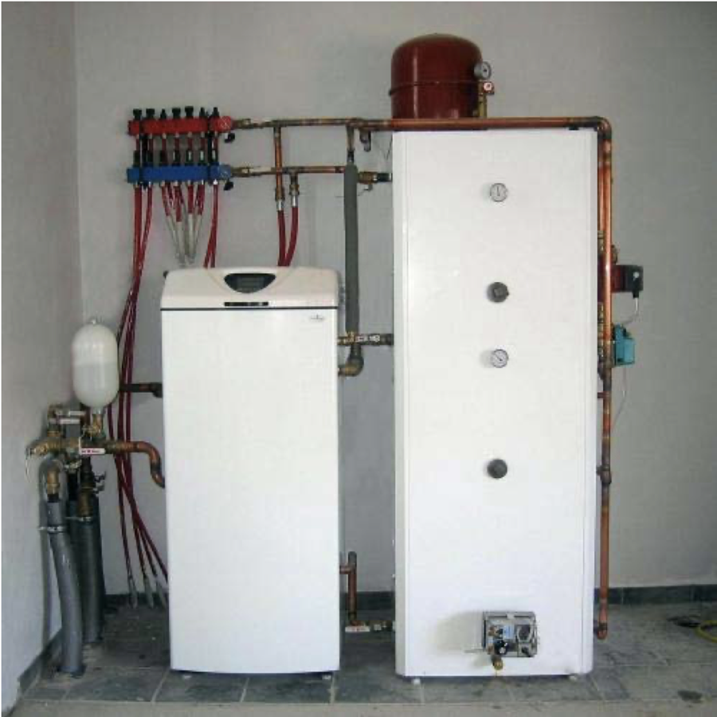

*Kuva 12. SH maalämpöpumppu ja tulistusvaraaja asennettuna.*

Kuvan kuvaus: valokuva teknisestä tilasta. Vasemmalla on valkoinen SH-maalämpöpumppu, jonka kannessa on säätimen näyttö, ja oikealla korkea valkoinen tulistusvaraaja. Varaajan etupuolella on kaksi lämpömittaria ja kaksi tulppaa, ja sen etuosan alaosassa on harmaa kotelo. Varaajan päällä on punainen paisunta-astia. Seinällä vasemmalla ovat lattialämmityksen jakotukit (punainen ja sininen), joista punaiset lattialämmitysputket laskeutuvat lattiaan. Pumpun vasemmalla puolella maapiirin harmaat eristetyt putket nousevat lattiasta, ja niissä on valkoinen paisunta-astia ja venttiilejä. Kupariputket yhdistävät pumpun, varaajan ja jakotukit; varaajan oikealla puolella pystyputkessa on kiertopumppu ja venttiilin toimilaite.

<table>
  <tr><th colspan="10">Tekniset tiedot</th></tr>
  <tr><th>Geopro SH</th><th></th><th>7</th><th>9</th><th>11</th><th>13</th><th>15</th><th>18</th><th>20</th><th>25</th></tr>
  <tr><td>Lämpöteho (0°C/+35°C)</td><td>kW</td><td>7,5</td><td>8,8</td><td>11,0</td><td>13,2</td><td>15,8</td><td>17,7</td><td>19,8</td><td>24,4</td></tr>
  <tr><td>Ottoteho (0°C/+35°C)</td><td>kW</td><td>1,8</td><td>2,2</td><td>2,7</td><td>3,2</td><td>3,7</td><td>4,1</td><td>4,8</td><td>6,0</td></tr>
  <tr><td>Sähköliitäntä</td><td></td><td colspan="8">3~400 V</td></tr>
  <tr><td>Lisälämpövastus</td><td>kW</td><td>6</td><td>6</td><td>6</td><td>9</td><td>9</td><td>9</td><td>9</td><td>9</td></tr>
  <tr><td>Sulakekoko</td><td>A</td><td>25</td><td>25</td><td>25</td><td>35</td><td>35</td><td>35</td><td>35</td><td>40</td></tr>
  <tr><td>Käynnistysvirta</td><td>A</td><td>39</td><td>44</td><td>50</td><td>62</td><td>70</td><td>96</td><td>94</td><td>116</td></tr>
  <tr><td>Nimellisteho, maakiertopumppu</td><td>W</td><td>245</td><td>245</td><td>245</td><td>400</td><td>400</td><td>400</td><td>400</td><td>400</td></tr>
  <tr><td>Nimellisteho, lämpöjohtopumppu</td><td>W</td><td>90</td><td>90</td><td>90</td><td>90</td><td>90</td><td>90</td><td>90</td><td>90</td></tr>
  <tr><td>Mitat</td><td>mm</td><td colspan="8">Korkeus 1430 mm, leveys 600 mm, syvyys 700 mm</td></tr>
</table>

> **Repo note:** this table, like p. 6, names the models SH 7 … SH 25. The note on [p. 1](#s1) has the cover's GS model names.

---

## Sivu 18: LIITE 1

### 4-tieventtiilin kytkentä SHB -varaajaan:

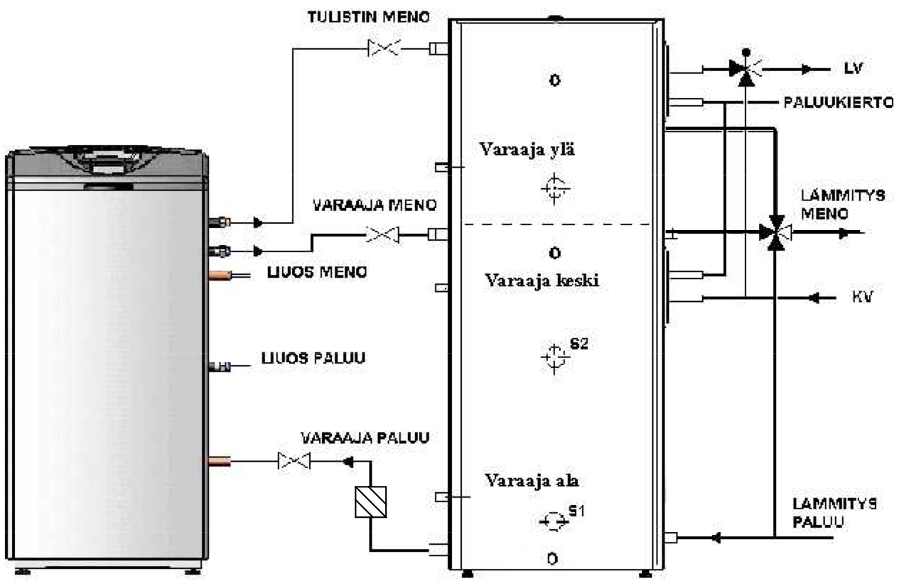

Kuvan kuvaus: sama kytkentä kuin sivun 6 kuvassa 2, mutta lämmityksen kolmitieventtiilin tilalla on nelitieventtiili. Sen vasen portti on yhdistetty varaajan oikeaan kylkeen katkoviivan korkeudelle, alaportti "LÄMMITYS PALUU" -linjaan ja oikea portti "LÄMMITYS MENO" -linjaan kuten sivulla 6. Neljäs, yläportti on yhdistetty paksulla putkella varaajan oikean kyljen yläosaan, PALUUKIERTO-yhteen alapuolelle.

Alla on periaatekuva Geopro SH maalämpöpumpun kytkennästä vanhaan lämmitysjärjestelmään, jossa on hyväkuntoinen varaaja. Vanhan varaajan lisäksi asennetaan erillinen käyttövesikierukalla varustettu tulistusvaraaja, johon ohjataan lämpöpumpun tulistuslämpö. Tulistusvaraajan pohjalta virtaus johdetaan vanhan varaajan yläosaan. Käyttövesi esilämmitetään vanhan varaajan kierukassa ja loppulämmitys tapahtuu tulistusvaraajan kierukassa.

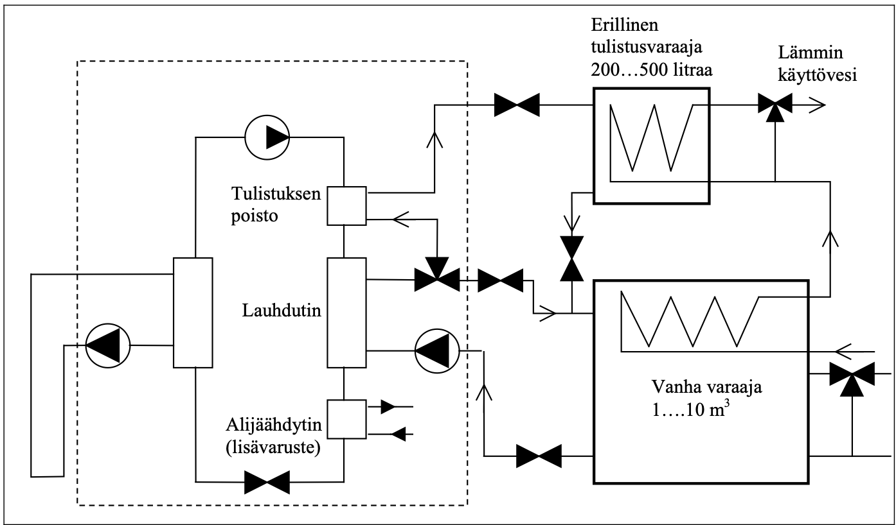

Kuvan kuvaus: periaatekuva. Katkoviivalla rajattu alue on lämpöpumppu.

- Kylmäainepiiri: höyrystimeltä (vasen, nimeämätön lämmönsiirrin) kompressorille (ympyrä, jossa kolmio), tulistuksen poistimelle ("Tulistuksen poisto"), lauhduttimelle ("Lauhdutin") ja alijäähdyttimelle ("Alijäähdytin (lisävaruste)"), ja paisuntaventtiilin kautta takaisin höyrystimelle. Höyrystimen toinen puoli on maapiiri, jossa on pumppu ja joka kulkee ulos vasemmalle. Alijäähdyttimessä on kaksi yhdettä ulospäin (nuolet).
- Tulistuksen poistosta vesi nousee (nuoli ylöspäin) ja kulkee sulkuventtiilin kautta erillisen tulistusvaraajan ("Erillinen tulistusvaraaja 200…500 litraa") yläosaan. Tulistusvaraajan pohjalta virtaus laskee (nuoli alaspäin) sulkuventtiilin kautta vanhan varaajan ("Vanha varaaja 1….10 m³") yläosaan.
- Lauhduttimen ylempi yhde menee kolmitieventtiiliin. Siitä yksi haara kulkee tulistuksen poiston paluuyhteeseen (nuoli tulistuksen poistoa kohti) ja toinen sulkuventtiilin kautta vanhan varaajan yläosaan (nuoli varaajaa kohti).
- Lauhduttimen alempaan yhteeseen pumppu tuo vettä vanhan varaajan pohjalta (nuoli ylöspäin) sulkuventtiilin kautta.
- Käyttövesi: kylmä vesi tulee oikealta (nuoli) vanhan varaajan kierukkaan, nousee siitä (nuoli ylöspäin) tulistusvaraajan kierukkaan ja lähtee sekoitusventtiilin kautta ulos ("Lämmin käyttövesi"). Sekoitusventtiilin kolmas portti on yhdistetty kierukoiden väliseen putkeen.
- Vanhan varaajan oikealla puolella on kolmitieventtiili, joka on yhdistetty varaajan keskiosaan ja pohjaan. Sen lähtö ja varaajan pohjan putki jatkuvat oikealle ilman nimeä.

---

## Sivu 19: LIITE 2

Kahdessa alla olevassa kuvassa on esimerkkikytkennät Geopro SH maalämpöpumpun ja öljy/puukattilan yhdistämisestä. Ylempi kuva soveltuu kohteisiin, joissa on vanha öljy/puukattila ja suuri lämminvesivaraaja. Lämpöpumpun lisäksi tarvitaan erillinen tulistusvaraaja, johon johdetaan öljy/puukattilalta tuleva kuuma vesi sekä lämpöpumpulta tuleva tulistuslämpö. Yksisuuntaventtiilit lämpöpumpun ja varaajan välillä estävät kuuman veden pääsyn lauhduttimelle öljykattilan käydessä. Lämpöpumpun automatiikka käynnistää lämpöpumpun automaattisesti mikäli lämpötilat varaajassa laskevat alle asetusarvojen ja kattila ei ole käytössä. Vastaavasti, kun kattila tuottaa lämmintä vettä varaajaan, lämpöpumpun automatiikka katkaisee kompressorin käynnin.

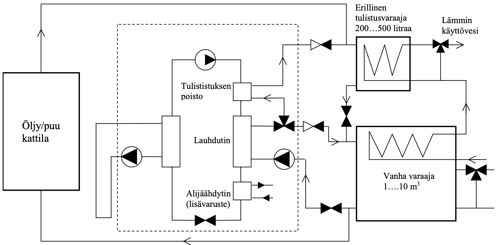

Kuvan kuvaus: sama kytkentä kuin sivun 18 alemmassa kuvassa, ja vasemmalla on lisäksi öljy/puukattila ("Öljy/puu kattila"). Tulistuksen poiston nimi on kirjoitettu "Tulististuksen poisto". Kattilan lähtö nousee (nuoli ylöspäin) ja kulkee kuvan yläreunaa pitkin tulistusvaraajan yläosan yhteeseen, samaan, johon tulistuksen poiston linja tulee. Kattilan paluu otetaan vanhan varaajan pohjan yhteestä, ja se kulkee kuvan alareunaa pitkin (nuoli vasemmalle) kattilan pohjaan. Sivun 18 kuvasta poiketen tulistuksen poiston ja lauhduttimen linjoissa lämpöpumpun ja varaajien välissä on yksisuuntaventtiili (venttiilimerkin toinen kolmio ontto).

Alla oleva kytkentä soveltuu rakennuksiin, joissa on pelkästään öljykattila. Lämpöpumppu liitetään normaaliin tapaan SHB-varaajaan. Öljykattilalta tuleva kuuma vesi johdetaan SHB varaajan yläosaan ja varaajan pohjalta otetaan kylmää vettä kattilalle. Yksisuuntaventtiilit lämpöpumpun ja varaajan välillä estävät kuuman veden pääsyn lauhduttimelle öljykattilan käydessä. Automatiikka toimii samalla tavoin kuin yllä olevassa kytkennässä.

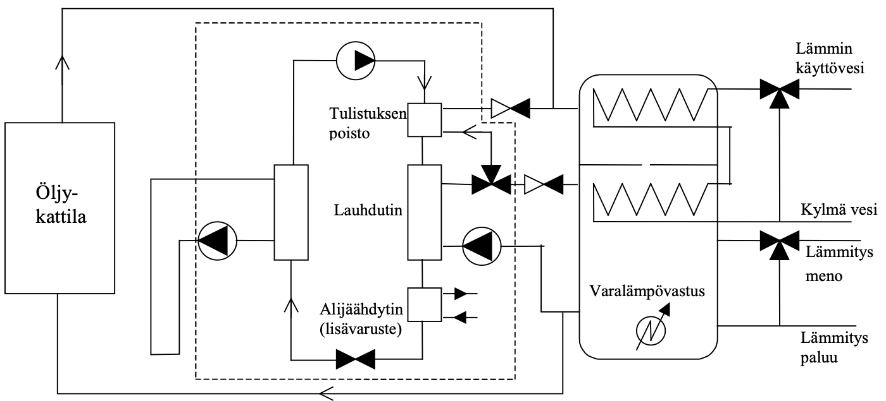

Kuvan kuvaus: vasemmalla öljykattila ("Öljy-kattila"), keskellä lämpöpumppu (katkoviivalla rajattu alue, sisältö kuten ylemmässä kuvassa, "Tulistuksen poisto") ja oikealla SHB-varaaja.

- Tulistuksen poistosta linja kulkee yksisuuntaventtiilin kautta varaajan vasemman kyljen yläosaan. Samaan linjaan liittyy kattilan lähtö, joka nousee kattilasta (nuoli ylöspäin) ja kulkee kuvan yläreunaa pitkin.
- Lauhduttimen ylempi yhde menee kolmitieventtiiliin. Siitä yksi haara palaa tulistuksen poistoon (nuoli) ja toinen kulkee yksisuuntaventtiilin kautta varaajan vasempaan kylkeen väliseinän alapuolelle.
- Lauhduttimen alempaan yhteeseen pumppu tuo vettä varaajan alaosasta. Samasta linjasta lähtee kattilan paluu, joka kulkee kuvan alareunaa pitkin (nuoli vasemmalle) kattilaan.
- Varaajassa on vaakasuora väliseinä, jonka keskellä on aukko. Väliseinän ylä- ja alapuolella on kierukka, ja kierukat on kytketty sarjaan varaajan oikealla puolella. "Kylmä vesi" tulee alemman kierukan alapäähän. Ylemmän kierukan yläpää menee sekoitusventtiiliin, jonka alaportti on yhdistetty kylmän veden linjaan, ja venttiililtä lähtee "Lämmin käyttövesi".
- Varaajan oikeasta kyljestä lähtee "Lämmitys meno" kolmitieventtiilin kautta, ja "Lämmitys paluu" tulee varaajan alaosaan. Paluulinjasta nousee haara kolmitieventtiilin alaporttiin.
- Varaajan alaosassa on "Varalämpövastus" (vastuksen piirrosmerkki).

---

## Sivu 20: LIITE 3

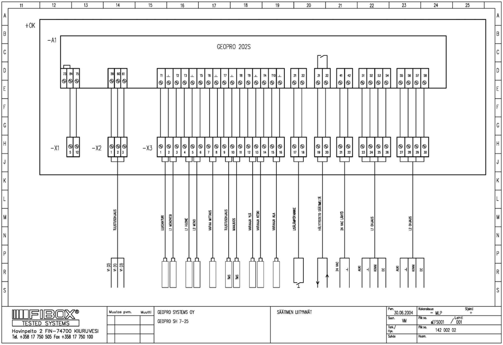

Kuvan kuvaus: sähköpiirustus "SÄÄTIMEN LIITYNNÄT", sivulla vaakasuunnassa (kuva on käännetty pystyyn). Piirustus näyttää, mihin keskuksen riviliittimiin säätimen -A1 (GEOPRO 202S) liittimet on johdotettu ja mitä kenttälaitteita riviliittimiin kytketään. Kehys +OK rajaa keskuksen. Ylhäällä on säätimen liitinrivi ja sen alla riviliittimet -X1, -X2 ja -X3. Säätimen liittimet on johdotettu suoraan alla oleviin riviliittimiin, paitsi liitin 73, joka on yhdistetty vain liittimeen 84. Riviliittimiltä lähtee kaapeli kenttälaitteelle. Kaapeli on piirretty yhdeksi viivaksi, jonka vieressä on sen nimi, ja kenttälaitteen päässä viiva jakautuu taas johtimiksi samassa järjestyksessä kuin riviliittimet.

Säätimen liitinrivi vasemmalta oikealle: 73, 84, 75 | 59, 60, 61 | T1, ⊥, T2, T3, ⊥, T5, T6, ⊥, T7, ⊥, T8, T9, ⊥, T4, T10, ⊥ | 21, 22 | 31, 32 | 41, 42 | 51, 52, 53, 54 | 55, 56, 57, 58. Liittimet 73 ja 84 on yhdistetty toisiinsa liitinrivin yläpuolella, ja liittimien 31 ja 32 välissä on säätimen sisällä kosketin.

| Kaapeli | Säätimen liitin → riviliitin | Kenttälaitteen pää |
|---|---|---|
| (ei kaapelia) | 84 → -X1:5, 75 → -X1:12 | Näistä ei lähde kaapelia tällä sivulla (ks. sivu 23). |
| TULISTUSOHJAUS | 59 → -X2:1, 60 → -X2:2, 61 → -X2:3 | johtimet V1 (2), V1 (1), V1 (3), kohdakkain liittimien -X2:1, 2, 3 kanssa |
| ULKOANTURI | T1 → -X3:1, ⊥ → -X3:2 | anturi |
| L1 MENOVESI | ⊥ → -X3:2, T2 → -X3:3 | anturi |
| L1 HUONE | T3 → -X3:4, ⊥ → -X3:5 | anturi |
| L2 MENO | ⊥ → -X3:5, T5 → -X3:6 | anturi |
| VAPAA MITTAUS | T6 → -X3:7, ⊥ → -X3:8 | anturi |
| TULISTUSOHJAUS | T7 → -X3:9, ⊥ → -X3:10 | anturi, merkintä TMS |
| MAALIUOS | ⊥ → -X3:10, T8 → -X3:11 | anturi, merkintä TMS |
| VARAAJA YLÄ | T9 → -X3:12, ⊥ → -X3:13 | anturi |
| VARAAJA KESKI | ⊥ → -X3:13, T4 → -X3:14 | anturi |
| VARAAJA ALA | T10 → -X3:15, ⊥ → -X3:16 | anturi |
| LISÄLÄMPÖPAINIKE | 21 → -X3:17, 22 → -X3:18 | painonappi |
| HÄLYTYSTIETO SÄÄTIMELTÄ | 31 → -X3:19, 32 → -X3:20 | kaksi johdinta: -X3:19:n johtimen päässä nuoli keskuksesta poispäin, -X3:20:n johtimen päässä nuoli keskusta kohti |
| 24 VAC LÄHTÖ | 41 → -X3:21, 42 → -X3:22 | johtimet 24 VAC (-X3:21) ja ⊥ (-X3:22) |
| L1 OHJAUS | 51 → -X3:23, 52 → -X3:24, 53 → -X3:25, 54 → -X3:26 | johtimet AUKI (-X3:23), ⊥ (-X3:24), KIINNI (-X3:25), DC (-X3:26) |
| L2 OHJAUS | 55 → -X3:27, 56 → -X3:28, 57 → -X3:29, 58 → -X3:30 | johtimet AUKI (-X3:27), ⊥ (-X3:28), KIINNI (-X3:29), DC (-X3:30) |

Riviliittimet -X3:2, -X3:5, -X3:10 ja -X3:13 ovat kahden anturin yhteisiä ⊥-liittimiä.

Nimiö: SÄÄTIMEN LIITYNNÄT; GEOPRO SYSTEMS OY, GEOPRO SH 7-25; Pvm. 30.06.2004; Suun. VM; Kokonaisuus = MLP; Sijainti +; Piir.no. &EFS001 / Lehti 001; Piir.no. 142 002 02. Vasemmassa reunassa FIBOX® TESTED SYSTEMS, Hovinpelto 2 FIN-74700 KIURUVESI, Tel. +358 17 750 505 Fax +358 17 750 100. Kentät Muutos pvm., Muutti, Tark./Hyv., Suhde ja Huom. ovat tyhjiä.

> **Repo note:** the wiring diagram on Käsikirja p. 39 names the Controller's own terminal groups X1–X3 (Dig 1–3), K1 (the alarm contact 31–32) and M1–M3 (the valve-motor outputs). On these drawings -X1, -X2 and -X3 are the heat pump's terminal strips, -K1 is the compressor contactor and -M1 the compressor.

> **Repo note:** T1–T10 are the measurement inputs Mitt.1–Mitt.10, M1–M10 in [CONTEXT.md](../CONTEXT.md), and the sensors here match its table. 51–54 and 55–58 are the outputs Moott. L1 and Moott. L2. The -X2 TULISTUSOHJAUS cable goes to the JV's 3-point motor on Moott. JV ([`docs/controller.md`](../docs/controller.md#jv), terminals 59–62). It wires 59–61, the 3-point motor's terminals on Käsikirja p. 39; 62 is the 0...10 V control of a voltage-controlled motor.

---

## Sivu 21: LIITE 4

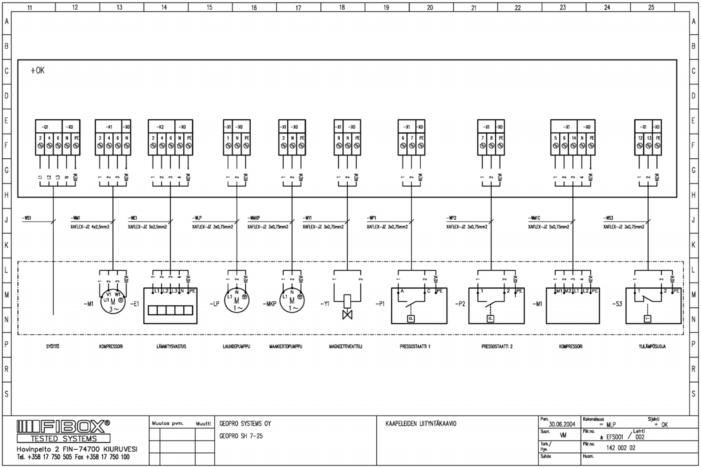

Kuvan kuvaus: sähköpiirustus "KAAPELEIDEN LIITYNTÄKAAVIO", sivulla vaakasuunnassa. Ylhäällä +OK-kehyksen (keskuksen) sisällä on liitinryhmät, ja kustakin lähtee kaapeli alas kenttälaitteelle. Kenttälaitteet ovat alhaalla pistekatkoviivalla rajatulla alueella, ja niiden nimet ovat alareunassa. Kaapelin johtimet on numeroitu keskuksen ja laitteen päässä samoin. KEVI on keltavihreä suojajohdin, ja -X0 on N- ja PE-riviliitin. Taulukko kulkee kuvan mukaan vasemmalta oikealle, ja kukin ketju on muotoa keskuksen liitin → johdin → laitteen liitin.

| Laite (nimi alareunassa) | Kaapeli | Keskuksen liitin → johdin → laitteen liitin |
|---|---|---|
| SYÖTTÖ | -WS1 (tyyppiä ei ole merkitty) | -Q1:2 → L1, -Q1:4 → L2, -Q1:6 → L3, -X0:N → N, -X0:PE → KEVI. Kaapeli päättyy ilman laitetta. |
| KOMPRESSORI -M1 (moottori 3~) | -WM1 XAFLEX-JZ 4x2,5mm2 | -K1:2 → 1 → U1, -K1:4 → 2 → V1, -K1:6 → 3 → W1, -X0:N → KEVI → maadoitus |
| LÄMMITYSVASTUS -E1 | -WE1 XAFLEX-JZ 5x2,5mm2 | -K2:2 → 1 → L1, -K2:4 → 2 → L2, -K2:6 → 3 → L3, -X0:N → 4 → N, -X0:PE → KEVI → PE |
| LAUHDEPUMPPU -LP (moottori 1~) | -WLP XAFLEX-JZ 3x0,75mm2 | -X1:1 → 1 → L1, -X0:N → 2 → N, -X0:PE → KEVI → maadoitus |
| MAAKIERTOPUMPPU -MKP (moottori 1~) | -WMKP XAFLEX-JZ 3x0,75mm2 | -X1:2 → 1 → L1, -X0:N → 2 → N, -X0:PE → KEVI → maadoitus |
| MAGNEETTIVENTTIILI -Y1 | -WY1 XAFLEX-JZ 3x0,75mm2 | -X1:9 → 1 → kela, -X0:N → 2 → kela, -X0:PE → KEVI. KEVI-johdinta ei ole piirretty venttiilille asti. |
| PRESSOSTAATTI 1 -P1 | -WP1 XAFLEX-JZ 3x0,75mm2 | -X1:6 → 1 → A, -X1:7 → 2 → C, -X0:PE → KEVI → PE |
| PRESSOSTAATTI 2 -P2 | -WP2 XAFLEX-JZ 3x0,75mm2 | -X1:7 → 1 → 1, -X1:8 → 2 → 2, -X0:PE → KEVI → PE |
| KOMPRESSORI -M1 (toinen kaapeli) | -WM1C XAFLEX-JZ 5x0,75mm2 | -X1:5 → 1 → M1, -X1:6 → 2 → M2, -X1:14 → 3 → L1, -X0:N → 4 → L2, -X0:PE → KEVI → PE |
| YLILÄMPÖSUOJA -S3 | -WS3 XAFLEX-JZ 3x0,75mm2 | -X1:12 → 1 → 1, -X1:13 → 2 → 2, -X0:PE → KEVI → PE |

Pressostaattien -P1 ja -P2 kosketin on piirretty P-merkityn painekytkimen ohjaamaksi ja ylilämpösuojan -S3 kosketin T-merkityn lämpötilakytkimen ohjaamaksi. Riviliittimet -X1:6 ja -X1:7 kuuluvat kumpikin kahteen ryhmään, koska laitteet on kytketty niiden kautta sarjaan (sivu 23).

Nimiö: KAAPELEIDEN LIITYNTÄKAAVIO; GEOPRO SYSTEMS OY, GEOPRO SH 7-25; Pvm. 30.06.2004; Suun. VM; Kokonaisuus = MLP; Sijainti + OK; Piir.no. & EFS001 / Lehti 002; Piir.no. 142 002 02.

> **Repo note:** the -K1 group labels the terminal of the compressor cable's KEVI conductor -X0 N, while every other KEVI on this page lands on -X0 PE. p. 22 runs the same conductor (WM1's 4) from the PE line to the motor's PE.

---

## Sivu 22: LIITE 5

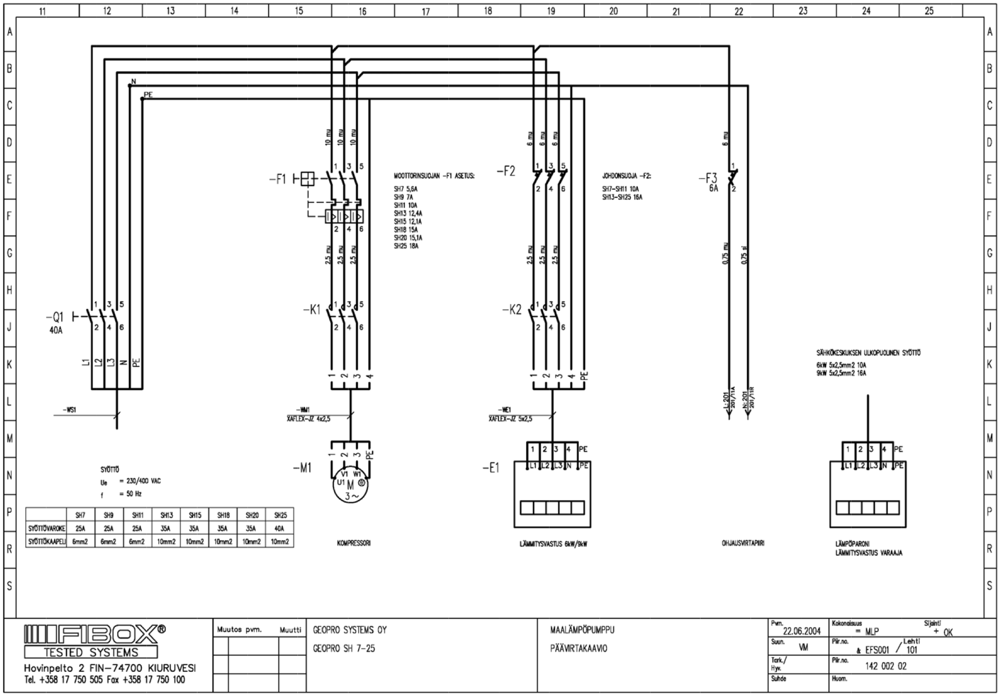

Kuvan kuvaus: sähköpiirustus "MAALÄMPÖPUMPPU PÄÄVIRTAKAAVIO" (lehti 101), sivulla vaakasuunnassa. Syöttökaapeli -WS1 tulee vasemmalta alhaalta, johtimet L1, L2, L3, N ja PE. L1, L2 ja L3 kulkevat pääkytkimen -Q1 (40A) läpi alhaalta (2, 4, 6) ylös (1, 3, 5) ja nousevat piirustuksen yläreunaan. Siellä viisi vaakajohdinta kulkee oikealle: ylimpänä L1, sitten L2, L3, N ja PE. Niistä haarautuvat:

- Kompressori -M1 (KOMPRESSORI): L1, L2 ja L3 (10 mu) → moottorinsuoja -F1 1, 3, 5 → 2, 4, 6 → (2,5 mu) → kontaktori -K1 1, 3, 5 → 2, 4, 6 → kaapelin -WM1 XAFLEX-JZ 4x2,5 johtimet 1, 2, 3 → moottorin U1, V1, W1. Kaapelin johdin 4 lähtee PE-johtimesta ja on moottorin päässä PE. -F1:n symboliin kuuluu kolme laukaisinta liittimien 2, 4 ja 6 puolella.
- Lämmitysvastus -E1 (LÄMMITYSVASTUS 6kW/9kW): L1, L2 ja L3 (6 mu) → johdonsuoja -F2 1, 3, 5 → 2, 4, 6 → (2,5 mu) → kontaktori -K2 1, 3, 5 → 2, 4, 6 → kaapelin -WE1 XAFLEX-JZ 5x2,5 johtimet 1, 2, 3 → E1:n L1, L2, L3. Johdin 4 lähtee N-johtimesta E1:n N:ään ja PE PE-johtimesta E1:n PE:hen.
- Ohjausvirtapiiri (OHJAUSVIRTAPIIRI): L1 (6 mu) → johdonsuoja -F3 6A, 1 → 2 → (0,75 mu) → nuoli "L:201", viittaus 201/11A. N → (0,75 si) → nuoli "N:201", viittaus 201/11R. Nämä jatkuvat sivun 23 ohjauspiirikaavioon.
- Oikealla erikseen LÄMPÖPARONI / LÄMMITYSVASTUS VARAAJA: vastus, jonka liittimet 1, 2, 3, 4 ja PE ovat L1, L2, L3, N ja PE. Sen syöttö on piirretty ylhäältä yhdeksi viivaksi, joka ei liity tämän sivun muihin johtimiin. Viivan yläpuolella lukee: SÄHKÖKESKUKSEN ULKOPUOLINEN SYÖTTÖ / 6kW 5x2,5mm2 10A / 9kW 5x2,5mm2 16A.

Johtimien merkinnät ovat poikkipinta (mm²) ja väri: mu = musta, si = sininen.

Kuvan tekstit:

MOOTTORINSUOJAN -F1 ASETUS:

- SH7 5,6A
- SH9 7A
- SH11 10A
- SH13 12,4A
- SH15 12,1A
- SH18 15A
- SH20 15,1A
- SH25 18A

JOHDONSUOJA -F2:

- SH7-SH11 10A
- SH13-SH25 16A

SYÖTTÖ

- Ue = 230/400 VAC
- f = 50 Hz

| | SH7 | SH9 | SH11 | SH13 | SH15 | SH18 | SH20 | SH25 |
|---|---|---|---|---|---|---|---|---|
| SYÖTTÖVAROKE | 25A | 25A | 25A | 35A | 35A | 35A | 35A | 40A |
| SYÖTTÖKAAPELI | 6mm2 | 6mm2 | 6mm2 | 10mm2 | 10mm2 | 10mm2 | 10mm2 | 10mm2 |

Nimiö: MAALÄMPÖPUMPPU PÄÄVIRTAKAAVIO; GEOPRO SYSTEMS OY, GEOPRO SH 7-25; Pvm. 22.06.2004; Suun. VM; Kokonaisuus = MLP; Sijainti + OK; Piir.no. & EFS001 / Lehti 101; Piir.no. 142 002 02.

---

## Sivu 23: LIITE 6

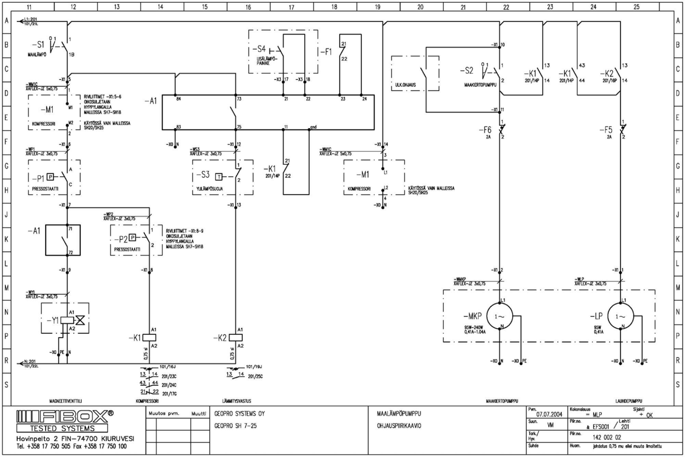

Kuvan kuvaus: sähköpiirustus "MAALÄMPÖPUMPPU OHJAUSPIIRIKAAVIO" (lehti 201), sivulla vaakasuunnassa. Vaihe "L1:201" tulee vasemmasta yläkulmasta (viittaus 101/21L) ja kulkee yläreunaa pitkin, nolla "N:201" (viittaus 101/22L) alareunaa pitkin. Sulkeutuvaksi kutsutaan alla kosketinta, joka on piirretty auki, ja avautuvaksi kosketinta, joka on piirretty kiinni.

- Kytkin -S1: L1:201 → -S1 "MAALÄMPÖ" (asennot 0 ja 1, kosketin 1–1B) → -X1:5. -X1:5 syöttää kompressorin ohjausketjun ja säätimen -A1 liittimet 84 ja 73.
- Säädin -A1 on suorakaide keskellä ylhäällä: yläreunassa liittimet 84, 73, 21, 22, 23 ja 24, alareunassa 83, 75, 11 ja gnd. Liittimien 73 ja 75 välissä on sulkeutuva kosketin.
  - 84 ja 73 saavat syötön -X1:5:stä, ja 83 menee -X0 N:ään.
  - 75 → -X1:12 → kaapeli -WS3 XAFLEX-JZ 3x0,75 → YLILÄMPÖSUOJA -S3 (T-merkitty lämpötilakytkin, avautuva kosketin 1–2) → -X1:13 → kontaktorin -K2 kela A1 → A2 → N:201 (0,75 si). Nimi alareunassa: LÄMMITYSVASTUS.
  - 21 → -X3:17 ja 22 → -X3:18 → LISÄLÄMPÖ-PAINIKE -S4 (sulkeutuva painonappi, rajattu katkoviivalla).
  - 23 ja 24 → moottorinsuojan -F1 avautuva kosketin 21–22.
  - 11 ja gnd → kontaktorin -K1 avautuva kosketin 21–22 (viittaus 201/14P).
- Kompressorin ohjausketju vasemmassa reunassa ylhäältä alas: -X1:5 → kaapelin -WM1C XAFLEX-JZ 5x0,75 johdin 1 → KOMPRESSORI -M1:n liitin M1 → M2 → johdin 2 → -X1:6 → kaapeli -WP1 XAFLEX-JZ 3x0,75 → PRESSOSTAATTI -P1 (P-merkitty painekytkin, sulkeutuva kosketin A–C) → -X1:7 → säätimen -A1 erillinen sulkeutuva kosketin 71–72 → -X1:9 → kaapeli -WY1 XAFLEX-JZ 3x0,75 → MAGNEETTIVENTTIILI -Y1:n kela A1 → A2 → -X0 N → N:201. Y1:n maadoitus menee -X0 PE:hen; piirroksessa viiva jatkuu PE-liittimen alta N:201-johtimeen asti.
- -X1:7:stä lähtee myös haara: kaapeli -WP2 XAFLEX-JZ 3x0,75 → PRESSOSTAATTI -P2 (P-merkitty painekytkin, sulkeutuva kosketin 1–2) → -X1:8 → kontaktorin -K1 kela A1 → A2 → N:201 (0,75 si). Nimi alareunassa: KOMPRESSORI.
- Kompressorin -M1 syöttö: L1:201 → -X1:14 → kaapelin -WM1C johdin 3 → M1:n L1. M1:n L2 → johdin 4 → -X0 N.
- Maakiertopumppu: L1:201 → -X1:10 → kytkin -S2 "MAAKIERTOPUMPPU" (asennot 0 ja 1, kosketin 1–2) → -X1:11. S2:n rinnalla ovat ulkoinen sulkeutuva kosketin ULK.OHJAUS (-X1:10:n ja -X1:11:n välissä, rajattu katkoviivalla) ja -K1:n sulkeutuva kosketin 13–14 (viittaus 201/14P). -X1:11 → johdonsuoja -F6 2A → -X1:2 → kaapeli -WMKP XAFLEX-JZ 3x0,75 → -MKP:n L1 (moottori 1~, 95W-240W, 0,41A-1.04A). N → -X0 N, maadoitus → -X0 PE. Nimi alareunassa: MAAKIERTOPUMPPU.
- Lauhdepumppu: L1:201 → rinnakkain -K1:n sulkeutuva kosketin 43–44 (viittaus 201/14P) ja -K2:n sulkeutuva kosketin 13–14 (viittaus 201/16P) → johdonsuoja -F5 2A → -X1:1 → kaapeli -WLP XAFLEX-JZ 3x0,75 → -LP:n L1 (moottori 1~, 95W, 0,41A). N → -X0 N, maadoitus → -X0 PE. Nimi alareunassa: LAUHDEPUMPPU.

Ketjun vieressä olevat tekstit:

- -M1:n kohdalla: RIVILIITTIMET -X1:5-6 OIKOSULJETAAN HYPPYLANGALLA MALLEISSA SH7-SH18 ja KÄYTÖSSÄ VAIN MALLEISSA SH20/SH25.
- -P2:n kohdalla: RIVILIITTIMET -X1:8-9 OIKOSULJETAAN HYPPYLANGALLA MALLEISSA SH7-SH18.
- Kompressorin -M1 syötön (L1, L2) kohdalla: KÄYTÖSSÄ VAIN MALLEISSA SH20/SH25.

Kelojen -K1 ja -K2 alla luetellaan niiden koskettimet ja paikat muodossa lehti/sarake+rivi. Lehti 101 on sivu 22 ja lehti 201 tämä sivu, ja sarakkeet 11–25 ja rivit A–S on merkitty piirustuksen reunoihin.

| Kontaktori | Kosketin | Paikka |
|---|---|---|
| -K1 | pääkoskettimet | 101/16J |
| -K1 | 13–14, sulkeutuva | 201/23C |
| -K1 | 43–44, sulkeutuva | 201/24C |
| -K1 | 21–22, avautuva | 201/17G |
| -K2 | pääkoskettimet | 101/19J |
| -K2 | 13–14, sulkeutuva | 201/25C |

Nimiö: MAALÄMPÖPUMPPU OHJAUSPIIRIKAAVIO; GEOPRO SYSTEMS OY, GEOPRO SH 7-25; Pvm. 07.07.2004; Suun. VM; Kokonaisuus = MLP; Sijainti + OK; Piir.no. & EFS001 / Lehti 201; Piir.no. 142 002 02; Huom. johdotus 0,75 mu ellei muuta ilmoitettu.

> **Repo note:** A1's terminals here match the Controller's in [`docs/controller.md`](../docs/controller.md#inputs-and-relays) (from Käsikirja p. 39): 71–72 is Rele 2 (the compressor), 73–75 Rele 1 (the electric heater), 21–22 Dig 1 (Lisälämpöpainike), 23–24 Dig 2 (Kompr. L-rele) and 11 with gnd Mitt.11 (Kompressorin käyntitieto), which this drawing feeds from K1's opening contact 21–22.

> **Repo note:** [`docs/controller.md`](../docs/controller.md#inputs-and-relays) puts the heater's overheat cut-out on Dig 3 (25–26), after Käsikirja p. 39. This drawing leaves 25–26 unused and wires YLILÄMPÖSUOJA -S3 in series with K2's coil. docs/controller.md also has Dig 2 (23–24) alarm on a closing contact, after Käsikirja p. 20, while this drawing wires F1's opening contact 21–22 to 23–24.

---

## Sivu 24

*Sivulla ei ole tekstiä.*
