# Geopro 202S Käsikirja

A transcription of `Geopro 202S Käsikirja.pdf` (in this folder). Each PDF page starts at an anchor `#sN`, where N is the PDF page index counted from 1; in the Käsikirja it equals the printed page number. [ADR 0006](../docs/adr/0006-manuals-are-markdown-transcriptions.md) sets the other conventions: figures, screens, key icons, what's left out, and the **Repo note** blocks the repo adds.

Transcribed so far: pp. 21–44. Pages 1–20 follow in #81; until then `geopro-202s-manual.md` paraphrases them.

---

<a id="s21"></a>

## Sivu 21: MAALÄMMITYSTOIMINNOT

### ASETUSARVOT, käyttäjätaso

| Asetusarvo: | Tehdasasetus: | Asettelualue: | Merkitys: |
|---|---|---|---|
| VaraajaAlaMin | 30°C | 30...55°C | Varaajan alaosan minimilämpötila (Maalämpökojeelta lähtevän lämmitysveden minimilämpötila) |
| SV_viiveaika | 30m | 0...120min | Varaajan keskiosa (mittaus 4) voi kytkeä lämpötilan mukaan sähkövastuksen päälle vasta, kun kompressori on ollut käynnissä tässä asetetun ajan (min) |
| Var.ylä kesä | 55°C | 30...75°C | Varaajan yläosan asetusarvo ulkolämpötilan ollessa ≥ +20°C. |
| Var.ylä talvi | 65°C | 30...75°C | Varaajan yläosan asetusarvo ulkolämpötilan ollessa ≤ -20°C. |
| VaraajaYlä: | Laskennallinen | | "Var.ylä kesä" ja "Var.ylä talvi" asetusarvojen mukaan määraytyvä varaajan yläosan lämpötila (ks. kuva). |
| Lisälämmitys | 50°C | 40...55°C | Lisälämpöpainikkeen painaminen asettaa varaajan alaosan minimin asetusarvoksi ko. asetusarvon |
| Lisäläm.aika | 2h | 0...6h | "Lisälämmitys"- asetusarvo on voimassa tässä aseteltavan ajan |


Kuvan kuvaus: kaavio "Varaajan yläosan lämpötilakäyrä". Pystyakseli on varaajan yläosan lämpötila, °C (asteikko 50, 55, 60, 65, 70), vaaka-akseli ulkolämpötila, °C (asteikko -25 … 25). Käyrä on vaakasuora 65 °C:ssa ulkolämpötilan ollessa -20 °C tai alle, laskee suorana viivana -20 °C:sta +20 °C:seen ja on vaakasuora 55 °C:ssa +20 °C:sta ylöspäin. Lukemat 65, 55, -20 ja 20 on merkitty punaisella ja katkoviivoilla, eli kuva käyttää Var.ylä talvi- ja Var.ylä kesä -tehdasasetuksia.

### ASETUSARVOT, huoltotila

| Asetusarvo: | Tehdasasetus: | Asettelualue: | Merkitys: |
|---|---|---|---|
| Kompr.esto | 55°C | 45...55°C | Lämmitysvaraajan alaosan lämpötilan (mittaus 10) ylittäessä tämän asetusarvon pysäytetään kompressori aina, vaikka varaajan yläosa käskisi kompressoria käyntiin. |
| VarYläEroSv | 3 °C | 0...10°C | Sähkövastus käynnistyy, kun varaajan yläosan lämpötila laskee ["VaraajaYläEro" + "VaraajaYläEroSv"] lämpötilan verran alle laskennallisen "VaraajaYlä " asetusarvon. |
| VaraajaAlaEro | 5 °C | 3...7 °C | Varaajan alaosan lämmityksen ohjauksen eroalue |
| VaraajaYläEro | 3°C | 3...10°C | Varaajan yläosan lämmityksen ohjauksen eroalue |
| JV Esiavaus | 40% | 25...100% | Jakoventtiilin esiavauksen määrä. Esiavaus suoritetaan ennen sähkövastuksen päällekytkemistä |
| JV Esto | 60s | 30...240s | Jakoventtiilin kiinniajon eston kestoaika. Kiinniajon esto aloitetaan sähkövastuksen päällekytkemisestä |
| Maaliuos häl | -6 | -10...0°C | Hälytys maalämpökoneelta palaavan maaliuoksen alilämmöstä |

> **Repo note:** the Merkitys text of VarYläEroSv calls the setting "VaraajaYläEroSv"; the menu label is VarYläEroSv. Maaliuos häl's factory value has no unit; its range is in °C.

> **Repo note:** p. 26 swaps the factory values of VaraajaAlaEro and VaraajaYläEro (3 °C and 5 °C). The factory-reset list on p. 29 agrees with this page. [`docs/controller.md`](../docs/controller.md#factory-values-that-contradict-each-other) has what the Controller held.

### OHJAUSTAVAT:

```
ML Ohjaustavat
▶● Kompr.+sähköv.
   Kompressori
   Sähkövastus
```

**Maalämmityksen säätöpiirin (ML) ohjaustavat:**

Voit siirtyä maalämmityksen säätöpiiriin (ML) [Ryhmänvaihto] -näppäimen avulla.

**Kompressori + sähkövastus:**
Jos maalämpö ei riitä, kytkeytyy sähkövastus päälle.

**Kompressori:**
Varaajan lämmitys tapahtuu vain maalämmöllä (ei käytetä sähkövastuksia).

**Sähkövastus:**
Varaajan lämmitys tapahtuu ainoastaan sähkövastuksella.

---

<a id="s22"></a>

## Sivu 22: MAALÄMMITYSTOIMINNOT


Kuvan kuvaus: periaatekuva maalämpöjärjestelmästä. Säädin on ylhäällä, ja siitä lähtee johdot antureille, venttiileille ja laitteille. Katkoviivalla piirretyt osat ovat valinnaisia.

- Lisälämpöpainike on kytketty säätimeen. Ulkoanturi M1 on talon seinässä.
- Maapiiri: maanpinnan alla oleva maaputkisto nousee kompressorin luo. Anturi M8 on maapiirin putkessa kompressorin vieressä.
- Kylmäainepiiri: kompressorilta piiri kulkee tulistimen (Tulistin) ja lauhduttimen (Lauhdutin) kautta takaisin kompressorille.
- Lauhduttimen vesipuoli: pumppu ottaa vettä varaajan alaosasta ja syöttää sen lauhduttimeen. Lauhduttimen yhde on yhdistetty jakoventtiiliin JV. JV:n kaksi muuta yhdettä ovat tulistimelle ja varaajan keskiosaan. Tulistimelta linja kulkee sähkövastuksen S1 ("Sähkövastus") ja anturin M7 kautta varaajan yläosaan.
- Varaaja: anturit M9 (yläosa), M4 (keskiosa) ja M10 (alaosa). Sähkövastus S2 on varaajan alaosassa ("Sähkövastus" varaajan alla).
- Varaajan läpi kulkee kaksiosainen kierukka. Kylmä vesi -linja tulee alempaan kierukkaan M4:n korkeudelle, ja kierukka jatkuu ylempään kierukkaan varaajan yläosassa. Ylemmän kierukan lähtö menee katkoviivalla rajatun alueen kolmitieventtiiliin, johon tulee myös kylmä vesi.
- L1 menovesi: varaajan oikealta sivulta lähtevä linja kulkee moottoroidun kolmitieventtiilin ja anturin M2 kautta lämmitysverkostoon. Paluulinja tulee lämmitysverkostosta pumpun kautta varaajan alaosaan, ja kolmitieventtiilin kolmas yhde on yhdistetty paluulinjaan.
- L2 menovesi on piirretty katkoviivalla samalla tavalla, anturina M5.

Huom! Varaajan keskianturin (M4) rikkoontuessa säädin käyttää ohjaavana anturina varaajan alaosan anturia (M10) ja päinvastoin.

> **Repo note:** the figure shows no flow direction on the JV's ports. [`docs/controller.md`](../docs/controller.md#jv) has the flow the owner confirmed for this unit.

### Esimerkki 1.

Maalämpökojeen ohjaus varaajan yläosan lämpötilan (mittaus 9) mukaan, kun "VaraajaYlä" asetusarvoksi on asetettu + 70°C ja ohjauksen eroalueeksi 5°C (VaraajaYläEro).


Kuvan kuvaus: kaavio, jossa on mittaus 9 (sininen käyrä) ajan funktiona. Vaakaviivat ovat 70 °C ("VaraajaYlä" asetusarvo, vihreä), 65 °C ("VaraajaYlä" asetusarvo - "VaraajaYläEro", vihreä) ja 62 °C ("VaraajaYlä" as.arvo - "VaraajaYläEro" - 3°C, punainen). Ensin mittaus 9 laskee 65 °C:seen: kompressori käynnistyy ("Kompressori on käynnissä") ja pysähtyy, kun mittaus 9 nousee 70 °C:seen. Toisella kerralla kompressori käynnistyy taas 65 °C:ssa, mutta mittaus 9 laskee edelleen alle 62 °C:n, jolloin sähkövastus menee päälle ("Sähkövastus on päällä"). Kompressori ja sähkövastus pysähtyvät yhtä aikaa, kun mittaus 9 nousee 70 °C:seen.

### Esimerkki 2.

Maalämpökojeen ohjaus varaajan alaosan lämpötilan mukaan (mittaus 10) ja varaajan keskiosan lämpötilan mukaan (mittaus 4), kun säätimen määräämä L1 menoveden lämpötila on +28 °C ja ohjauksen eroalueeksi (VaraajaAlaEro) on asetettu 3°C. (Käyntikäskyt annetaan mittauksen 4 perusteella ja poistetaan mittauksen 10 perusteella).


Kuvan kuvaus: kaavio, jossa on mittaus 4 (sininen käyrä) ja mittaus 10 (punainen käyrä) ajan funktiona. Vaakaviivat ja niiden selitteet:

| °C | Selite vasemmalla | Selite viivalla |
|---|---|---|
| 33 | Säätimen määrämä L1 menoveden lämpöt. + 5 °C | Kompressorin pysäytysraja |
| 31,5 | Säätimen määrämä L1 menoveden lämpöt. +5 °C - puolet "VaraajaAlaEro" | Sähkövastuksen pysäytysraja |
| 30 | Säätimen määrämä L1menoveden lämpöt. + 5 °C - "VaraajaAlaEro" | Kompressorin käynnistysraja |
| 29 | Säätimen määrämä L1menoveden lämpöt. + 5 °C - "VaraajaAlaEro"-1 | Sähkövastuksen käynnistysraja |

Ensimmäisellä kerralla mittaus 4 laskee 30 °C:seen ja kompressori käynnistyy ("Kompressori on käynnissä"). Mittaus 4 ei laske 29 °C:seen, joten sähkövastus ei mene päälle. Kompressori pysähtyy, kun mittaus 10 nousee 33 °C:seen. Toisella kerralla kompressori käynnistyy taas, kun mittaus 4 laskee 30 °C:seen, ja mittaus 4 laskee edelleen alle 29 °C:n. Sähkövastus menee päälle vasta, kun kompressorin käynnistyksestä on kulunut "SV_viiveaika" (merkitty pystysuoraan kompressorin käynnistyksen ja sähkövastuksen käynnistyksen väliin). Sähkövastus menee pois, kun mittaus 10 nousee 31,5 °C:seen, ja kompressori pysähtyy, kun mittaus 10 nousee 33 °C:seen.

Kaavion tekstit:

Huom! Sähkövastus kytkeytyy päälle vasta "SV_viiveaika" -ajan kuluttua (tehdasas. 30 min)

\*)Käynnistyy kun edellisestä käyntijaksosta on kulunut väh. 5 min.

Huom! Esimerkissä oletetaan, että säätöpiiri L1 pyytää ylintä lämpötilaa, jolloin ohjaus on esitetty L1:n mukaan. Jos L2 tai "VaraajaAlaMin" edellyttävät ylempää lämpötilaa kuin L1, tapahtuu ohjaus niiden perusteella.

> **Repo note:** VaraajaYläEro 5 °C and VaraajaAlaEro 3 °C are the examples' own settings; [`docs/controller.md`](../docs/controller.md#factory-values-that-contradict-each-other) has the factory values. The asterisk of the 5-minute footnote isn't attached to anything in the chart; p. 23 states the same wait for a start on mittaus 4.

---

<a id="s23"></a>

## Sivu 23: MAALÄMMITYSTOIMINNOT

### KOMPRESSORIN KÄYNNIN OHJAUS:

- **Kompressori käynnistyy varaajan yläosan perusteella, kun:**
  **mittaus 9** alittaa asetusarvon "VaraajaYlä" - "VaraajaYläEro".

- **Kompressori pysähtyy varaajan yläosan perusteella, kun:**
  **mittaus 9** ylittää asetusarvon "VaraajaYlä".

- **Kompressori käynnistyy varaajan alaosan perusteella, kun:**
  edellisestä kompressorin käyntijaksosta on kulunut vähintään 5 minuuttia **ja mittaus 4** alittaa jonkin seuraavista asetusarvoista:
  - säätimen määräämä menoveden lämpötila L1 + 5°C - "VaraajaAlaEro" tai
  - säätimen määräämä menoveden lämpötila L2 + 5°C - "VaraajaAlaEro" tai
  - "VaraajaAlaMin" tai
  - "Lisälämmitys", mikäli lisälämmityspainiketta on painettu.

- **Lisälämpöpainike:** painikkeen painaminen vaihtaa varaajan alaosan asetusarvon "VaraajaAlaMin" asetusarvoksi "Lisälämmitys". Lisälämmitysasetusarvo on voimassa määriteltävän ajan "Lisäläm.aika".

- **Kompressori pysähtyy varaajan alaosan perusteella, kun:**
  **mittaus 10** ylittää seuraavat asetusarvot:
  - säätimen määräämä menoveden lämpötila L1 + 5°C ja
  - säätimen määräämä menoveden lämpötila L2 + 5°C ja
  - "VaraajaAlaMin" + "VaraajaAlaEro" ja
  - "Lisälämmitys" + "VaraajaAlaEro", mikäli lisälämmityspainiketta on painettu.

- **Kompressori pysäytetään aina, kun:**
  **mittauksen 10 lämpötila nousee "Kompr.esto" lämpötilaan.** (Tämän pysäytyksen jälkeen kompressori voi käynnistyä uudelleen vasta kun mittaus 10:n lämpötila on laskenut asetusarvon "VaraajaAlaEro" verran alle "Kompr.esto" lämpötilan).

- **Kompressori ei voi käynnistyä, jos:**
  - mittaus 10 on yli "Kompr.esto" lämpötilan tai
  - valikosta on valittu maalämmityksen ohjaustavaksi "Sähkövastus", tällöin kompressorin ohjaus muutetaan sähkövastuksen ohjaukseksi tai
  - kompressorin käyntitietohälytys (pressostaattihälytys) on aktiivinen.

### SÄHKÖVASTUKSEN OHJAUS:

- **Sähkövastus menee päälle varaajan yläosan perusteella, kun:**
  **mittaus 9** alittaa asetusarvon "VaraajaYlä" - "VaraajaYläEro" - "VarYläEroSv".

- **Sähkövastus kytkeytyy pois päältä varaajan yläosan perusteella, kun:**
  **mittaus 9** ylittää asetusarvon "VaraajaYlä".

- **Sähkövastus menee päälle varaajan alaosan perusteella, kun:**
  kompressorin ohjaus on ollut päällä "SV-viiveaika"-asetusarvon ajan ja **mittaus 4** alittaa jonkin seuraavista asetusarvoista:
  - säätimen määräämä menoveden lämpötila L1 + 5°C - "VaraajaAlaEro" - 1°C tai
  - säätimen määräämä menoveden lämpötila L2 + 5°C - "VaraajaAlaEro" - 1°C tai
  - "VaraajaAlaMin" - 1°C tai
  - "Lisälämmitys"- 1°C, mikäli lisälämmityspainiketta on painettu.

- **Sähkövastuksen päällekytkemisen ennakointi:**
  Ennakointi suoritetaan **aina** ennen sähkövastuksen päällekytkemistä. Sähkövastus kytketään päälle vasta kun ennakointi on suoritettu loppuun. Kun sähkövastus halutaan päälle:
  - jakoventtiiliä JV ajetaan pakkoajolla auki asetusarvon "JV Esiavaus" verran, jotta saadaan suurempi vesivirtaama sähkövastukselle ja estetään sähkövastuksen ylikuumeneminen
  - sähkövastus kytketään päälle
  - estetään jakoventtiilin ajo kiinni-suuntaan asetusarvolla "JV esto" määriteltäväksi ajaksi.

- **Huom! Jakoventtiilin JV ohjaus tapahtuu mittauksen 7 perusteella; asetusarvo on "VaraajaYlä" + 5°C.**

- **Sähkövastus kytkeytyy pois päältä varaajan alaosan perusteella, kun:**
  **mittaus 10** ylittää seuraavat asetusarvot:
  - säätimen määräämä menoveden lämpötila L1 + 5°C - 1/2 \* "VaraajaAlaEro" ja
  - säätimen määräämä menoveden lämpötila L2 + 5°C - 1/2 \* "VaraajaAlaEro" ja
  - "VaraajaAlaMin" + 1/2 \* "VaraajaAlaEro" ja
  - "Lisälämmitys" + 1/2 \* "VaraajaAlaEro", mikäli lisälämmityspainiketta on painettu

- **Sähkövastus ei voi mennä päälle, jos:**
  - sähkövastuksen ennakointia ei ole suoritettu loppuun tai
  - valikosta on valittu maalämmityksen ohjaustavaksi "Kompressori", tällöin sähkövastuksen ohjaus muutetaan kompressorin ohjaukseksi.

> **Repo note:** this page writes SV_viiveaika (p. 21) as "SV-viiveaika" and JV Esto as "JV esto".

---

<a id="s24"></a>

## Sivu 24: HUOLTOTILAAN SIIRTYMINEN

Tästä alkaa huoltomiehelle tarkoitettu huolto-opas (s. 22 - 42).

Geopro 202S:ssa huoltotilaan pääsy rajoitetaan käyttäjäoikeuksilla. Huoltotilaan pääsevät vain sellaiset henkilöt, joilla on käytössään huoltokoodi.

**Huoltotilassa** on tyypillisiä viritysarvoja ja asetusarvoja, joita huoltomies tarvitsee järjestelmän käyttöönoton yhteydessä. Tavallinen kaukolämmönvaihtimen viritys tapahtuu tässä tilassa.

**Erikoishuoltotilassa** voidaan tehdä harvemmin tarvittavia asetuksia, kuten tehtaan alkuasetusten palautus, erikoisasetusarvot, mittauksen 6 asetukset, LON- asetukset, väylämittausten käyttöönotto sekä modeemiasetukset ja tekstiviestiasetukset.

### HUOLTOTILAAN SIIRTYMINEN:

Kuvan kuvaus: kolme näyttöä päällekkäin. Takimmaisena on ML-näyttö ("ML Kompressori"), sen edessä L2-näyttö ("L2 Autom.säätö") ja edessä L1-näyttö:

```
L1 Autom.säätö
  Ulkolämpö-15°C
  Menovesi  52°C
▶ Valinta
```

Paina **ESC** niin monta kertaa, että näyttö ei enää muutu. Olet silloin oheisen kuvan mukaisessa "Valinta"-näytössä. Paina **OK**.

Voit siirtyä säätöpiiristä toiseen (L1, L2, ML) [Ryhmänvaihto] -näppäimen avulla.

```
L1 Valitse
  Säätökäyrien as
  Asetusarvot
  Mittaukset
  Menovesi-info
  Ohjaustavat
  Kellotoiminnat
  Kieli/ Språk
  Tyyppitiedot
  Starttitoiminta
▶ Huoltotila
```

Siirrä osoitin kohtaan "Huoltotila" [Selaus] -näppäimellä. Paina **OK**.

```
L1 Huoltotila
Anna huoltokoodi
▶ 0000
```

Paina **OK**. Aseta huoltokoodi numero kerrallaan oikeaksi **-** tai **+** -näppäimellä ja paina kunkin numeron jälkeen **OK**.

### HUOLTOTILA:

```
L1 Huoltotila
▶ Viritysarvot
  Asetusarvot
  Trendit
  Mootorivalinta
  JV ohjaustapa
  Erikoishuolto
```

Valitse oheisesta valikosta [Selaus] -näppäimellä, mitä asiaa haluat käsitellä.

Jokainen kohta on esitetty yksityiskohtaisesti omalla sivullaan.

### ERIKOISHUOLTO:

Nuoli vie Huoltotila-valikon kohdasta "Erikoishuolto" tähän valikkoon.

```
Erikoishuolto
▶ Aset.palautus
  Asetusarvot
  Mitt. 6 asetus
  LON käytt.otto
  Väylämittaukset
  Tekstiviestias.
```

> **Repo note:** this page gives the Huolto-opas as pp. 22–42; it starts here, on p. 24, as the contents on p. 5 list it. The Huoltotila menu here spells Moottorivalinta "Mootorivalinta", which pp. 27 and 28 spell in full, and the Erikoishuolto menu has "Mitt. 6 asetus" where pp. 29–31 and 33–36 have "Mitt.6 asetus".

---

<a id="s25"></a>

## Sivu 25: VIRITYSARVOT

Geopro 202S:ssa on kaksi PID-säädintä. Viritysarvojen muuttaminen saattaa tulla tarpeelliseksi käyttöönottotilanteessa, mikäli tehtaan alkuasetusarvoilla tapahtuu säädössä huojuntaa.

Ohjeet huoltotilaan siirtymisestä on esitetty sivulla 22.

Viritys tapahtuu seuraavasti:

```
L1 Huoltotila
▶ Viritysarvot
  Asetusarvot
  Trendit
```

Osoitin on kohdassa "Viritysarvot". Paina **OK**.

```
L1 Viritysarvot
▶ P-alue:  140 °C
  I-aika:   50  s
  D-aika:  0.0  s
```

Siirrä osoitin haluamaasi kohtaan [Selaus] -näppäimellä. Paina **OK**. Tee muutokset **-** tai **+** -näppäimellä. Hyväksy painamalla **OK**.

Siirtyminen säätöpiiristä toiseen tapahtuu [Ryhmänvaihto] -näppäimellä.

### TIETOJA VIRITYSARVOISTA:

| Asetusarvo: | Tehdasasetus: | Asettelualue: | Merkitys: | Huom! |
|---|---|---|---|---|
| P-alue | L1, L2: 140 °C<br>ML: 250°C | 10...300 °C | Menoveden lämpötilan muutoksen suuruus, jolla moottori ajaa venttiiliä 100%. | Esim. Jos menoveden lämpötila muuttuu 10°C ja P-alue on 100 °C, muuttuu moottorin asento 10%. |
| I-aika | L1, L2: 50 s<br>ML: 25 s | 5...300 s | Menoveteen jäänyt lämpötilan poikkeama asetusarvoon nähden korjataan ajamalla P-ajomäärä joka I-jakson aikana. | |
| D-aika | L1, L2: 0.0 s<br>ML: 0.0 s | 0.0...10.0 s | Säädön reagoinnin nopeutus lämpötilan muuttuessa. | Varo vakiohuojuntaa! |

Huom! Tehtaan alkuasetukset voivat poiketa edellä mainituista.

> **Repo note:** this page points to "sivulla 22" for entering huoltotila; the instructions are on p. 24.

---

<a id="s26"></a>

## Sivu 26: ASETUSARVOT

Geopro 202S:ssa on kolmenlaisia asetusarvoja:

a) **käyttäjätason** asetusarvot, joita käyttäjä saa muuttaa (s. 8-9)

b) **huoltotilan** asetusarvot, joita huoltomies voi joutua muuttamaan

c) **erikoishuoltotilan** harvoin muutettavat asetusarvot (s. 30)

Tehtaalla asetettujen alkuasetusten palautus tehdään erikoishuollossa (s. 29).

Ohjeet huoltotilaan siirtymisestä on esitetty sivulla 24.

```
L1 Huoltotila
  Viritysarvot
▶ Asetusarvot
  Trendit
```

Siirrä osoitin kohtaan "Asetusarvot" [Selaus] -näppäimellä. Paina **OK**.

```
L1 Asetusarvot
▶ Ulkol.hidas 2h
  Esikorotus  0h
```

Siirrä osoitin [Selaus] -näppäimellä sen asetuksen kohdalle, jonka arvoa haluat muuttaa. Paina **OK**. Muuta asetusarvoa **-** tai **+** -näppäimellä. Paina **OK**.

```
ML Asetusarvot
▶ VaraajaAlaEro 3°C
  VaraajaYläEro 5°C
  JV Esiavaus   40%
  JV Esto       60s
  Maaliuos häl  -6
```

Siirry maalämmön säätöpiiriin [Ryhmänvaihto] -näppäimen avulla.

Siirrä osoitin [Selaus] -näppäimellä sen asetuksen kohdalle, jonka arvoa haluat muuttaa. Paina **OK**. Muuta asetusarvoa **-** tai **+** -näppäimellä. Paina **OK**.

### TIETOJA HUOLTOTILAN ASETUSARVOISTA:

| Asetusarvo: | Tehdasasetus: | Asettelualue: | Merkitys: |
|---|---|---|---|
| Ulkolämpötilan hidastus | L1: 2 h<br>L2: 0 h | 0...20h<br>0...20h | Ulkolämmön mittauksen seuranta-jakson pituus, jolta säädin laskee keskiarvon. Keskiarvomittauksen perusteella tapahtuvat menoveden säätö ja pumpun ohjaus. |
| Esikorotus | L1: 0 h<br>L2: 0 h | 0...5h<br>0...5h | Yöpudotuksen jälkeisen automaattisen esikorotuksen kestoaika. |
| VaraajaAlaEro | 3 °C | 3...7 °C | Varaajan alaosan lämmityksen ohjauksen eroalue |
| VaraajaYläEro | 5°C | 3...10°C | Lämmitysvaraajan yläosan lämmityksen ohjauksen eroalue |
| JV Esiavaus | 40% | 25...100% | Jakoventtiilin esivauksen määrä. Esiavaus suoritetaan ennen sähkövastuksen päällekytkemistä. |
| JV Esto | 60s | 30...240s | Jakoventtiilin kiinniajon eston kestoaika. Kiinniajon esto aloitetaan sähkövastuksen päällekytkemisestä. |
| Maaliuos häl | -6 | -10...0°C | Hälytys maalämpökoneelta palaavan maaliuoksen alilämmöstä. |

> **Repo note:** p. 21 gives VaraajaAlaEro 5 °C and VaraajaYläEro 3 °C, and the factory-reset list on p. 29 agrees with p. 21. This page swaps them, in both its ML Asetusarvot screen and its table. [`docs/controller.md`](../docs/controller.md#factory-values-that-contradict-each-other) has what the Controller held.

> **Repo note:** Kompr.esto and VarYläEroSv, which p. 21 lists as huoltotila settings and p. 29 lists among the huoltotaso factory values, are on neither this page's screen nor its table.

---

<a id="s27"></a>

## Sivu 27: TRENDIT

Trendinäytössä on mahdollista seurata menoveden lämpötilan vaihtelua graafisen kuvaajan avulla. Voit itse määrittää, kuinka usein lämpötilaa mitataan. Tehdasasetuksena näytteenottoväli on sekunti.

Ohjeet huoltotilaan siirtymisestä on esitetty sivulla 24.

```
L1 Huoltotila
  Viritysarvot
  Asetusarvot
▶ Trendit
  Moottorivalinta
```

Siirrä osoitin kohtaan "Trendit" [Selaus] -näppäimellä. Paina **OK**.

```
L1 Menov.trendi
▶ Trendinäyttö
  Näyteväli 1s
```

Jos haluat nähdä menoveden lämpötilakuvaajan, paina **OK**.
Voit lukea graafisesti menoveden lämpötilan vaihteluita. Näytön oikeaan reunaan on painettu menoveden lämpötila-asteikko. Menoveden tarkka lämpötila näkyy myös lukuarvona.

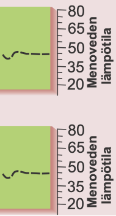

Kuvan kuvaus: kahden trendinäytön oikea puoli; näyttöjen tekstit ovat alla. Kummassakin on menoveden lämpötilan kuvaaja ja näytön oikeassa reunassa pystyasteikko 20, 35, 50, 65, 80, otsikkona "Menoveden lämpötila". Kuvaaja notkahtaa vasemmassa päässä noin 41:een ja jatkuu sitten katkoviivana vaakasuorana noin 45:n kohdalla. Kuvaaja on kummassakin näytössä sama; näytöt eroavat vain alimmalta riviltään.

```
Trendi
L1 Menovesi
   45 °C
Ajos.[+]
```

Jos käytössä on 3-tilaohjattu moottori, näytössä näkyy, mihin suuntaan venttiilimoottoria ajetaan. \+ merkki osoittaa, että venttiilimoottoria ajetaan auki suuntaan. - merkki osoittaa, että venttiilimoottoria ajetaan kiinni suuntaan.

```
Trendi
L1 Menovesi
   45 °C
Asento 0%
```

Jos käytössä on jänniteohjattu moottori, (0…10V tai 2...10V) näytössä näkyy, venttiilimoottorin asentotieto. (0% = kiinni, 100% = auki).

Painamalla ryhmänvaihtonäppäintä [Ryhmänvaihto] voit tarkastella muiden säätöpiirien menoveden lämpötilaa trendinäyttönä.

Poistu näytöstä **ESC**illä.

```
L1 Menov.trendi
  Trendinäyttö
▶ Näyteväli 1s
```

Jos haluat muuttaa näyteväliä, siirrä osoitin kohtaan "Näyteväli" [Selaus] -näppäimellä. Paina **OK**. Aika vilkkuu. Aseta aika **-** tai **+** -näppäimellä. Paina **OK**.

---

<a id="s28"></a>

## Sivu 28: MOOTTORIVALINTA

Moottorivalinnassa valitaan L1 ja L2 säätöpiirin venttiilimoottorin ohjaustapa sekä jakoventtiilin JV moottorin ohjaustapa. Vaihtoehtoina on joko 24VAC 3-tilaohjaus tai DC -jännite-ohjaus (0...10V tai 2...10V).

Säätöpiirin L1 venttiilimoottorin ohjauslähtö on M1.
Säätöpiirin L2 venttiilimoottorin ohjauslähtö on M2.
Maalämmityksen ML jakoventtiilin (JV) moottorin ohjauslähtö on M3.

Ohjeet huoltotilaan siirtymisestä on esitetty sivulla 24.

```
L1 Huoltotila
  Viritysarvot
  Asetusarvot
  Trendit
▶ Moottorivalinta
  JV ohjaustapa
```

Siirrä osoitin kohtaan "Moottorivalinta" [Selaus] -näppäimellä. Paina **OK**.

```
L1 Moott.valinta
▶● 3tila/aika 35s
   0-10V
   2-10V
```

Siirrä osoitin sen moottorin ohjaustavan kohdalle, jonka haluat ottaa käyttöön [Selaus] -näppäimellä. Paina **OK**.

Valittuasi moottorille ohjaustavan, säädin kysyy moottorin ajoaikaa. Ajoaika kertoo, kuinka monta sekuntia kuluu, jos moottori ajaa yhtäjaksoisesti venttiilin kiinni asennosta auki asentoon.
Aseta aika **-** tai **+** -näppäimellä. Paina **OK**.
● -merkki osoittaa, mikä ohjaustapa on valittu käyttöön.

```
ML Moott.valinta
▶● 3tila/aika 35s
   0-10V
   2-10V
```

[Ryhmänvaihto] -näppäimellä voit siirtyä säätöpiiristä toiseen.

### VENTTIILIMOOTTOREIDEN KYTKENTÄ:

**3-tilaohjattu moottori (24VAC)**

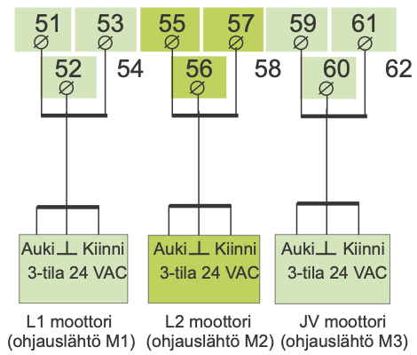

Kuvan kuvaus: säätimen riviliittimet 51–62 kahdessa rivissä (ylärivi 51, 53, 55, 57, 59, 61; alarivi 52, 54, 56, 58, 60, 62). Kukin kolmesta moottorista on kytketty kolmella johtimella kolmeen liittimeen; liittimiin 54, 58 ja 62 ei ole kytketty mitään. L2:n liittimet ja moottori on korostettu tummemmalla vihreällä. Moottorin liittimet ovat Auki, ⊥ ja Kiinni (3-tila 24 VAC):

| Moottori | Auki | ⊥ | Kiinni |
|---|---|---|---|
| L1 moottori (ohjauslähtö M1) | 51 | 52 | 53 |
| L2 moottori (ohjauslähtö M2) | 55 | 56 | 57 |
| JV moottori (ohjauslähtö M3) | 59 | 60 | 61 |

**0...10V tai 2...10V DC-ohjattu moottori (24 VAC)**

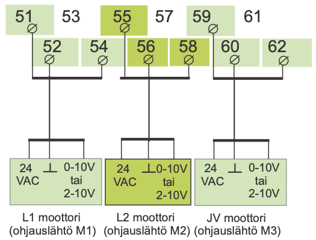

Kuvan kuvaus: samat riviliittimet 51–62. Kukin moottori on kytketty kolmella johtimella; liittimiin 53, 57 ja 61 ei ole kytketty mitään. L2:n liittimet ja moottori on korostettu tummemmalla vihreällä. Moottorin liittimet ovat 24 VAC, ⊥ ja 0-10V tai 2-10V:

| Moottori | 24 VAC | ⊥ | 0-10V tai 2-10V |
|---|---|---|---|
| L1 moottori (ohjauslähtö M1) | 51 | 52 | 54 |
| L2 moottori (ohjauslähtö M2) | 55 | 56 | 58 |
| JV moottori (ohjauslähtö M3) | 59 | 60 | 62 |

### JAKOVENTTIILIN OHJAUSTAPA

```
L1 Huoltotila
  Viritysarvot
  Asetusarvot
  Trendit
  Moottorivalinta
▶ JV ohjaustapa
```

```
JV ohjaustapa
▶● Autom.säätö
   Käsiajo mek.
   Käsiajo sähk.
```

**Automaattisäätö:**
Säädin ohjaa jakoventtiiliä mittauksen 7 perusteella.

**Venttiilimoottorin mekaaninen käsiajo:**
Moottori on sähkötön.
Vain mekaaninen käsikäyttö on mahdollinen.

**Venttiilimoottorin käsiajo sähköllä:** Paina **OK**.
Muuta venttiilimoottorin asentoa **-** tai **+** -näppäimellä.
Näytössä näkyy, mihin suuntaan venttiilimoottoria ajetaan.
Asennon %-luku osoittaa venttiililmoottorin asennon, mikäli käytetään jänniteohjattua 0 (2) ... 10V venttiilimoottoria (0% = kiinni, 100%=auki).

---

<a id="s29"></a>

## Sivu 29: ASETUSTEN PALAUTUS

**Asetusarvon palautus:**

1. Säädin palauttaa tehdasasetukset säätökäyrien asetuksiin
2. Poistaa kello-ohjelmoinnit
3. Palauttaa sekä käyttäjä- että huoltotason alkuasetusarvot
4. Valitsee ohjaustavaksi automaattiohjauksen
5. Valitsee säätimen tyypiksi perussäätimen
6. Tunnistaa kytketyt anturit ja tekee oletuksen käytössä olevista säätöpiireistä
7. Palauttaa tehdasasetukset viritysarvoihin ja trendien näyteväliin
8. Valitsee moottorin ohjaustavaksi 3-tilaohjauksen, jolla on ajoaikana 35 s L1:ssä ja L2:ssa
9. Väylältä ei lueta mittauksia
10. Nollaa puhelinnumeron ja palauttaa tehdasasetukset modeemiasetuksiin

Ohjeet erikoishuoltoon siirtymisestä on esitetty sivulla 24.

**Voit palauttaa tehtaan alkuasetusarvot säätimelle seuraavasti:**

```
Erikoishuolto
▶ Aset.palautus
  Asetusarvot
  Mitt.6 asetus
  LON käytt.otto
  Väylämittaukset
  Tekstiviestias.
```

Siirrä osoitin kohtaan "Erikoishuolto" [Selaus] -näppäimellä. Paina **OK**.

Osoitin on kohdassa "Aset.palautus". Paina **OK**.

```
Tehtaan alkuase-
tusten palautus
▶ Ei
  Kyllä
```

**Tehtaan alkuasetusarvon palautus:**

Siirrä osoitin kohtaan "Kyllä" [Selaus] -näppäimellä. Paina **OK**.

### TEHTAAN ALKUASETUSARVOT:

**Säätökäyrät:**

```
L1 Käyrä:
▶ -20 = 32°C
    0 = 26°C
  +20 = 19°C
```

```
L2 Käyrä:
▶ -20 = 30°C
    0 = 27°C
  +20 = 20°C
```

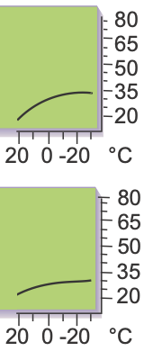

Kuvan kuvaus: yllä olevien L1- ja L2-käyränäyttöjen oikea reuna, jossa on säätökäyrän kuvaaja: pystyasteikko 20, 35, 50, 65, 80 ja vaaka-asteikko 20, 0, -20 °C vasemmalta oikealle. Käyrä nousee vasemmalta oikealle eli ulkolämpötilan laskiessa ja loivenee kylmässä päässä. Käyrät on piirretty näyttöjen lukujen mukaan: L1-käyrä nousee jyrkemmin (19 °C → 32 °C), L2-käyrä loivemmin (20 °C → 30 °C).

**Ohjaustapa:**

```
L1 Ohjaustavat
▶● Autom.säätö
   Jatkuva päivä
   Jatkuva yö
   Alasajo
   Käsiajo mek.
   Käsiajo sähk.
```

```
ML Ohjaustavat
▶● Kompr.+sähköv
   Kompressori
   Sähkövastus
```

**Moottorin ohjaustapa:**

```
L1 Moott.valinta
▶● 3tila/aika 35s
   0-10V
   2-10V
```

| Käyttäjätason asetusarvot: | Tehdasasetus: |
|---|---|
| Huonelämpö | 21.5 °C |
| Yöalennus (menovedelle) | 0 °C |
| Minimiraja | 15 °C |
| Maksimiraja | 70 °C |
| Huonekompensointisuhde | 4 °C |
| Tuulikompensointisuhde | 0 °C |
| Aurinkokompensointisuhde | 0 °C |
| Esikorotus | 0 °C |
| Syyskuivaus | 2 °C |
| Venttiilin kesäsulkeutuminen | 30°C |
| VaraajaAlaMin | 30°C |
| Varaaja yläosa kesä | 55°C |
| Varaaja yläosa talvi | 65°C |
| Lisälämmitys | 50°C |
| Lisäläm.aika | 2h |
| SV-viiveaika | 30min |
| **Huoltotason asetusarvot:** | |
| Ulkolämpötilan hidastus L1/L2 | 2 h/ 0 h |
| Esikorotus | 0 h |
| Kompressorin esto | 55°C |
| Var. yläosan eroalue sähkövast. | 3°C |
| VaraajaAlaEro | 5°C |
| VaraajaYläEro | 3°C |
| JV Esiavaus | 40% |
| JV Esto | 60s |
| Maaliuos häl | -6°C |
| **Erikoishuollon asetusarvot:** | |
| Huonelämpötilan hidastus | 0.5h |
| Menov. min. 0°C:ssa L1:ssä | 10°C |
| Menov. min. 0°C:ssa L2:ssä | 10°C |
| Menov. min. -20°C:ssa L2:ssä | 30°C |
| Menov. min. -20°C:ssa L1:ssä | 30°C |
| Poikkeaman suuruus aset.arvosta, joka aih. hälytyksen L1/L2 | 75°C |
| Poikkeaman kesto, joka aih. hälyt. | 60 min |

**Starttitoiminta:**

```
Säätötapa
▶● L1 perussäädin
   L1 itseoppiva
   L1 ei käytössä
 ● L2 perussäädin
   L2 itseoppiva
   L2 ei käytössä
```

**Viritysarvot:**

```
L1 Viritysarvot
▶ P-alue: 140°C
  I-aika:  50 s
  D-aika: 0.0 s
```

```
ML Viritysarvot
▶ P-alue: 250°C
  I-aika:  25 s
  D-aika:  0.0s
```

> **Repo note:** the list names some settings differently from their menu labels on p. 21: Varaaja yläosa kesä and talvi are Var.ylä kesä and Var.ylä talvi, SV-viiveaika is SV_viiveaika, Kompressorin esto is Kompr.esto, and Var. yläosan eroalue sähkövast. is VarYläEroSv. Its VaraajaAlaEro and VaraajaYläEro agree with p. 21; p. 26 swaps them.

---

<a id="s30"></a>

## Sivu 30: ERIKOISHUOLLON ASETUSARVOT

Geopro 202S lämmönsäätimessä suurimman osan säätimen asetusarvoista voi käyttäjä asettaa (ks. asetusarvot s. 7-9). Osa säätimen toimintaa ohjaavista asetusarvoista voidaan asetella huoltotilassa (ks. s. 26) ja osa erikoishuoltotilassa. Erikoishuollossa voidaan asetella harvoin tarvittavia asetusarvoja.

Ohjeet erikoishuoltoon siirtymisestä on esitetty sivulla 24.

```
Erikoishuolto
  Aset.palautus
▶ Asetusarvot
  Mitt.6 asetus
```

Siirrä osoitin kohtaan "Asetusarvot" [Selaus] -näppäimellä. Paina **OK**.

```
Asetusarvot
▶ Huonel.hid.0.5h
  L1mv.min (0) 10
  L1mv.min(-20)10
  L2mv.min (0) 30
  L2mv.min(-20)30
  L1 Poikk.häl 75
  L2 Poikk.häl 75
  PoikHälHid60min
```

Siirry [Selaus] -näppäimellä sen parametrin kohdalle, jonka arvoa haluat muuttaa. Paina **OK**.

Muuta asetusarvoa **-** tai **+** - näppäimellä. Paina **OK**.

### TIETOJA ERIKOISHUOLLON ASETUSARVOISTA:

<table>
<tr><th>Asetusarvo:</th><th>Tehdasasetus:</th><th>Asetelualue:</th><th>Merkitys:</th></tr>
<tr><td>Huonel.hid.</td><td>0.5h</td><td>0...2</td><td>Sisälämmön keskiarvomittausten aika, jota huonekom-pensointi käyttää.</td></tr>
<tr><td>L1mv.min (0)</td><td>10°C</td><td>5...20</td><td rowspan="2">Menoveden vapaan pudotuksen alaraja säätöpiirissä L1/ L2 , kun ulkolämpötila on 0°C (alasajotoiminta).</td></tr>
<tr><td>L2mv.min (0)</td><td>10°C</td><td>5...20</td></tr>
<tr><td>L1mv.min(-20)</td><td>30°C</td><td>10...50</td><td rowspan="2">Menoveden vapaan pudotuksen alaraja säätöpiirissä L1/L2 , kun ulkolämpötila on -20°C (alasajotoiminta)</td></tr>
<tr><td>L2mv.min(-20)</td><td>30°C</td><td>10...50</td></tr>
<tr><td>L1 Poikk.häl</td><td>75°C</td><td>1...75</td><td rowspan="2">L1/L2 menoveden lämpötilan poikkeama säätimen määräämästä asetusarvosta, joka aiheuttaa hälytyksen.</td></tr>
<tr><td>L2 Poikk.häl</td><td>75°C</td><td>1...75</td></tr>
<tr><td>PoikHälHid</td><td>60min</td><td>0...90</td><td>Hälytys tapahtuu, jos poikkeama on kestänyt asetetun ajan.</td></tr>
</table>

> **Repo note:** the screen shows L1mv.min(-20) 10 and L2mv.min (0) 30. The table and the factory list on p. 29 give L1mv.min(-20) 30 °C and L2mv.min (0) 10 °C.

---

<a id="s31"></a>

## Sivu 31: MITTAUKSEN 6 ASETUS

Tässä erikoishuollon tilassa voidaan vaihtaa mittauksen 6 merkitys pelkästä vapaasta lämpötilan mittauksesta säätöpiirin L2 huonekompensoinnin tai säätöpiirien L1 ja L2 yhteisen tuuli- tai aurinkokompensoinnin mittaukseksi. Tehdasasetuksena on vapaa lämpötilan mittaus, joka on nimetty "Mittaus 6" -mittaukseksi. Nimen voi muuttaa tekstieditorilla.

Ohjeet huoltotilaan siirtymisestä on esitetty sivulla 24.

```
Erikoishuolto
  Aset.palautus
  Asetusarvot
▶ Mitt.6 asetus
```

Siirrä osoitin kohtaan "Mitt.6 asetus" [Selaus] -näppäimellä. Paina **OK**.

**Mittauksen 6 merkityksen valinta:**

```
Mitt.6 asetus
▶● Mittaus 6
   L2 Huonelämpö
   Tuulimittaus
   Aurinkomittaus
   Ei kytketty
```

Siirry [Selaus] -näppäimellä sen asian kohdalle, jonka haluat kytkeä mittaukseen 6. Paina **OK**.
● -merkki osoittaa, mikä mittaus on valittu mittaukseen 6.

Kuvan kuvaus: nuolet vievät rivistä "Mittaus 6" alla olevaan nimeämisnäyttöön ja riveistä "Tuulimittaus" ja "Aurinkomittaus" alla olevaan raja-arvon asettamiseen.

**Mittauksen 6 nimeäminen tekstieditorilla:**

```
Nimen vaihto
▶ Mittaus 6
  Anna uusi nimi
```

Mittauksessa 6 tehdasasetuksena on "Mittaus 6" -mittaus. Uudelleen nimeäminen esitellään sivulla 11.

**Tuuli- tai aurinkoanturin mittausviestin raja-arvon asettaminen:**

Tuuli- tai aurinkomittaukselle joudut asettamaan kompensointialueen raja-arvot. Minimi kertoo, missä lähettimen viestialueen kohdassa kompensointi alkaa ja maksimi kertoo, mistä viestialueen kohdasta lähtien kompensointi on maksimissaan.

Aurinko- ja tuulianturin kytkennästä lisää tietoa seuraavalla sivulla.

```
Komp./Mitt.viesti
▶ Min / 30 %
  Max / 70 %
```

Paina **OK**.
Aseta raja-arvo **-** tai **+** -näppäimellä ja hyväksy painamalla **OK**.

---

<a id="s32"></a>

## Sivu 32: Mittaus 6: Tuuli-/aurinkomittaus

Kun tuuli- tai aurinkoanturi kytketään mittaukseen 6, annetaan säätimelle ohjeet siitä, milloin tuuli- tai aurinkokompensoinnin halutaan toimivan. Kompensoinnin raja-arvot (min/max) lasketaan samalla tavalla huolimatta siitä, millainen anturi on käytössä.

Tuuli- ja aurinkokompensointisuhde kertoo, montako astetta menoveden lämpötilaa voidaan muuttaa kompensoinnin avulla ja sen voi käyttäjä asettaa (ks. asetusarvot s. 8-9).

Tuuli- ja aurinkoantureiden mittaussignaali voi olla 0...10 V, 2...10 V, 0...20 mA tai 4...20 mA. Anturit sovitetaan säätimeen vastuksien avulla niin, että säätimelle tuleva mittausviesti on aina 0...5 V.

**Kompensointialueen laskeminen**

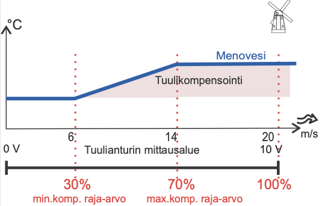

Kuva. Tuulikompensoitu menoveden lämpötilakäyrä.

Kuvan kuvaus: kaavio, jonka pystyakseli on menoveden lämpötila (°C, ei asteikkoa) ja vaaka-akseli tuulen nopeus (m/s, merkkinä tuulen symboli); oikeassa yläkulmassa on tuulimyllyn kuva. Sininen käyrä "Menovesi" on vaakasuora tuulen nopeuteen 6 m/s asti, nousee suorana 6 m/s:sta 14 m/s:iin ja on taas vaakasuora 14 m/s:sta ylöspäin. Käyrän ja sen alemman tason väliin jäävä alue on merkitty "Tuulikompensointi". Punaiset pystysuorat pisteviivat ovat kohdissa 6, 14 ja 20 m/s. Akselin alla on jana "Tuulianturin mittausalue", joka alkaa 0 V:sta ja päättyy kohtaan 20 m/s = 10 V. Janan alle on merkitty punaisella 30% (6 m/s, "min.komp. raja-arvo"), 70% (14 m/s, "max.komp. raja-arvo") ja 100% (20 m/s).

```
Komp./Mitt.viesti
▶ Min   /  30%
  Max  /  70%
```

Esimerkki: Käytössä on tuulianturi, jonka mittausalue on 0...20 m/s. Haluat, että tuulikompensointi alkaa, kun tuulen nopeus on 6m/s (min.raja) ja kompensointi saa maksimiarvon, kun tuulen nopeus on vähintään 14m/s (max raja). Laske, montako prosenttia tuulen kompensoinnin raja-arvot (min. raja ja max raja) ovat mittausalueen maksimista (=20m/s), ja aseta ne minimi- ja maksimikompensoinnin prosenteiksi.

Min. komp.raja = (min. raja / mittausalueen maks.) x 100% = (6 m/s / 20 m/s) x 100% = 30%

Maks.komp.raja = (max raja / mittausalueen maks.) x 100% = (14 m/s / 20 m/s) x 100% = 70%

Jos käytössä on nollasta lähtevät mitta-anturit ( 0...10V tai 0...20 mA), aseta yllä olevilla kaavoilla lasketut arvot minimi- ja maksimikompensoinniksi.

**Minimi- ja maksimikompensoinnin asettaminen, kun anturin mittausalue ei lähde nollasta**

| Kaavasta saatu arvo | 2-10V<br>4 -20 mA |
|---|---|
| 10 % | 28 % |
| 20 % | 36 % |
| 30 % | 44 % |
| 40 % | 52 % |
| 50 % | 60 % |
| 60 % | 68 % |
| 70 % | 76 % |
| 80 % | 84 % |
| 90 % | 92 % |
| 100 % | 100 % |

1. Laske "min.komp.raja" ja "maks.komp.raja" kaavalla kompensoinnin prosentit.

2. Katso vastaavuustaulukosta, mitkä arvot asetat säätimelle.

**Tuuli- tai aurinkoanturin kytkentä:**

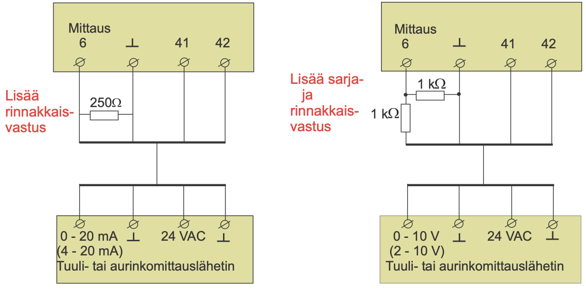

Kuvan kuvaus: kaksi kytkentäkuvaa, kummassakin ylhäällä säätimen liittimet "Mittaus 6", ⊥, 41 ja 42 ja alhaalla "Tuuli- tai aurinkomittauslähetin". Vasemmalla virtaviestilähetin (liittimet "0 - 20 mA (4 - 20 mA)", ⊥, 24 VAC, ⊥) ja punainen teksti "Lisää rinnakkaisvastus": 250Ω:n vastus on Mittaus 6:n ja ⊥:n välissä. Oikealla jänniteviestilähetin (liittimet "0 - 10 V (2 - 10 V)", ⊥, 24 VAC, ⊥) ja punainen teksti "Lisää sarja- ja rinnakkaisvastus": 1 kΩ:n vastus on Mittaus 6:n ja ⊥:n välissä, ja toinen 1 kΩ:n vastus on sarjassa lähettimen viestijohtimessa ennen Mittaus 6:ta. Kytkennät:

| Säätimen liitin | 0 - 20 mA (4 - 20 mA) -lähetin | 0 - 10 V (2 - 10 V) -lähetin |
|---|---|---|
| Mittaus 6 | 0 - 20 mA (4 - 20 mA); 250Ω Mittaus 6:n ja ⊥:n välissä | 0 - 10 V (2 - 10 V) sarjavastuksen 1 kΩ kautta; 1 kΩ Mittaus 6:n ja ⊥:n välissä |
| ⊥ | ⊥ | ⊥ |
| 41 | 24 VAC | 24 VAC |
| 42 | ⊥ | ⊥ |

---

<a id="s33"></a>

## Sivu 33: LON-KÄYTTÖÖNOTTO

Geopro 202S:än on saatavana lisävarusteena LON-200 sovitinkortti (sis. FTT-10A väyläsovitin), joka mahdollistaa säätimen liittämisen LON-kenttäväylään.
Tässä erikoishuollon tilassa ohjataan LON-200 -kortilla olevan Neuron-prosessorin ns. service pin:iä niin, että Neuron lähettää väylälle oman tunnuksensa (48 bit Neuron ID). Tämä toimenpide on tarpeellinen asennettaessa Geopro 202S + LON-200 osaksi kiinteistön LON-verkkoa.

Ohjeet erikoishuoltoon siirtymisestä on esitetty sivulla 24.

```
Erikoishuolto
  Aset.palautus
  Asetusarvot
  Mitt.6 asetus
▶ LON käytt.otto
  Väylämittaukset
```

Siirrä osoitin kohtaan "LON-käytt.otto" [Selaus] -näppäimellä. Paina **OK**.

```
LON käyttöönotto
▶ Ei
  Kyllä (Service
          switch)
```

Siirrä osoitin kohtaan "Kyllä" (service switch) [Selaus] -näppäimellä. Paina **OK**.

**Kytkentäohje:**
**Käytettäessä LON-väylää kytketään virransyötön 230VAC suojamaa säätimen riviliittimelle 81!**

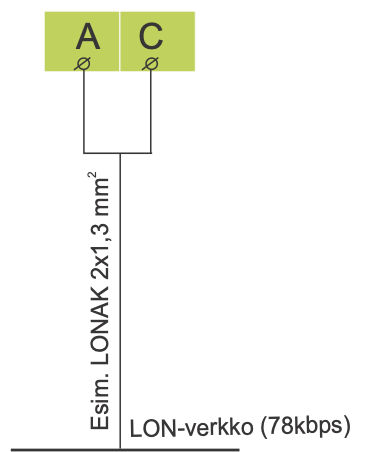

Kuvan kuvaus: liittimet A ja C (vihreät liitinkilvet) kytketään kaapelilla LON-verkkoon. Kummankin liittimen johdin yhtyy yhdeksi viivaksi (kaapeli, merkintä "Esim. LONAK 2x1,3 mm²"), joka päättyy vaakasuoraan väylään "LON-verkko (78kbps)".

**LON-200-sovitinkortti**

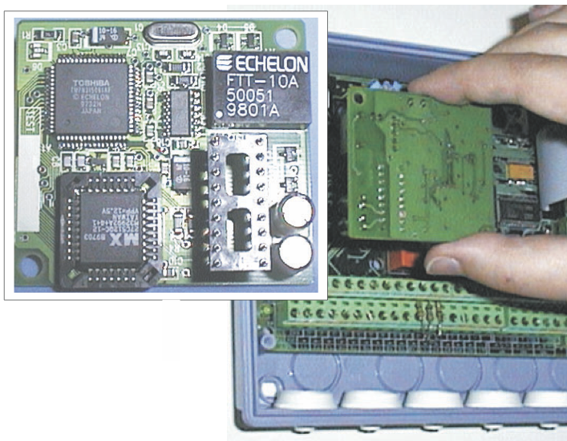

Kuvan kuvaus: valokuva. Vasemmalla ylhäällä on lähikuva sovitinkortista: piirilevyllä on Toshiban suuri piiri (merkinnät "TOSHIBA" ja "© ECHELON"), Echelonin väyläsovitin (merkinnät "ECHELON FTT-10A 50051 9801A"), kannassa oleva MX-muistipiiri, kaksi kondensaattoria ja kaksirivinen liitinrima. Oikealla kortti asennetaan kädellä säätimen avatun kotelon sisään, vihreiden riviliitinten yläpuolelle.

LON-200 sovitinkortin mukana toimitetaan asennus- ja käyttöönotto-ohje.

> **Repo note:** the text calls the menu item "LON-käytt.otto"; the Erikoishuolto menus on this page and p. 24 show "LON käytt.otto".

---

<a id="s34"></a>

## Sivu 34: VÄYLÄMITTAUKSET

Geopro 202S:än on saatavana lisävarusteena LON-200 sovitinkortti, joka mahdollistaa säätimen liittämisen LON-väylään ja EH-485 ja MODBUS-väyläsovitinkortit, jotka muuttavat Geopro 202S säätimen sarjaliikenneväylän RS-485 kenttäväylään yhteensopivaksi. Tässä erikoishuollon tilassa valitaan, mitä mittaustietoja luetaan väylän kautta. Jos valitsit tuuli- tai aurinkomittauksen luettavaksi väylän kautta, joudut asettamaan kompensointialueen tässä tilassa.

Ohjeet erikoishuoltoon siirtymisestä on esitetty sivulla 24.

```
Erikoishuolto
  Aset.palautus
  Asetusarvot
  Mitt.6 asetus
  LON käytt.otto
▶ Väylämittaukset
  Tekstiviestias.
```

Siirrä osoitin kohtaan "Väylämittaukset" [Selaus] -näppäimellä. Paina **OK**.

```
Väylämittaukset
▶● Ulkol.mittaus
   L1 Huonemittaus
   L2 Huonemittaus
 ● Tuulimittaus
 ● Aurinkomittaus
   Veden kulut.m3
```

Näytöstä lähtevät nuolet Ulkol.mittaus-näyttöön, Tuulimittaus-riviltä m/s-raja-arvojen näyttöön ja Aurinkomittaus-riviltä lx-raja-arvojen näyttöön.

### Väylämittausten selaus:

Selaamalla [Selaus] -näppäimellä näet, mitä mittauksia on yleensä luettavissa väylän kautta.

### Väylämittausten asettaminen:

```
Ulkol.mittaus
▶● Ei väylä
   On väylä
```

Siirrä osoitin haluamasi mittauksen kohdalle ja paina **OK**. Jos haluat valita kyseiselle mittaukselle sarjaliikenneväylän, siirrä osoitin kohtaan "On väylä" ja paina **OK**. ● -merkki osoittaa, että mittaustieto luetaan väylän kautta.

> **Repo note:** the Väylämittaukset screen marks Ulkol.mittaus with ●, which means it is read over the bus, but the Ulkol.mittaus screen has ● on Ei väylä.

### Tuuli- tai aurinkomittauksen asettaminen (väylä):

Tuuli- tai aurinkomittaukselle joudut asettamaan kompensoinnin raja-arvot. Minimi kertoo, millä arvolla kompensointi alkaa, ja maksimi kertoo, mistä arvosta lähtien kompensointi on maksimissaan. Raja-arvot asetetaan tuulimittauksessa tuulen nopeutena (m/s) ja aurinkomittauksessa valoisuuden määränä (lx).

```
Komp/Mitt.viesti
▶ Min/0.0m/s
  Max/10.0m/s
```

**Raja-arvojen asettaminen:**
Paina **OK**.
Aseta raja-arvo **-** tai **+** - näppäimellä ja hyväksy painamalla **OK**.

```
Komp/Mitt.viesti
▶ Min/   0lx
  Max/9000lx
```

Huom! Tuuli- ja aurinkokompensointisuhde asetetaan kohdassa "Asetusarvot" (ks. sivu 8-9).

---

<a id="s35"></a>

## Sivu 35: MODEEMIASETUKSET (TEKSTIVIESTIYHTEYS)

Tekstiviestiyhteys edellyttää, että säätimeen on kytketty GSM-modeemi (lisävaruste). Modeemin mukana toimitetaan D-liittimellä varustettu sovitinkaapeli, jonka avulla modeemi kytketään säätimeen. Säätimen riviliittimien B-D väli yhdistetään hyppylangalla.

GSM-modeemin käyttöönotto tapahtuu starttitoiminnassa. Säädin alustaa automaattisesti GSM-modeemin aina 2 tunnin välein. Tällä varmistetaan GSM-yhteys sähkökatkojen jälkeen.

Ohjeet erikoishuoltoon siirtymisestä on esitetty sivulla 24.

```
Erikoishuolto
  Aset.palautus
  Asetusarvot
  Mitt.6 asetus
  LON käytt.otto
  Väylämittaukset
▶ Tekstiviestias.
```

```
Tekstiv.asetuk.
  Häl.nro GSM 1
  Häl.nro GSM 2
▶ Laitetunnus
  Sanomak. nro.
  PIN-koodi
  Modeemin tyyppi
```

### Hälytysviestien vastaanottajien asettaminen:

Anna puhelinnumero, johon säädin lähettää automaattisesti tekstiviestin hälytyksestä hälytystilanteessa. Hälytysviesti lähetään aluksi vain GSM 1:n numeroon. Mikäli tästä numerosta hälytystä ei kuitata, lähettää säädin 5 minuutin kuluttua uuden hälytyksen sekä GSM 1 että GSM 2 numeroon.

```
Puhelinnumero
▶
  Muuta
```

Siirrä osoitin [Selaus] -näppäimellä kohtaan “Muuta”. Paina **OK**. “0” vilkkuu. Kirjoita puhelinnumero käyttäen tekstieditoria.

Voit siirtyä merkkijonossa eteen tai taakse päin **+** tai **-** -näppäimellä. Hyväksy numero painamalla **OK**, jolloin seuraavan numeron kohdalla vilkkuu viimeksi valittu numero. Viimeksi valittu poistetaan painamalla **ESC**. Mikäli painat pitkään yhtäjaksoisesti **ESC**-näppäintä, saadaan numero poistettua ja aikaisemmin syötetty puhelinnumero jää voimaan. Kun olet valmis, paina pitkään **OK**:ta (yli 2 sek.).

### Laitetunnus:

Säätimelle voidaan antaa laitetunnus, joka toimii laitteen salasanana ja osoitetietona. Laitetunnus on vapaasti nimettävissä. Kommunikoitaessa säätimen kanssa GSM:llä laitetunnus kirjoitetaan aina avainsanan eteen.

```
Laitetunnus
▶ Ei käytössä
  Käytössä ----
```

Siirrä osoitin kohtaan “Käytössä”. Paina **OK**. “-” vilkkuu. Kirjoita maks. 4 merkin pituinen laitetunnus. Tekstieditorilla on kirjaimet A ...Z ja numerot 0 ... 9. Voit siirtyä merkkijonossa eteen tai taakse päin **+** tai **-** -näppäimellä. Hyväksy merkki painamalla **OK**.

### Sanomakeskuksen numeron asettaminen:

```
Puhelinnumero
▶ +.....

  Muuta
```

Anna operaattorikohtainen sanomakeskuksen numero **+** tai **-** -näppäimellä. Hyväksy **OK**.

| Muutamia sanomakeskusnumeroita | |
|---|---|
| TeliaSonera | +358 40 520 2000 |
| Elisa | +358 50 877 1010 |
| Saunalahti | +358 45 110 0100 |
| DNA | +358 44 798 3500 |
| Tele Finland | +358 40 520 2330 |

### Modeemin PIN-koodin asettaminen säätimelle:

```
PIN-koodi
▶ ----
  Muuta
```

Anna SIM-kortin PIN-koodi. Säädin ei alusta GSM-modeemia ennen kuin PIN-koodi on asetettu. Modeemin PIN-koodin muuttaminen tehdään käyttämällä SIM-kortti GSM-puhelimessa. Vaihdettuasi PIN-koodin, aseta SIM-kortti takaisin modeemiin.

### Modeemin tyypin valinta:

```
Modeemin tyyppi
   Falcom
   Nokia/Siemens
▶● Ouman/Fargo
```

Geopro 202S on yhteensopiva Falcomin A2D, Nokian 30 ja Siemensin M20T ja TC35T sekä Fargon Maestro 20 modeemien kanssa. Tehdasasetuksena on Ouman/Fargo.

### Pikaohje Fargo Maestro 20 modeemin kytkennästä ja käyttöönotosta:

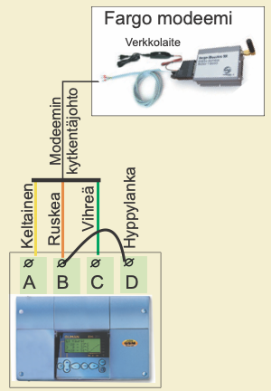

Kuvan kuvaus: Fargo-modeemin kytkentä säätimeen. Ylhäällä on valokuva Fargo-modeemista (Fargo modeemi) ja sen verkkolaitteesta (Verkkolaite). Modeemin kytkentäjohto haarautuu kolmeksi johtimeksi: Keltainen menee säätimen riviliittimeen A, Ruskea liittimeen B ja Vihreä liittimeen C. Hyppylanka yhdistää liittimet B ja D. Riviliittimien alla on valokuva säätimestä.

| LED merkkivalo | Modeemin tila/ toimintaohje |
|---|---|
| LED ei pala: | Modeemissa ei ole käyttöjännitettä. Kytke verkkolaite modeemiin. |
| LED palaa: | Modeemissa on käyttöjännite, mutta modeemi ei ole valmiustilassa. Tarkista seuraavat asiat:<br>1. Geopro 202S:ssä on sama PIN-koodi kuin GSM-modeemin SIM-kortin PIN-koodi.<br>2. Tee starttitoiminta. Starttitoiminta tehdään menemällä säätimellä kohtaan Starttitoiminta, painetaan OK ja poistutaan starttitilasta ESC:llä muuttamatta mitään asetuksia. |
| LED vilkkuu hitaasti: | Modeemi on valmiustilassa. |
| LED vilkkuu nopeasti: | Modeemi lähettää tai vastaanottaa viestiä. Mikäli säätimeltä ei tule viestiä tarkista lähettämästäsi tekstiviestistä, onko laitetunnus ja avainsana kirjoitettu oikein. Tarkista myös, että säätimellä on sen operaattorin sanomakeskusnumero, jonka GSM-liittymä sinulla on käytössä. Tehdasasetuksena on Saunalahden liittymä. |

---

<a id="s36"></a>

## Sivu 36: TEKSTIVIESTIASETUKSET(väyläratkaisu)

Tällä sivulla esitettävät asiat ovat voimassa silloin, kun säätimeen ei ole suoraan kytketty modeemia. Kommunikointi tapahtuu säätimen RS-485 kenttäväylän kautta. Järjestelmään voidaan liittää useita säätimiä EH-485 väyläsovitinkortin avulla ja kytkeä GSM- modeemi RS-485 kenttäväylään väyläliikennettä ohjaavan laitteen EH-686 kautta.

Jotta Geopro 202S säädin voidaan kytkeä RS-485 kenttäväylään, täytyy säätimeen asentaa EH-485 väyläsovitinkortti (ks. asennus- ja käyttöönotto-ohje EH-485 kortin mukana toimitetusta ohjeesta). Väylään kytketyille säätimille annetaan laitetunnus (esim. TC 1), jolloin järjestelmä tunnistaa, minkä säätimen kanssa milloinkin kommunikoidaan. Kommunikoitaessa säätimen kanssa avainsanan eteen kirjoitetaan aina laitetunnus.

Esimerkki väyläkytkennästä

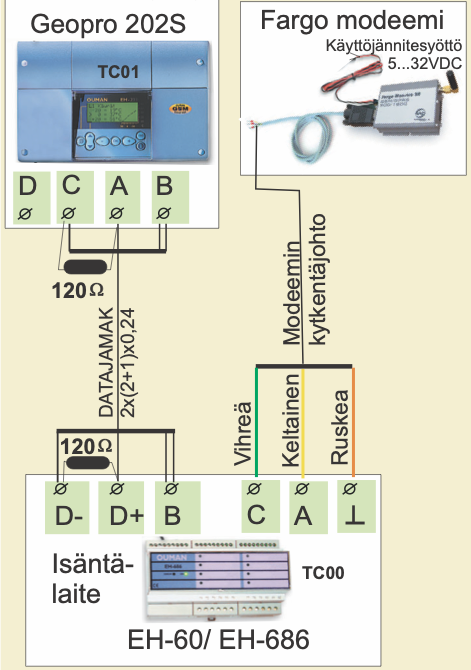

Kuvan kuvaus: kytkentäkuva. Ylhäällä vasemmalla on Geopro 202S (valokuvassa säädin, jossa merkintä TC01) ja sen riviliittimet järjestyksessä D, C, A, B. Ylhäällä oikealla on Fargo modeemi (Käyttöjännitesyöttö 5...32VDC). Alhaalla on Isäntälaite EH-60/ EH-686 (merkintä TC00) ja sen liittimet D-, D+, B, C, A ja ⊥. Säätimeltä isäntälaitteelle kulkee DATAJAMAK 2x(2+1)x0,24 -kaapeli, joka on piirretty yhtenä viivana; johtimet ovat samassa järjestyksessä kummassakin päässä:

| Geopro 202S | EH-60/ EH-686 |
|---|---|
| C | D- |
| A | D+ |
| B | B |
| D | ei kytketty |

Liittimeen B tulee kummassakin päässä kaksi johdinta. Kaapelin kummassakin päässä on 120 Ω vastus: säätimellä liittimien C ja A välissä, isäntälaitteella liittimien D- ja D+ välissä. Modeemin kytkentäjohdon johtimet menevät isäntälaitteelle: Vihreä liittimeen C, Keltainen liittimeen A ja Ruskea liittimeen ⊥.

> **Repo note:** this drawing puts the Controller's terminals in the order D, C, A, B; on p. 39 the strip runs A, B, C, D.

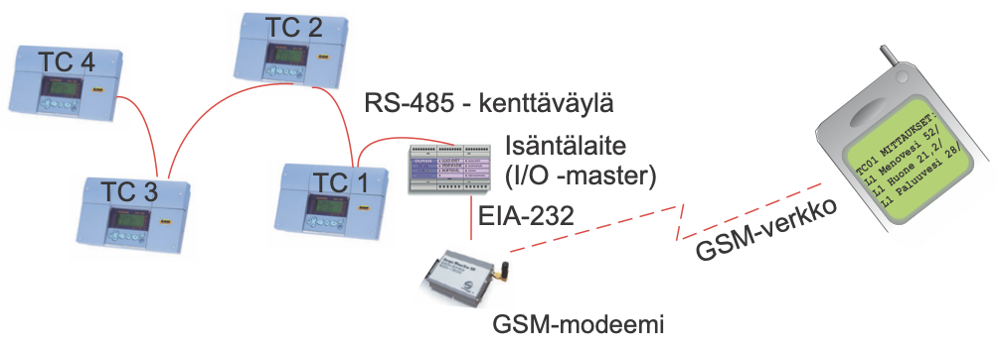

Kuvan kuvaus: väyläjärjestelmä. Neljä säädintä on ketjutettu punaisella viivalla RS-485 - kenttäväylään järjestyksessä TC 4, TC 3, TC 2, TC 1, ja TC 1:ltä väylä jatkuu isäntälaitteelle (Isäntälaite (I/O -master)). Isäntälaitteelta lähtee EIA-232-yhteys GSM-modeemiin (GSM-modeemi), ja katkoviiva (GSM-verkko) johtaa matkapuhelimeen, jonka näytössä on viesti:

```
TC01 MITTAUKSET:
L1 Menovesi 52/
L1 Huone 21,2/
L1 Paluuvesi 28/
```

Ohjeet erikoishuoltoon siirtymisestä on esitetty sivulla 24.

```
Erikoishuolto
  Aset.palautus
  Asetusarvot
  Mitt.6 asetus
  LON käytt.otto
  Väylämittaukset
▶ Tekstiviestias.
```

Siirrä osoitin kohtaan "Tekstiviestias.” [Selaus] -näppäimellä. Paina **OK**.

```
Tekstiv.asetuk.
▶ Häl.nro GSM1
  Häl.nro GSM2
  Laitetunnus
```

### Hälytysviestien vastaanottajien asettaminen:

GSM-puhelin voi vastaanottaa hälytyksiä ja GSM:n kautta voidaan myös kuitata hälytyksiä. Tässä annetaan puhelinnumero, johon säädin lähettää automaattisesti tekstiviestin hälytyksestä hälytystilanteessa. Hälytysviesti lähetään aluksi vain GSM 1:n numeroon. Mikäli tästä numerosta hälytystä ei kuitata, lähettää säädin 5 minuutin kuluttua uuden hälytyksen sekä GSM 1 että GSM 2 numeroon.

```
Puhelinnumero
▶
  Muuta
```

Siirrä osoitin [Selaus] -näppäimellä kohtaan “Muuta”. Paina **OK**. “0” vilkkuu. Kirjoita puhelinnumero käyttäen tekstieditoria.

Voit siirtyä merkkijonossa eteen tai taakse päin **+** tai **-** -näppäimellä. Hyväksy numero painamalla **OK**, jolloin seuraavan numeron kohdalla vilkkuu viimeksi valittu numero. Viimeksi valittu poistetaan painamalla **ESC**. Mikäli painat pitkään yhtäjaksoisesti **ESC**-näppäintä, saadaan numero poistettua ja aikaisemmin syötetty puhelinnumero jää voimaan. Kun olet valmis, paina pitkään **OK**:ta (yli 2 sek.), jolloin pääset pois kirjoitustilasta ja säädin ottaa käyttöön valitun puhelinnumeron.

### Laitetunnuksen asettaminen:

Kun tekstiviestiyhteyksissä käytetään RS-485 kenttäväylää, tunnistetaan säätimet laitetunnusten avulla. Vapaasti nimettävissä oleva 4 merkin pituinen laitetunnus toimii osoitetietona. Laitetunnus annetaan seuraavasti:

```
Laitetunnus
▶ Ei käytössä
  Käytössä ----
```

Siirrä osoitin [Selaus] -näppäimellä kohtaan “Käytössä”. Paina **OK**. “-” vilkkuu. Kirjoita maks. 4 merkin pituinen laitetunnus **-** tai **+** -näppäimellä.

### Pikaohje Fargo Maestro 20 modeemin käyttöönotosta:

| LED merkkivalo | Modeemin tila/ toimintaohje |
|---|---|
| LED ei pala: | Modeemissa ei ole käyttöjännitettä. Kytke verkkolaite modeemiin. |
| LED palaa: | Modeemissa on käyttöjännite, mutta modeemi ei ole valmiustilassa. Tarkista seuraavat asiat:<br>1. EH-60/EH-686 on sama PIN-koodi kuin GSM-modeemin SIM-kortin PIN-koodi. GSM-modeemin käyttöönottotilanteessa PIN-koodin on oltava 0000.<br>2. Käytä laitetta virrattomana modeemin kytkemisen jälkeen. |
| LED vilkkuu hitaasti: | Modeemi on valmiustilassa. |
| LED vilkkuu nopeasti: | Modeemi lähettää tai vastaanottaa viestiä. Mikäli säätimeltä/ohjauslaitteelta ei tule viestiä tarkista lähettämästäsi tekstiviestistä, onko laitetunnus ja avainsana oikein kirjoitettu. Tarkista myös, että EH-60/EH-686:ssa on sen operaattorin sanomakeskusnumero, jonka GSM-liittymä sinulla on käytössä. Oletuksena on Saunalahden liittymä. |

Yksityiskohtaiset ohjeet GSM-modeemin kytkemisestä isäntälaitteeseen saat EH-60/EH-686 käsikirjan kohdasta GSM-modeemn käyttöönotto.

---

<a id="s37"></a>

## Sivu 37: SELAINKÄYTTÖ

Jos Geopro 202S säätimeen on asennettu MODBUS-väyläsovitinkortti (lisävaruste), voidaan säädin liittää selainpohjaiseen käyttöliittymään Modbus väylän kautta EH-netin avulla.

EH-net kytketään kiinteän IP-osoitteen avulla julkiseen internet verkkoon tai paikallisverkkoon, intranettiin. Jos EH-net kytketään suoraan julkiseen IP-osoitteeseen, suosittelemme käyttämään palomuurilaitetta EH-netin ja verkon välillä.

Selainkäyttö mahdollistaa kommunikaation Geopro 202S säätimen kanssa, mistä tahansa pc:ltä. Pc:ltä on luettavissa ja muutettavissa tietoja säätimeltä. Haluttaessa voidaan rajoittaa pääsyä tiettyihin toimintoihin tai estää näkymästä sellaisia asioita, joihin liittyy turvallisuusriskejä tai jotka eivät muuten ole kohteen kannalta mielenkiintoisia.

Mikäli säädin hälyttää, tieto hälytyksestä voidaan välittää sähköpostina. Mikäli isäntälaitteeseen on kytketty GSM-modeemi, tieto hälytyksistä voidaan välittää myös tekstiviestinä GSM-puhelimeen.

Väyläsovitinkortin mukana saat yksityiskohtaiset ohjeet MODBUS-kortin asentamisesta Geopro 202S säätimeen ja käyttöönotosta. EH-netin mukana toimitetaan ohje verkkokytkennöistä ja käyttöönotosta.

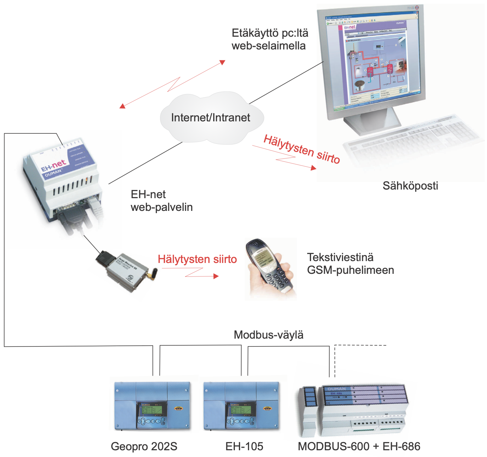

Kuvan kuvaus: selainkäytön järjestelmäkuva. Alhaalla ovat laitteet Geopro 202S, EH-105 ja MODBUS-600 + EH-686, jotka on ketjutettu Modbus-väylällä (Modbus-väylä); väylä jatkuu oikealle katkoviivana. Väylä nousee vasemmalta EH-net-laitteelle (EH-net web-palvelin). EH-net on yhdistetty Internet/Intranet-pilveen, ja pilvestä viiva jatkuu pc:lle, jonka näytössä on EH-netin selainnäkymä. Punainen kaksipäinen salamanuoli kuvaa etäkäyttöä (Etäkäyttö pc:ltä web-selaimella), ja punainen nuoli pilvestä kohti pc:tä hälytysten siirtoa sähköpostina (Hälytysten siirto, Sähköposti). EH-netiin on kytketty GSM-modeemi, josta punainen nuoli (Hälytysten siirto) osoittaa GSM-puhelimeen (Tekstiviestinä GSM-puhelimeen).

---

<a id="s38"></a>

## Sivu 38: DATAYHTEYS (SUORAAN TIETOKONEESEEN)

Geopro 202S säädin voidaan kytkeä suoraan tietokoneeseen. Kytkentään käytetään DATAJAMAK-kaapelia.

Huom! Mikäli tiedonsiirrossa esiintyy häiriöitä, kannattaa kokeilla kaapelin vaipan kytkemistä D-25 -liittimen nastaan nro 1 (protective GND).

Windows-ympäristössä toimiva sarjaliikenneajuri Geopro 202 laitteille on vapaasti ladattavissa osoitteesta www.ouman.fi.

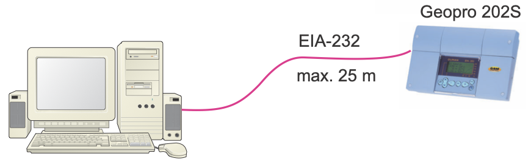

Kuvan kuvaus: pc on kytketty kaapelilla Geopro 202S -säätimeen. Kaapelin merkinnät ovat EIA-232 ja max. 25 m.

### Kytkentäohje:

**Säätimen kytkeminen suoraan PC:hen:**
D-25 liitin (naaras)

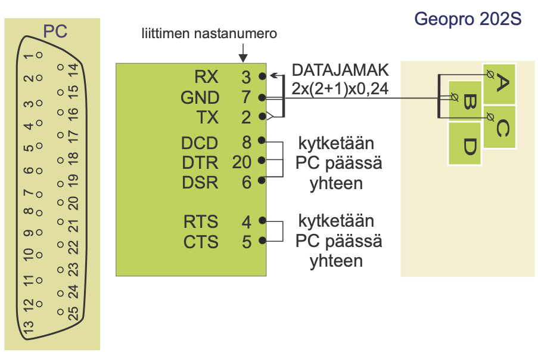

Kuvan kuvaus: kytkentäkuva. Vasemmalla on PC:n D-25-liitin (PC), jonka nastat 1–13 ovat yhdessä rivissä ja 14–25 toisessa. Keskellä on PC:n signaalien ja liittimen nastanumeroiden taulukko, oikealla Geopro 202S:n riviliittimet A, B, C ja D. DATAJAMAK 2x(2+1)x0,24 -kaapeli on piirretty yhtenä viivana PC:n nastoista RX, GND ja TX säätimen liittimiin A, B ja C samassa järjestyksessä; GND ja B on piirretty kaksoisviivalla. Liitin D jää kytkemättä. RX-nastaan osoittaa nuoli, ja TX-nastasta lähtee nuoli.

<table>
<tr><th>Signaali</th><th>liittimen nastanumero</th><th>Kytkentä</th></tr>
<tr><td>RX</td><td>3</td><td>Geopro 202S, liitin A</td></tr>
<tr><td>GND</td><td>7</td><td>Geopro 202S, liitin B</td></tr>
<tr><td>TX</td><td>2</td><td>Geopro 202S, liitin C</td></tr>
<tr><td>DCD</td><td>8</td><td rowspan="3">kytketään PC päässä yhteen</td></tr>
<tr><td>DTR</td><td>20</td></tr>
<tr><td>DSR</td><td>6</td></tr>
<tr><td>RTS</td><td>4</td><td rowspan="2">kytketään PC päässä yhteen</td></tr>
<tr><td>CTS</td><td>5</td></tr>
</table>

**Säätimen kytkeminen suoraan PC:hen:**
D-9 liitin (naaras)

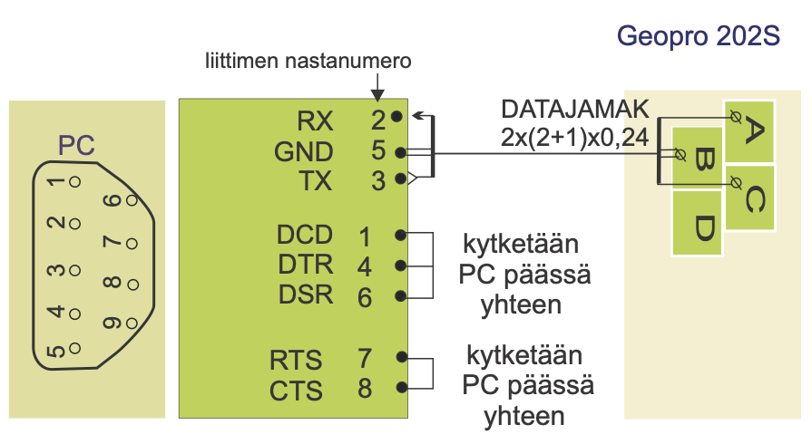

Kuvan kuvaus: kytkentäkuva samaan tapaan kuin D-25-liittimellä. Vasemmalla on PC:n D-9-liitin (PC), jonka nastat 1–5 ovat yhdessä rivissä ja 6–9 toisessa. DATAJAMAK 2x(2+1)x0,24 -kaapeli on piirretty yhtenä viivana PC:n nastoista RX, GND ja TX Geopro 202S:n liittimiin A, B ja C samassa järjestyksessä; GND ja B on piirretty kaksoisviivalla. Liitin D jää kytkemättä.

<table>
<tr><th>Signaali</th><th>liittimen nastanumero</th><th>Kytkentä</th></tr>
<tr><td>RX</td><td>2</td><td>Geopro 202S, liitin A</td></tr>
<tr><td>GND</td><td>5</td><td>Geopro 202S, liitin B</td></tr>
<tr><td>TX</td><td>3</td><td>Geopro 202S, liitin C</td></tr>
<tr><td>DCD</td><td>1</td><td rowspan="3">kytketään PC päässä yhteen</td></tr>
<tr><td>DTR</td><td>4</td></tr>
<tr><td>DSR</td><td>6</td></tr>
<tr><td>RTS</td><td>7</td><td rowspan="2">kytketään PC päässä yhteen</td></tr>
<tr><td>CTS</td><td>8</td></tr>
</table>

> **Repo note:** this page draws no jumper between B and D; pp. 35 and 39 join B and D with one (hyppylanka).

### Geopro 202S huolto-ohjeita:

**Sulakkeen vaihto:**

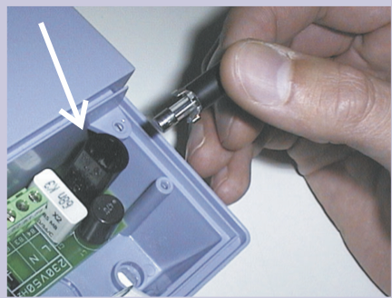

Kuvan kuvaus: valokuva avatusta säätimestä. Valkoinen nuoli osoittaa piirilevyllä olevaa mustaa sulakepesää, ja käsi pitelee irrotettua sulaketta.

Kytke säädin jännitteettömäksi. Paina sulakkeen kantaa ja kierrä vastapäivään. Vaihda 200mA (5x20mm) lasiputkisulake. Paina ja kierrä myötäpäivään sulakepesä paikoilleen.

**Pariston vaihto:**

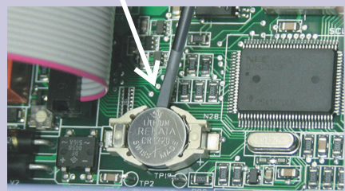

Kuvan kuvaus: valokuva piirilevystä. Valkoinen nuoli osoittaa pidikkeessä olevaa nappiparistoa (RENATA CR1220), ja meisselin kärki on pariston vieressä.

Geopro 202S:ssa on kellonajan ja kello-ohjelman säilyttävä varakäynti lyhytaikaisia sähkökatkoksia vastaan. Jos sähkökatkoksen jälkeen kellonaika ei ole oikein, on paristo vaihdettava. Paristotyyppi: Litium -nappiparisto CR 1220, 3V. Irrota säätimen sulake (ks. yläkuva).Vanha paristo kammetaan varovasti esimerkiksi ohuella meisselillä pidikkeestään. Uusi paristo työnnetään pidikkeeseen + puoli ylöspäin. Vanha paristo voidaan panna talousjätteisiin.

---

<a id="s39"></a>

## Sivu 39: YLEISKYTKENTÄKAAVIO

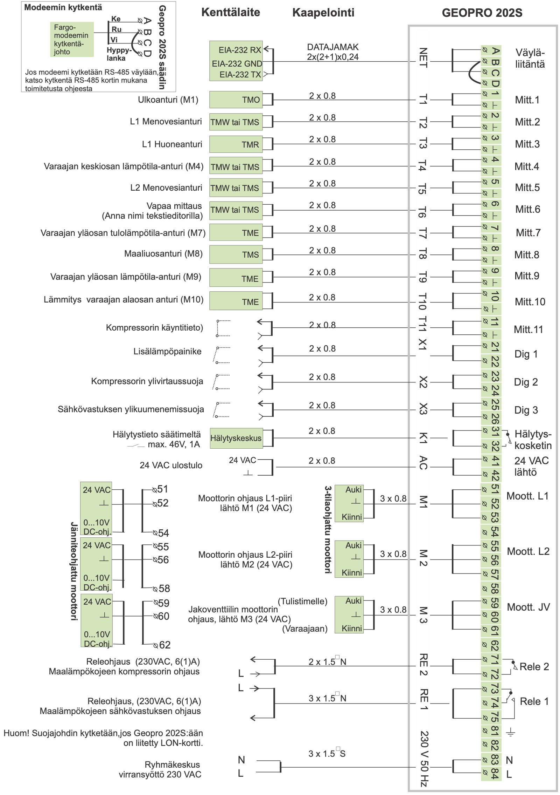

Kuvan kuvaus: kaavio säätimen kaikista kytkennöistä. Sarakkeet ovat Kenttälaite, Kaapelointi ja GEOPRO 202S. Jokaisella rivillä kenttälaitteen nimi on vasemmalla ja sen tyyppi tai symboli Kenttälaite-sarakkeessa. Kaapeli on piirretty yhtenä viivana säätimen liitäntään (pystysuora merkintä, kuten NET tai T1), josta johtimet haarautuvat riviliittimiin; johtimet on piirretty samassa järjestyksessä kummassakin päässä. Riviliittimien oikealla puolella on liitännän nimi. ⊥ on maaliitin. Taulukoissa Kohde on rivin vasemmalla puolella oleva teksti, Liitäntä säätimen pystysuora merkintä ja Nimi riviliittimien oikealla puolella oleva teksti.

Vasemmassa yläkulmassa on laatikko "Modeemin kytkentä": Fargo-modeemin kytkentäjohdon johtimet Ke, Ru ja Vi menevät Geopro 202S säätimen liittimiin A, B ja C, ja Hyppylanka yhdistää liittimet B ja D. Laatikossa lukee:

Jos modeemi kytketään RS-485 väylään, katso kytkentä RS-485 kortin mukana toimitetusta ohjeesta

Väyläliitäntä (NET):

| Riviliitin | Kenttälaite, kaapeli DATAJAMAK 2x(2+1)x0,24 | Modeemin kytkentä |
|---|---|---|
| A | EIA-232 RX | Ke |
| B | EIA-232 GND | Ru |
| C | EIA-232 TX | Vi |
| D | kaari liittimestä B (ei nimeä) | Hyppylanka liittimestä B |

EIA-232 RX:ään osoittaa nuoli, ja EIA-232 TX:stä lähtee nuoli. Kaavion muut rivit:

| Kohde | Kenttälaite | Kaapelointi | Liitäntä | Riviliittimet | Nimi |
|---|---|---|---|---|---|
| Ulkoanturi (M1) | TMO | 2 x 0.8 | T1 | 1, ⊥ | Mitt.1 |
| L1 Menovesianturi | TMW tai TMS | 2 x 0.8 | T2 | 2, ⊥ | Mitt.2 |
| L1 Huoneanturi | TMR | 2 x 0.8 | T3 | 3, ⊥ | Mitt.3 |
| Varaajan keskiosan lämpötila-anturi (M4) | TMW tai TMS | 2 x 0.8 | T4 | 4, ⊥ | Mitt.4 |
| L2 Menovesianturi | TMW tai TMS | 2 x 0.8 | T5 | 5, ⊥ | Mitt.5 |
| Vapaa mittaus (Anna nimi tekstieditorilla) | TMW tai TMS | 2 x 0.8 | T6 | 6, ⊥ | Mitt.6 |
| Varaajan yläosan tulolämpötila-anturi (M7) | TME | 2 x 0.8 | T7 | 7, ⊥ | Mitt.7 |
| Maaliuosanturi (M8) | TMS | 2 x 0.8 | T8 | 8, ⊥ | Mitt.8 |
| Varaajan yläosan lämpötila-anturi (M9) | TME | 2 x 0.8 | T9 | 9, ⊥ | Mitt.9 |
| Lämmitys varaajan alaosan anturi (M10) | TME | 2 x 0.8 | T10 | 10, ⊥ | Mitt.10 |
| Kompressorin käyntitieto) | kosketin, piirretty kiinni | 2 x 0.8 | T11 | 11, ⊥ | Mitt.11 |
| Lisälämpöpainike | kosketin, piirretty auki | 2 x 0.8 | X1 | 21, 22 | Dig 1 |
| Kompressorin ylivirtaussuoja | kosketin, piirretty auki | 2 x 0.8 | X2 | 23, 24 | Dig 2 |
| Sähkövastuksen ylikuumenemissuoja | kosketin, piirretty auki | 2 x 0.8 | X3 | 25, 26 | Dig 3 |
| Hälytystieto säätimeltä, max. 46V, 1A (kosketin, piirretty auki) | Hälytyskeskus | 2 x 0.8 | K1 | 31, 32 | Hälytyskosketin |
| 24 VAC ulostulo | 24 VAC, ⊥ | 2 x 0.8 | AC | 41, 42 | 24 VAC lähtö |
| Moottorin ohjaus L1-piiri lähtö M1 (24 VAC) | 3-tilaohjattu moottori: Auki, ⊥, Kiinni | 3 x 0.8 | M1 | 51, 52, 53 | Moott. L1 |
| Moottorin ohjaus L2-piiri lähtö M2 (24 VAC) | 3-tilaohjattu moottori: Auki, ⊥, Kiinni | 3 x 0.8 | M 2 | 55, 56, 57 | Moott. L2 |
| Jakoventtiilin moottorin ohjaus, lähtö M3 (24 VAC) | 3-tilaohjattu moottori: Auki (Tulistimelle), ⊥, Kiinni (Varaajaan) | 3 x 0.8 | M 3 | 59, 60, 61 | Moott. JV |
| Releohjaus (230VAC, 6(1)A) Maalämpökojeen kompressorin ohjaus | L sisään, lähtö ulos | 2 x 1.5□N | RE 2 | 71, 72 | Rele 2 |
| Releohjaus, (230VAC, 6(1)A) Maalämpökojeen sähkövastuksen ohjaus | L sisään, lähtö ulos | 3 x 1.5□N | RE 1 | 73, 74, 75 | Rele 1 |
| Ryhmäkeskus virransyöttö 230 VAC | N, L | 3 x 1.5□S | 230 V 50 Hz | 83 (N), 84 (L) | |

Moottorilähtöjen johtimet riviliittimittäin. 3-tilaohjattu moottori kytketään kuten taulukossa yllä; jänniteohjattu moottori (Jänniteohjattu moottori, kaavion vasemmassa reunassa) kytketään liittimiin, jotka on piirretty sen viereen:

| Lähtö | 3-tila: Auki | 3-tila: ⊥ | 3-tila: Kiinni | Jännite: 24 VAC | Jännite: ⊥ | Jännite: 0...10V DC-ohj. |
|---|---|---|---|---|---|---|
| M1 (Moott. L1) | 51 | 52 | 53 | 51 | 52 | 54 |
| M2 (Moott. L2) | 55 | 56 | 57 | 55 | 56 | 58 |
| M3 (Moott. JV) | 59 (Tulistimelle) | 60 | 61 (Varaajaan) | 59 | 60 | 62 |

Rele 2 on piirretty sulkeutuvaksi koskettimeksi liittimien 71 ja 72 välille, auki-asentoon. Rele 1 on vaihtokosketin, jonka yhteinen napa on 73; kosketin on piirretty liittimen 74 puolelle, ja liittimen 75 kosketin on auki. Liitin 81 on suojamaaliitin (⏚), ja liittimellä 82 ei ole merkintää eikä kytkentää.

Huom! Suojajohdin kytketään,jos Geopro 202S:ään on liitetty LON-kortti.

> **Repo note:** this page rates the alarm contact (K1, terminals 31–32) max. 46V, 1A; p. 42 gives the alarm relay as 24VAC/ 1A. The label "Kompressorin käyntitieto)" has a stray parenthesis.

---

<a id="s40"></a>

## Sivu 40: LISÄVARUSTEET

### LON-200

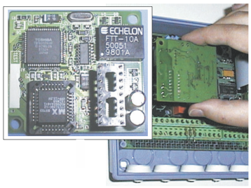

Kuvan kuvaus: valokuva LON-200-sovitinkortista (piirilevyllä ECHELON FTT-10A -piiri) ja kortin asentamisesta säätimeen.

LON-200 on sovitinkortti, joka muuttaa Geopro 202S -säätimen sarjaliikenneväylän LON-kenttäväylään yhteensopivaksi. LON-200 sovitinkortin mukana toimitetaan asennus- ja käyttöönotto-ohje.

### EH-485

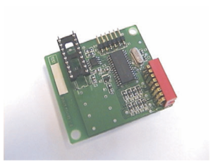

Kuvan kuvaus: valokuva EH-485-väyläsovitinkortista.

Geopro 202S:än on saatavana lisävarusteena EH-485 väyläsovitinkortti, joka muuttaa Geopro 202S -säätimen sarjaliikenneväylän RS-485 kenttäväylään yhteensopivaksi. Tämä tarjoaa edullisen vaihtoehdon kytkeä Geopro 202S säädin OuNet-valvomoon tai GSM-puhelimeen.

### MODBUS-200

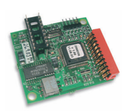

Kuvan kuvaus: valokuva MODBUS-200-sovitinkortista.

MODBUS-200 on sovitinkortti, joka muuttaa Geopro 202S säätimen sarjaliikenneväylän MODBUS RTU-kenttäväylään yhteensopivaksi. Kortilla oleva fyysinen liityntä kenttäväylään on galvaanisesti erotettu RS-485.

### GSM-modeemi

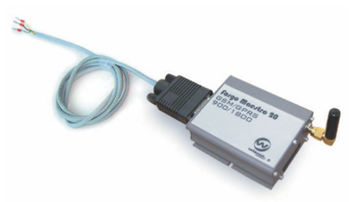

Kuvan kuvaus: valokuva Fargo Maestro 20 -GSM-modeemista, jossa on antenni ja D-liittimeen kytketty johto.

GSM -modeemi mahdollistaa kommunikoinnin Geopro 202S säätimen kanssa tekstiviestien välityksellä. Selainpohjaisessa etäkäytössä hälytykset voidaan välittää tekstiviestinä GSM-puhelimeen.

### EH-686

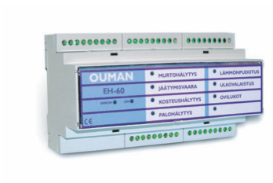

Kuvan kuvaus: valokuva kiskoon asennettavasta Ouman-yksiköstä, jonka etupaneelissa lukee EH-60.

Input/output yksikkö, joka sisältää releitä, analogia- ja digitaalituloja sekä analogialähtöjä. Yksikön avulla voidaan toteuttaa aikaohjattuja reletoimintoja, siirtää hälytyksiä digitaalitulojen kautta ja sen avulla voidaan tehdä yksittäinen säätöpiiri. EH-686 voi myös toimia Ouman RS-485 väylällä isäntälaitteena (master), jolloin sen tehtävänä on ohjata väyläliikennettä.

---

<a id="s41"></a>

## Sivu 41: HAKUSANAT

- Aikaohjaukset 14, 15, 19
- Alasajo 13, 30
- Anturivikahälytys 18
- Aurinkokompensointi 9, 31, 32,34
- Automaattisäätö 13

- Bakteerien tappotoiminto 15

- Datayhteys 38

- EH-485 väyläsovitinkortti 34, 36, 40
- EH-net 35, 38
- Esikorotuksen määrä 8, 9, 19
- Esikorotuksen kestoaika 26

- GSM-modeemi 35, 36, 40
- GSM-toiminnot 19

- Huonekompensointi 8, 19, 31, 34
- Huonelämpötilan hidastus 30
- Hyväksynnät 42
- Hälytykset 18
- Hälytysten nimeäminen 11, 18
- Hälytysten ohjaus GSM:ään 35, 36

- Input/Output yksikkö 36, 39
- Itseoppivuus 17

- Jakoventtiili 21, 23
- Jakoventtiilin ohjaustapa 28
- Jäätymissuojausrajat 30
- Jäätymisvaarahälytys 18

- Kello-ohjelmat 15
- Kenttäväylä 34
- Kielisyyden vaihto 16
- Kompressorin ohjaus 21-23
- Kosteusvaarahälytys 18
- Kytkentäohje 39
- Käsiajo 13, 19

- Laitetunnus 35, 36
- Lattialämmitys 7
- Lokasäiliöhälytys 18
- LON käyttöönotto 33
- LON-väyläsovitinkortti 33, 40
- LON-mittaukset 34
- Lämpötilan pudotus 13, 15

- Maalämmitystoiminnot 20-23
- Maalämpökojeen hälytykset 20
- Maksimiraja (menovesi) 8
- Menovesi-info 12
- Minimiraja (menovesi) 8
- Mittaukset 10, 11, 31
- Mittausten nimeäminen 11
- MODBUS-väyläsovitinkortti 34,38,40
- Modeemin kytkentä 35, 36
- Moottorivalinta 28

- Nimen vaihto 11

- Ohjauslähdöt 28

- Pakkoajo 13, 19
- Palohälytys 18, 19
- Paluuveden maksimi 30
- Paluuveden minimi 30
- Pariston vaihto 39
- PID- säätö 25
- Pintatermostaatti 7
- Poikkeamahälytys 18, 19, 30
- Poikkeamahälytyksen hidastus 30
- Päivälämpö 13, 19

- RS-485 kenttäväylä 34, 36, 40

- Selainkäyttö 37, 40
- Starttitoiminta 17
- Stand by-toiminto 13, 30
- Sulakkeen vaihto 38
- Suojausluokka 42
- Syyskuivaus 9
- Sähkövastuksen toiminta 20-23
- Säätökäyrien asetus 6, 7, 19
- Säätötapa 17

- Tehdasasetusten palautus 29
- Tekstieditori 11
- Tekstiviestiasetukset 35, 36
- Trendinäytöt 27
- Tuulikompensointi 8, 9, 31, 32, 34
- Tyyppitiedot 16

- Ulkolämpötila 11, 34
- Ulkolämpötilan hidastus 26

- Vedenpainehälytys 18, 19
- Venttiilin kesäsulkeutuminen 8,9
- Venttiilin huuhtelu 19
- Viritys 25
- Väylämittaukset 34
- Väyläsovitinkortti 33, 34, 36, 38, 40

- Yöalennus 8, 13, 19

> **Repo note:** some entries give the wrong page. EH-net, listed on pp. 35 and 38, is on p. 37, and so is the MODBUS card, which MODBUS-väyläsovitinkortti and Väyläsovitinkortti list on p. 38. Input/Output yksikkö (EH-686) is on p. 40, where the index has 39, and Pariston vaihto is on p. 38, where the index has 39.

---

<a id="s42"></a>

## Sivu 42

### Tekniset tiedot:

| | |
|---|---|
| Käyttöjännite: | 230 VAC, 50 Hz, 200m A |
| Kotelointi: | PC/ ABS |
| Suojausluokka: | Ilman kansitiivistettä IP 41 |
| Mitat (mm): | |
| Paino: | 1.2 kg |
| Kaapelointisuunta: | Ylhäältä tai alhaalta (näyttö ja näppäimistö käännettävissä). Läpivientiaihiot myös pohjassa. |
| Säädintyyppi | Lämmityspiireissä PID |
| Kello-ohjelmat: | - maks. 7 ohjelmajaksoa/ säätöpiiri (säätöpiireillä yhteensä 14 ohjelmajaksoa) |
| Mittaukset: | 10 kpl (NTC 10 kΩ) |
| Digitaalitulot: | 3 kpl<br>Digitaalituloon kytketään potentiaalivapaa kosketin (kuormitus 6…9 VDC/ 20 mA) |
| Ohjauslähdöt: | 3 kpl moottoriohjauslähtöä<br>3-tila 24 VAC tai jänniteohjaus (0…10 V tai 2…10 V)<br>Moottoreiden yhteisteho max. 25 VA |
| Releohjauslähdöt: | 1 kpl vaihtokosk. rele 230VAC/ 6(1)A<br>1 kpl sulkeutuva kosketin rele 230VAC/ 6(1)A |
| Hälytysrelelähdöt: | 1 kpl 24VAC/ 1A |
| Tiedonsiirtoliitäntä: | Vakiona:EIA-232C<br>Lisävarusteena: RS-485, MODBUS tai LON |
| Käyttölämpötila: | 0 … +50°C |
| Varastointilämpötila: | -20 … +70 °C |
| Hyväksynnät: | |
| EMC-direktiivi | 89/336/EEC, 92/31/EEC |
| - Häiriönsieto | EN 61000-6-1 |
| - Häiriöpäästöt | EN 61000-6-3 |
| Pienjännitedirektiivi | 73/23/EEC |
| - Turvallisuus | EN 60730-1 |
| Takuu: | 2 vuotta |
| Valmistaja: | Ouman Finland Oy<br>Kempele Finland<br>Puh. 0424 840 1<br>Fax 0424 840 201 |

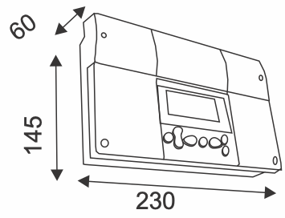

Kuvan kuvaus: Mitat (mm) -kohdan piirros säätimen kotelosta vinosta kuvattuna. Leveys on 230, korkeus 145 ja syvyys 60.

Hyväksynnät-kohdan vieressä ovat CE-merkki ja FI-merkki.

### Säätöperiaatteet:

| Kuvake | Säätöperiaate |
|---|---|
| talo ja ulkolämpömittari | Ulkolämpötilan mukaan tapahtuva menoveden säätö. |
| talo, sisälämpömittari ja ulkolämpömittari | Ulkolämpötilan mukaan tapahtuva menoveden säätö, jossa mukana sisälämpötilan mittaus (huonekompensointi). |
| tuuli, talo ja ulkolämpömittari | Ulkolämpötilan mukaan tapahtuva menoveden säätö, jossa mukana tuulikompensointi. |
| aurinko, talo ja ulkolämpömittari | Ulkolämpötilan mukaan tapahtuva menoveden säätö, jossa mukana aurinkokompensointi. |
| tuuli, talo, sisälämpömittari ja ulkolämpömittari | Ulkolämpötilan mukaan tapahtuva menoveden säätö, jossa mukana sisälämpötilan mittaus (huonekompensointi) sekä tuulikompensointi. |
| aurinko, talo, sisälämpömittari ja ulkolämpömittari | Ulkolämpötilan mukaan tapahtuva menoveden säätö, jossa mukana sisälämpötilan mittaus (huonekompensointi) sekä aurinkokompensointi. |
| aurinko, tuuli, talo, sisälämpömittari ja ulkolämpömittari | Ulkolämpötilan mukaan tapahtuva menoveden säätö, jossa mukana sisälämpötilan mittaus, (huonekompensointi), aurinkokompensointi sekä tuulikompensointi. |

> **Repo note:** p. 10 counts 11 NTC measurements; this page counts 10. On p. 39, Mitt.11 is wired to the compressor's running contact (Kompressorin käyntitieto).

---

<a id="s43"></a>

## Sivu 43

*Sivulla ei ole tekstiä.*

---

<a id="s44"></a>

## Sivu 44

GEOPRO SYSTEMS OY\
Metsä-Pietilänkatu 1, PL 5\
15801 LAHTI\
Puh. (03) 857 6400\
Fax. (03) 857 6499\
geopro@oilon.com\
www.geopro.fi
