# Geopro 202S Käsikirja

A transcription of `Geopro 202S Käsikirja.pdf` (in this folder). Each PDF page starts at an anchor `#sN`, where N is the PDF page index counted from 1; in the Käsikirja it equals the printed page number. [ADR 0006](../docs/adr/0006-manuals-are-markdown-transcriptions.md) sets the other conventions: figures, screens, key icons, what's left out, and the **Repo note** blocks the repo adds.

Transcribed so far: pp. 1–23. Pages 24–44 follow in #82; until then `geopro-202s-manual.md` paraphrases them.

---

<a id="s1"></a>

## Sivu 1

*Sivulla ei ole tekstiä kuvan ulkopuolella.*


Kuvan kuvaus: kansisivu, jonka tekstit ovat osa kuvaa. Ylhäällä on Geopro-logo (vihreä teksti ja vihreä-punainen lehti) ja sen alla tekstit "202S" ja "Käsikirja". Keskellä on valkoinen, kaapin muotoinen maalämpöpumppu, jonka yläkannessa on säätimen näyttö ja näppäimet. Pumpun etuosan päällä on teksti "Maalämpöpumpun ohjaus- ja säätökeskus". Taustalla on aurinkoinen metsä ja nurmirinne. Vasemmalla alhaalla on merkki "PATENTOITU GSM CONTROL". Alareunan harmaassa palkissa on oikealla logo "Geopro by Oilon" ja vasemmalla koodi "202S1.14/0709".

---

<a id="s2"></a>

## Sivu 2

*Sivulla ei ole tekstiä.*

---

<a id="s3"></a>

## Sivu 3: ALUKSI

**Onnittelut erinomaisesta valinnastanne! Olet hankkinut monipuolisen uuden sukupolven asuin- ja liikerakennusten lämmönsäätimen - huipputuotteen joka soveltuu mitä erilaisimpiin käyttökohteisiin ja lämmitysjärjestelmiin.**

**Seuraavaksi esittelemme säätimen ja käyttöohjeen käytön perusperiaatteet.**

### Käyttöpaneeli

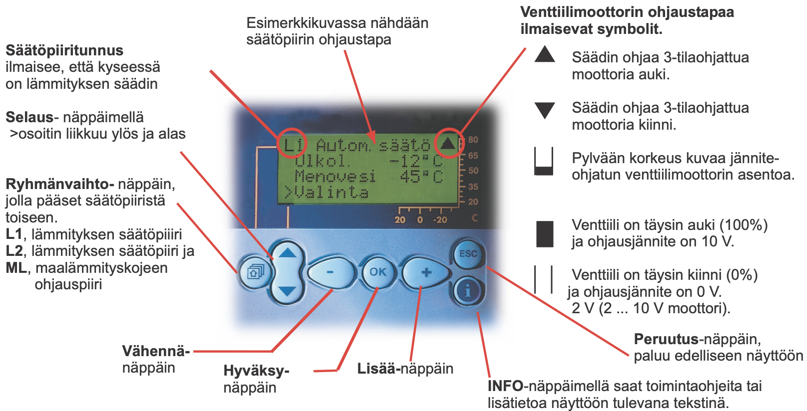

Kuvan kuvaus: valokuva säätimen käyttöpaneelista: ylhäällä nelirivinen näyttö, sen alla näppäinrivi. Punaiset viivat yhdistävät selitteet näytön ja näppäinten kohtiin. Näytössä lukee:

```
L1 Autom.säätö ▲
 Ulkol.    -12°C
 Menovesi   45°C
>Valinta
```

Näytön oikeassa reunassa on asteikko 80, 65, 50, 35, 20 ja C, alareunassa asteikko 20, 0, -20. Näppäimet vasemmalta oikealle: talon kuvalla merkitty näppäin, pystysuuntainen kaksoisnäppäin (nuolet ylös ja alas), -, OK ja + sekä oikeassa reunassa päällekkäin ESC ja i. Selitteet ja kohdat, joita ne osoittavat:

- "**Säätöpiiritunnus** ilmaisee, että kyseessä on lämmityksen säädin" osoittaa näytön ympyröityä tunnusta L1.
- "Esimerkkikuvassa nähdään säätöpiirin ohjaustapa" osoittaa tekstiä Autom.säätö.
- "**Venttiilimoottorin ohjaustapaa ilmaisevat symbolit.**" osoittaa näytön oikean yläkulman ympyröityä ▲-symbolia. Selitteen alla ovat symbolit ja niiden merkitykset:
  - ▲ Säädin ohjaa 3-tilaohjattua moottoria auki.
  - ▼ Säädin ohjaa 3-tilaohjattua moottoria kiinni.
  - osittain täytetty pylväs: Pylvään korkeus kuvaa jänniteohjatun venttiilimoottorin asentoa.
  - täysi pylväs: Venttiili on täysin auki (100%) ja ohjausjännite on 10 V.
  - tyhjä pylväs (kaksi pystyviivaa): Venttiili on täysin kiinni (0%) ja ohjausjännite on 0 V. 2 V (2 ... 10 V moottori).
- "**Selaus**- näppäimellä >osoitin liikkuu ylös ja alas" osoittaa nuolinäppäintä.
- "**Ryhmänvaihto-** näppäin, jolla pääset säätöpiiristä toiseen. **L1**, lämmityksen säätöpiiiri **L2**, lämmityksen säätöpiiri ja **ML**, maalämmityskojeen ohjauspiiri" osoittaa talon kuvalla merkittyä näppäintä.
- "**Vähennä-**näppäin" osoittaa näppäintä -.
- "**Hyväksy-**näppäin" osoittaa näppäintä OK.
- "**Lisää-**näppäin" osoittaa näppäintä +.
- "**Peruutus**-näppäin, paluu edelliseen näyttöön" osoittaa näppäintä ESC.
- "**INFO**-näppäimellä saat toimintaohjeita tai lisätietoa näyttöön tulevana tekstinä." osoittaa i-näppäintä.

**Huom!** Kun painat + näppäintä oheisessa perusnäyttötilassa, säädin näyttää vuorotellen kaikki mittaustulokset, jonka jälkeen se siirtyy takaisin perusnäyttötilaan.

### Sivun lukeminen:

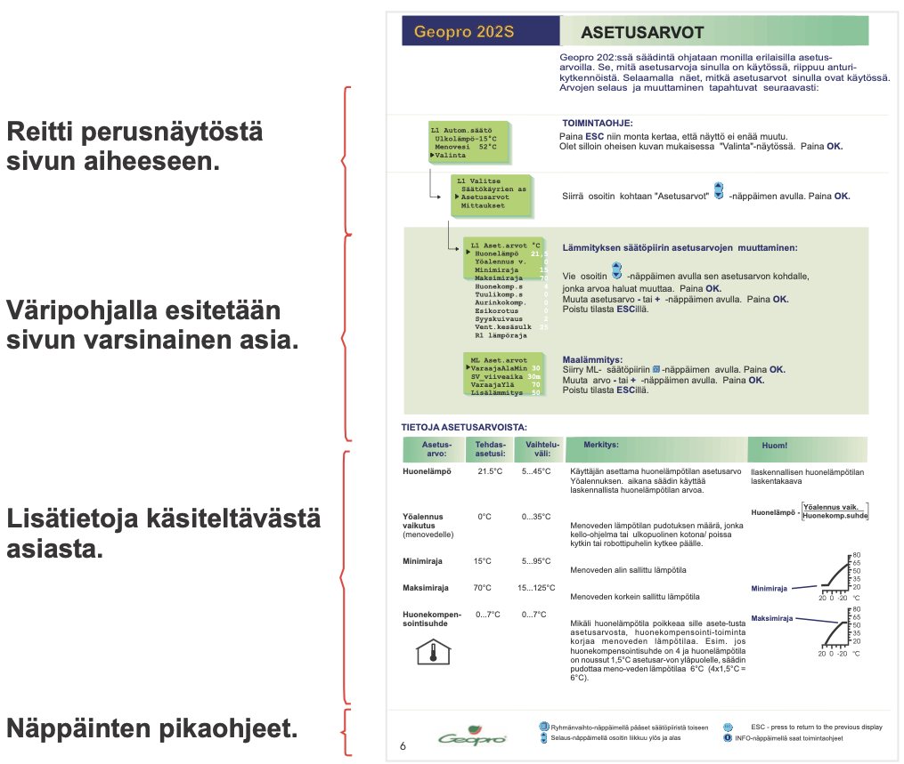

Kuvan kuvaus: pienennetty esimerkkisivu ASETUSARVOT ja sen vasemmalla puolella aaltosulkeilla merkityt selitteet, jotka nimeävät sivun osat ylhäältä alas:

- "Reitti perusnäytöstä sivun aiheeseen." kattaa sivun yläosan: perusnäytön L1 Autom.säätö ja valikon L1 Valitse, jossa osoitin on kohdassa Asetusarvot. Nuolet yhdistävät näytöt, ja niiden oikealla puolella on TOIMINTAOHJE-teksti.
- "Väripohjalla esitetään sivun varsinainen asia." kattaa vihreäpohjaisen alueen: näytöt L1 Aset.arvot ja ML Aset.arvot sekä ohjeet "Lämmityksen säätöpiirin asetusarvojen muuttaminen:" ja "Maalämmitys:".
- "Lisätietoja käsiteltävästä asiasta." kattaa taulukon TIETOJA ASETUSARVOISTA (sarakkeet Asetusarvo, Tehdasasetus, Vaihteluväli, Merkitys ja Huom!).
- "Näppäinten pikaohjeet." kattaa sivun alareunan rivin, jossa näppäinkuvakkeet ovat selityksineen.

Esimerkkisivun yläreunassa on otsikkopalkki (Geopro 202S, ASETUSARVOT) ja johdantoteksti, alareunassa Geopro-logo ja sivunumero 6.

Muutettavissa olevat arvot on sivulla merkitty **valkoisella**.

> **Repo note:** the sample page is an older version of p. 8, and its values differ: Vent.kesäsulk 25, an extra R1 lämpöraja line, and VaraajaYlä 70 where p. 8 has Var.ylä kesä and Var.ylä talvi. Read p. 8 for the settings.

---

<a id="s4"></a>

## Sivu 4

*Sivulla ei ole tekstiä.*

---

<a id="s5"></a>

## Sivu 5: SISÄLTÖ

### Käyttäjäopas

| | Sivu |
|---|---|
| Säätökäyrien asetukset | 6 |
| Asetusarvot | 8 |
| Mittaukset | 10 |
| Tietoa mittauksista ja anturikytkennöistä | 11 |
| Menovesi-info (menoveden lämpötilan määräytyminen) | 12 |
| Ohjaustavat | 13 |
| Kellotoiminnat | 14 |
| Kielivalinta/Tyyppitiedot | 16 |
| Starttitoiminta | 17 |
| Hälytykset | 18 |
| GSM-toiminnot | 19 |
| Maalämmitystoiminnot | 20 |

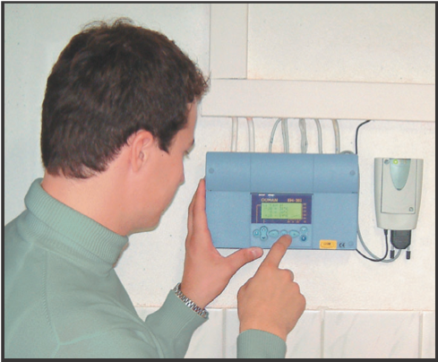

Kuvan kuvaus: valokuva, jossa vihreäpuseroinen mies painaa etusormella seinään asennetun sinisen säätimen näppäintä. Säätimen yläpuolelta nousee johtoja, ja sen oikealla puolella on pienempi valkoinen laite.

### Huolto-opas

Näillä sivuilla on ohjeet valtuutetuille Geopro-huoltomiehille. Säätimen huoltotilaan pääseminen on suojattu huoltokoodilla.

#### Huolto

| | Sivu |
|---|---|
| Ohjeet huoltotilaan siirtymisestä | 24 |
| Viritysarvot | 25 |
| Huoltotilan asetusarvot | 26 |
| Trendit | 27 |
| Moottorivalinta | 28 |
| Jakoventtiilin ohjaustapa | 28 |

#### Erikoishuolto

| | Sivu |
|---|---|
| Tehdasasetusten palautus | 29 |
| Erikoishuoltotilan asetusarvot | 30 |
| Mittauksen 6 asetus | 31 |
| Tuuli-/ aurinkomittaus | 32 |
| Säätimen liittäminen LON-kenttäväylään | 33 |
| Väylämittaukset | 34 |
| Tekstiviestiyhteys modeemin kautta | 35 |
| Tekstiviestiyhteys väylän kautta | 36 |
| Selainkäyttö | 37 |
| Datayhteys suoraan tietokoneeseen | 38 |

| | Sivu |
|---|---|
| **Huolto-ohje** | 38 |
| **Yleiskykentäohje** | 39 |
| **Lisävarusteet** | 40 |
| **Hakusanat** | 41 |
| **Tekniset tiedot** | 42 |

> **Repo note:** "Yleiskykentäohje" is printed for Yleiskytkentäohje, the general wiring guide on p. 39.

---

<a id="s6"></a>

## Sivu 6: SÄÄTÖKÄYRIEN ASETUKSET

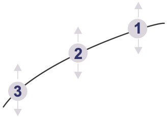

Kuvan kuvaus: kaareva säätökäyrä, jolla on kolme numeroitua pistettä. Piste 1 on käyrän oikeassa, korkeimmassa päässä, piste 2 keskellä ja piste 3 vasemmassa, matalimmassa päässä. Kunkin pisteen ylä- ja alapuolella on nuoli, eli pistettä voi nostaa ja laskea. Numerot vastaavat alla olevaa luetteloa: piste 1 on ulkolämpötilassa -20 °C, piste 3 ulkolämpötilassa +20 °C.

Tasaisen huonelämmön perusta on juuri oikean muotoinen säätökäyrä. Oikea säätökäyrän muoto riippuu monesta tekijästä. Geopro 202S:ssa voidaan säätökäyrää muokata tarkalleen kiinteistön tarpeita vastaavaksi kolmesta pisteestä;

1. **ulkolämpötilan arvolla - 20 °C**
2. **ulkolämpötilan arvolla 0 °C**
3. **ulkolämpötilan arvolla + 20 °C**

Geopro 202S estää väärän muotoisten säätökäyrien asettamisen. Se tekee korjausehdotuksen automaattisesti.

### TOIMINTAOHJE:

```
L1 Autom.säätö
 Ulkolämpö-15°C
 Menovesi  52°C
▶Valinta
```

Näytön takana on toinen näyttö, josta näkyy vain rivi "L2 Autom.säätö".

Paina **ESC** niin monta kertaa, että näyttö ei enää muutu.
Olet silloin oheisen kuvan mukaisessa "Valinta"-näytössä.
Paina **OK**.
Voit siirtyä säätöpiiristä toiseen (L1, L2, ML) [Ryhmänvaihto] -näppäimen avulla.

```
L1 Valitse
▶Säätökäyrien as
 Asetusarvot
 Mittaukset
 Menovesi-info
 Ohjaustavat
 Kellotoiminnat
 Kieli/ Språk
 Tyyppitiedot
 Starttitoiminta
 Huoltotila
```

Näytössä näkyy neljä riviä kerrallaan; valikon muut rivit on piirretty näytön alapuolelle, ja nuoli niiden vieressä osoittaa alas.

Siirrä osoitin kohtaan "Säätökäyrien as" [Selaus] -näppäimen avulla.

Paina **OK**.

```
L1 Käyrä:
▶-20 = 32°C
   0 = 26°C
 +20 = 19°C
```

Näytössä valkoisella: 32. Tämän ja kahden seuraavan näytön oikeassa reunassa on pieni kuva säätökäyrästä; pystyasteikko on 80, 65, 50, 35, 20 ja vaaka-asteikko 20, 0, -20 °C.

Paina **OK**.
Aseta **-** tai **+** -näppäimellä menoveden lämpötila -20°C ulkolämpötilassa.
Paina **OK**.

```
L1 Käyrä:
 -20 = 32°C
▶  0 = 26°C
 +20 = 19°C
```

Näytössä valkoisella: 26.

Paina **OK**.
Aseta **-** tai **+** -näppäimellä menoveden lämpötila 0°C ulkolämpötilassa.
Paina **OK**.

```
L1 Käyrä:
 -20 = 32°C
   0 = 26°C
▶+20 = 19°C
```

Näytössä valkoisella: 19.

Paina **OK**.
Aseta **-** tai **+** -näppäimellä menoveden lämpötila +20°C ulkolämpötilassa.
Paina **OK**.

Poistu tilasta **ESC**illä.

### KÄYRÄN LUKUOHJE:

```
L1 Käyrä:
▶-20 = 32°C
   0 = 26°C
 +20 = 19°C
```

Näytön oikeassa reunassa on säätökäyrä. Pystyasteikko on 80, 65, 50, 35, 20 ja sen otsikko "Menoveden lämpötila"; vaaka-asteikko on 20, 0, -20 °C ja sen otsikko "Ulkolämpötila". Käyrä nousee vasemmalta oikealle eli ulkolämpötilan laskiessa.

Kun ulkolämpötila on:

- \- 20°C, menovesi on +32°C
- 0°C, menovesi on +26°C
- \+ 20°C, menovesi on +21°C

**Huom!**
Menoveden lämpötila voi poiketa käyrän mukaisesta, jos säätimeen on kytketty yöalennus, huone-, tuuli- tai aurinkokompensointi tai jos jokin rajoitustoiminnoista rajoittaa lämpötilaa (ks. sivu 12).

**Mikäli ulkoanturi ei ole kytketty tai anturi on poikki, säädin olettaa ulkolämmöksi 0°C** (rakennusaikainen käyttö ilman ulkoanturia).

> **Repo note:** the reading guide gives +21°C at +20 °C, but the screen beside it shows +20 = 19°C.

---

<a id="s7"></a>

## Sivu 7: Ohjeita säätökäyrän asetteluun

### ESIMERKKEJÄ ERI LÄMMITYSJÄRJESTELMISTÄ:

a) Lattialämmitys

```
L1 Käyrä:
▶-20 = 32°C
   0 = 26°C
 +20 = 19°C
```

b) Lattialämmitys
(kosteat tilat, L2-piirin tehdasasetus)

```
L2 Käyrä:
▶-20 = 30°C
   0 = 27°C
 +20 = 20°C
```

Kummankin näytön oikeassa reunassa on pieni kuva säätökäyrästä; pystyasteikko on 80, 65, 50, 35, 20 ja vaaka-asteikko 20, 0, -20 °C. L2-käyrä on loivempi kuin L1-käyrä.

**OHJE:**

Jos pakkasella huonelämpö laskee, nosta käyrän asettelua -20°C:ssa.

Jos pakkasella huonelämpö nousee, laske käyrän asettelua -20°C:ssa.

Jos huonelämpö tuntuu kolealta nollakelillä, nosta käyrän asettelua 0°C:ssa.

Tällä tavoin voit asetella säätökäyrän juuri kiinteistösi lämmitystarpeen mukaiseksi.

**Huom!** Odota asetusten muutosten jälkeen riittävän kauan, että muutos ehtii vaikuttaa huonelämpötilaan.

### LATTIALÄMMITYSTALOT:

Aseta säätimen maksimirajoitus välille +35 … +40°C ja minimirajoitus välille +20 … +25°C.

Lattialämmitystaloissa on tärkeä varmistua siitä, että putkistoon ei milloinkaan pääse liian kuumaa vettä, joka saattaisi vaurioittaa rakenteita tai pinnotteita. Menovesiputkeen on asennettava mekaaninen termostaatti, joka pysäyttää kiertovesipumpun ylikuumenemistilanteessa.Tähän tarkoitukseen sopii pintatermostaatti C01A. Asettele termostaatin asetusarvoksi 40 ... 45°C.

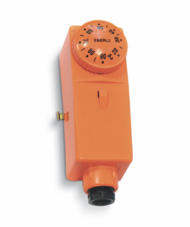

Kuvan kuvaus: valokuva oranssista, pitkulaisesta pintatermostaatista. Yläpäässä on pyöreä säätönuppi, jossa on merkintä EBERLE ja asteikko 20–90 °C. Alapäässä on musta kaapeliläpivienti ja kyljessä pieni metalliosa.

Pintatermostaatti C01A
vaihtokosketin

AC 250V 15 (2,5) A

| Malli | Alue °C säädett. | Eroalue °C kiinteä | Kotelon lämpötila, °C |
|---|---|---|---|
| CO1A | +20 ...+90 | 7 | -35 ...+120 |

#### Pintatermostaatin C01A kytkentä:

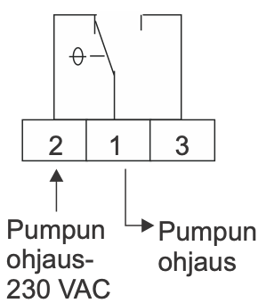

Kuvan kuvaus: kytkentäkaavio. Alhaalla on kolme riviliitintä, vasemmalta oikealle 2, 1 ja 3. Liittimestä 1 nousee vaihtokoskettimen kieli, joka on piirretty asentoon, jossa se on yhteydessä liittimeen 2; liittimen 3 kosketin on auki. Kosketinta ohjaa lämpötila (θ-merkki). Liittimeen 2 osoittaa alhaalta nuoli, jonka selite on "Pumpun ohjaus- 230 VAC". Liittimestä 1 lähtee alas ja oikealle nuoli, jonka selite on "Pumpun ohjaus".

### AVAINSANAT:

- Säätökäyrät
- L1 Säätökäyrä
- L2 Säätökäyrä

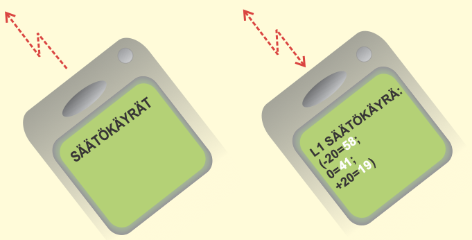

Kuvan kuvaus: kaksi kallistettua matkapuhelinta. Ensimmäisen näytössä on viesti "SÄÄTÖKÄYRÄT", ja puhelimesta lähtee poispäin punainen salaman muotoinen katkoviivanuoli. Toisen näytössä on viesti "L1 SÄÄTÖKÄYRÄ: (-20=58; 0=41; +20=19)", jossa luvut 58, 41 ja 19 ovat valkoisella; sen nuolessa on kärki kummassakin päässä.

> **Repo note:** the table writes the model as CO1A, with a letter O; the text and the caption write C01A.

---

<a id="s8"></a>

## Sivu 8: ASETUSARVOT

Geopro 202S:ssa säädintä ohjataan monilla erilaisilla asetusarvoilla. Se, mitä asetusarvoja sinulla on käytössä, riippuu anturikytkennöistä. Selaamalla näet, mitkä asetusarvot sinulla ovat käytössä. Arvojen selaus ja muuttaminen tapahtuvat seuraavasti:

### TOIMINTAOHJE:

```
L1 Autom.säätö
 Ulkolämpö-15°C
 Menovesi  52°C
▶Valinta
```

Näytön takana on kaksi muuta näyttöä, joista näkyy vain reunat: L2 Autom.säätö ja M-kirjaimella alkava ML-näyttö.

Paina **ESC** niin monta kertaa, että näyttö ei enää muutu.
Olet silloin oheisen kuvan mukaisessa "Valinta"-näytössä. Paina **OK**.
Voit siirtyä säätöpiiristä toiseen (L1, L2, ML) [Ryhmänvaihto] -näppäimen avulla.

```
L1 Valitse
 Säätökäyrien as
▶Asetusarvot
 Mittaukset
```

Siirrä osoitin kohtaan "Asetusarvot" [Selaus] -näppäimen avulla. Paina **OK**.

```
 L1 Aset.arvot °C
▶ Huonelämpö 21.5
  Yöalennus v.  0
  Minimiraja   15
  Maksimiraja  70
  Huonekomp.s 4.0
  Tuulikomp.s   0
  Aurinkokomp   0
  Esikorotus    0
  Syyskuivaus   2
  Vent.kesäsulk30
```

Näytössä näkyy neljä riviä kerrallaan; muut rivit on piirretty näytön alapuolelle. Kaikki arvot on merkitty valkoisella.

**Lämmityksen säätöpiirin asetusarvojen muuttaminen:**

Vie osoitin [Selaus] -näppäimen avulla sen asetusarvon kohdalle, jonka arvoa haluat muuttaa. Paina **OK**.
Muuta asetusarvo **-** tai **+** -näppäimen avulla. Paina **OK**.
Poistu tilasta **ESC**illä.

```
ML Aset.arvot °C
▶VaraajaAlaMin 30
 SV_viiveaika 30m
 Var.ylä kesä 55
 Var.ylä talvi 65
 Lisälämmitys  50
 Lisäläm.aika  2h
```

Näytössä näkyy neljä riviä kerrallaan; muut rivit on piirretty näytön alapuolelle. Kaikki arvot on merkitty valkoisella; yksiköt m ja h eivät.

**Maalämmitys:**
Siirry ML säätöpiiriin [Ryhmänvaihto] -näppäimen avulla. Paina **OK**.
Muuta arvo **-** tai **+** -näppäimen avulla. Paina **OK**.
Poistu tilasta **ESC**illä.

### TIETOJA ASETUSARVOISTA:

| Asetusarvo: | Tehdasasetus: | Asettelualue: | Merkitys: | Huom! |
|---|---|---|---|---|
| Huonelämpö | 21.5°C | 5...45°C | Käyttäjän asettama huonelämpötilan asetusarvo. Yöalennuksen aikana säädin käyttää laskennallista huonelämmön arvoa. | Laskennallinen huonelämpö= **Huonelämpö - [Yöalenn. määrä / Huonekomp.suhde]** |
| Yöalennus vaikutus *“Yöalennus v.”* | 0°C | 0...35°C | Menoveden lämpötilan pudotuksen määrä, jonka kello-ohjelma tai ulkopuolinen kotona/ poissa kytkin tai GSM-ohjaus kytkee päälle. | |
| Minimiraja | 15°C | 5...95°C | Menoveden alin sallittu lämpötila | |
| Maksimiraja | 70°C | 15...125°C | Menoveden korkein sallittu lämpötila | |
| Huonekompensointisuhde *“Huonekomp.s”* | 4.0°C | 0.0...7.0°C | Mikäli huonelämpötila poikkeaa sille asetetusta asetusarvosta, huonekompensointitoiminta korjaa menoveden lämpötilaa. Esim. jos huonekompensointisuhde on 4 ja huonelämpötila on noussut 1,5°C asetusarvon yläpuolelle, säädin pudottaa menoveden lämpötilaa 6°C (4x1,5°C = 6°C). | **Huoneanturi** (TMR) on oltava kytkettynä (L1: mittaus 3, L2: mittaus 6, tai väylä). |
| Tuulikompensointisuhde *“Tuulikomp.s”* | 0°C | 0...7°C | Tuulisilla ilmoilla talo pyrkii jäähtymään. Silloin tuulikompensointi nostaa menoveden lämpötilaa. Lukuarvo kertoo, kuinka paljon tuulikompensointi voi enimmillään nostaa menoveden lämpötilaa. | **Tuulianturi** on oltava kytkettynä. Tuulimittaus on yhteinen säätöpiireille L1 ja L2 (mittaus 6 tai väylä). |

Huom!-sarakkeen kaavassa Yöalenn. määrä on murtoviivan yläpuolella ja Huonekomp.suhde sen alapuolella.

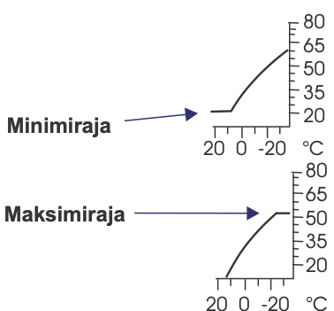

Kuvan kuvaus: Huom!-sarakkeessa Minimiraja- ja Maksimiraja-rivien kohdalla on kaksi pientä säätökäyrää, kummassakin pystyasteikko 80, 65, 50, 35, 20 ja vaaka-asteikko 20, 0, -20 °C. Ylemmässä käyrä nousee oikealle mutta on vasemmassa päässään vaakasuora noin 20 °C:ssa; nuoli selitteestä "Minimiraja" osoittaa tätä vaakasuoraa osaa. Alemmassa käyrä nousee oikealle ja tasaantuu oikeassa päässään vaakasuoraksi noin 50 °C:ssa; nuoli selitteestä "Maksimiraja" osoittaa tätä vaakasuoraa osaa.

> **Repo note:** the screen shows Aurinkokomp; p. 9 names the setting "Aurinkokomp.s".

---

<a id="s9"></a>

## Sivu 9: Lisätietoja asetusarvoista

| Asetusarvot | Tehdasasetus | Asettelualue: | Merkitys: |
|---|---|---|---|
| Aurinkokompensointisuhde *“Aurinkokomp.s”* | 0 °C | 0...-7 °C | Talossa, jossa on suuret etelänpuoleiset ikkunat, huonelämpötila nousee aurinkoisina päivinä pakkassäälläkin. Lukuarvo kertoo, kuinka paljon aurinkokompensointi voi enimmillään pudottaa menoveden lämpötilaa. **Aurinkoanturi** on oltava kytkettynä. Aurinomittaus on yhteinen säätöpiireille L1 ja L2 (mittaus 6 tai väylä). |
| Esikorotus | 0 °C | 0...20 °C | Yöpudotuksen jälkeen tapahtuva automaattisen esikorotuksen **määrä** asteina. Esikorotuksen ansiosta yöpudotuksen jälkeen saadaan huonelämpö nostettua nopeammin päivälämpöön. Esikorotusajan pituuden asettaa huoltomies (ks. huoltotila sivu 26). |
| Syyskuivaus | 2 °C | 0...15 °C | Syysajan kuivaustoiminnolla nostetaan syksyllä automaattisesti menoveden lämpötilaa 20 vuorokauden ajaksi. Toiminto kytkeytyy päälle, kun **vuorokauden keskilämpö** on yhtäjaksoisesti ollut vähintään 20 vrk:n ajan yli 7°C ja putoaa tämän jälkeen +7°C rajan alapuolelle. Toiminto on päällä niinä seuraavina 20 vrk:na, jolloin vrk:n keskilämpötila on alle 7°C. Syyskuivaus asetusarvo kertoo, kuinka paljon syysajan kuivaustoiminto nostaa menoveden lämpötilaa. Tehtaan alkuasetusarvo on 2°C. |
| Venttiilin kesäsulkeutuminen *”Vent.kesäsulk”* | 30 °C | 5...50 °C | Ulkolämpötilaraja, jossa L1-piirin venttiili sulkeutuu |

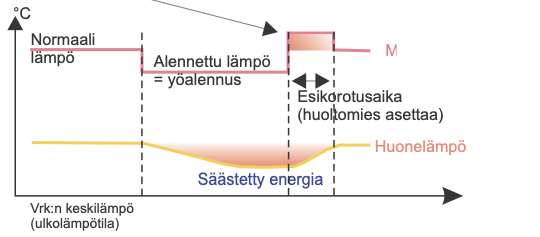

Kuvan kuvaus: Esikorotus-rivin kaavio. Pystyakselin otsikko on °C, ja vaaka-akselin alle vasemmalle on kirjoitettu "Vrk:n keskilämpö (ulkolämpötila)". Punainen viiva on ensin tasolla "Normaali lämpö", laskee ensimmäisen pystysuoran katkoviivan kohdalla tasolle "Alennettu lämpö = yöalennus" ja nousee toisen katkoviivan kohdalla normaalitason yläpuolelle. Korotettu jakso on väritetty punaiseksi, ja sen pituus toisen ja kolmannen katkoviivan välillä on merkitty kaksoisnuolella "Esikorotusaika (huoltomies asettaa)". Sen jälkeen viiva palaa normaalitasolle. Viivan oikeassa päässä on punainen teksti, josta näkyy vain M-kirjain (tekstikerroksessa "Menovesi"). Keltainen viiva "Huonelämpö" laskee loivasti alennuksen aikana ja nousee esikorotuksen aikana takaisin normaaliksi; laskun ja normaalitason välinen punertava alue on merkitty "Säästetty energia". Nuoli Esikorotus-otsikosta osoittaa korotettua jaksoa.

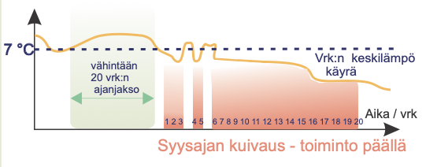

Kuvan kuvaus: Syyskuivaus-rivin kaavio. Pystyakselille on merkitty 7 °C, josta lähtee vaakasuora katkoviiva; vaaka-akselin otsikko on "Aika / vrk". Keltainen käyrä "Vrk:n keskilämpö käyrä" on alussa 7 °C:n yläpuolella; tämä jakso on merkitty vaaleanvihreällä alueella ja kaksoisnuolella "vähintään 20 vrk:n ajanjakso". Sitten käyrä laskee 7 °C:n alle, käy kahdesti hetken sen yläpuolella ja jää lopulta pysyvästi alle. Punaiset palkit merkitsevät vuorokaudet, joina keskilämpö on alle 7 °C. Ne on numeroitu 1–20 (1 2 3, 4 5 ja 6–20), ja käyrän käynnit 7 °C:n yläpuolella jäävät palkkien väliin rakoina. Palkkien selite on "Syysajan kuivaus - toiminto päällä".

**Maalämmitys:**

| Asetusarvot | Tehdasasetus | Asettelualue: | Merkitys: |
|---|---|---|---|
| VaraajaAlaMin | 30°C | 30...55°C | Varaajan alaosan minimilämpötila (Maalämpökojeelta lähtevän lämmitysveden minimilämpötila) |
| SV_viiveaika | 30m | 0...120min | Varaajan keskiosa (mittaus 4) voi kytkeä lämpötilan mukaan sähkövastuksen päälle vasta, kun kompressori on ollut käynnissä tässä asetetun ajan (min) |
| Var.ylä kesä | 55°C | 30...75°C | Varaajan yläosan asetusarvo ulkolämpötilan ollessa ≥ +20°C. |
| Var.ylä talvi | 65°C | 30...75°C | Varaajan yläosan asetusarvo ulkolämpötilan ollessa ≤ -20°C. |
| VaraajaYlä: | Laskennallinen | | "Var.ylä kesä" ja "Var.ylä talvi" asetusarvojen mukaan määraytyvä varaajan yläosan lämpötila (ks. kuva). |
| Lisälämmitys | 50°C | 40...55°C | Lisälämpöpainikkeen painaminen asettaa varaajan alaosan minimin asetusarvoksi ko. asetusarvon |
| Lisäläm.aika | 2h | 0...6h | “Lisälämmitys”- asetusarvo on voimassa tässä aseteltavan ajan |

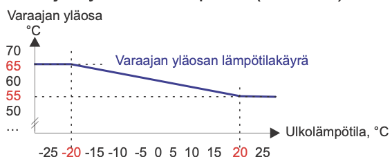

Kuvan kuvaus: kaavio "Varaajan yläosan lämpötilakäyrä", sama kuin sivulla 21. Pystyakseli on varaajan yläosan lämpötila, °C (asteikko 50, 55, 60, 65, 70), vaaka-akseli ulkolämpötila, °C (asteikko -25 … 25). Käyrä on vaakasuora 65 °C:ssa ulkolämpötilan ollessa -20 °C tai alle, laskee suorana viivana -20 °C:sta +20 °C:seen ja on vaakasuora 55 °C:ssa +20 °C:sta ylöspäin. Lukemat 65, 55, -20 ja 20 on merkitty punaisella ja katkoviivoilla, eli kuva käyttää Var.ylä talvi- ja Var.ylä kesä -tehdasasetuksia.

### AVAINSANAT:

- **L1 Asetusarvot**
- **L2 Asetusarvot**
- **ML Asetusarvot**

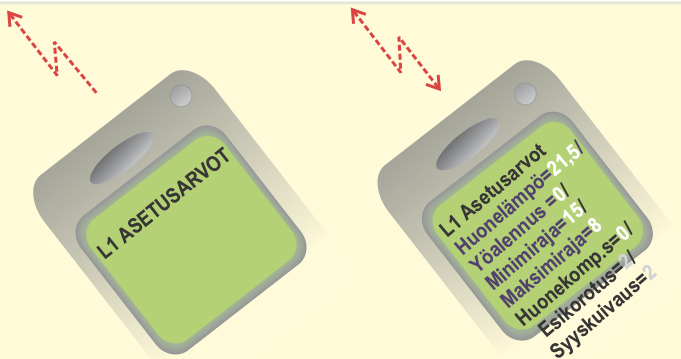

Kuvan kuvaus: kaksi kallistettua matkapuhelinta. Ensimmäisen näytössä on viesti "L1 ASETUSARVOT", ja puhelimesta lähtee poispäin punainen salaman muotoinen katkoviivanuoli. Toisen näytössä on viesti, joka jatkuu näytön reunan yli:

```
L1 Asetusarvot
Huonelämpö=21,5/
Yöalennus =0/
Minimiraja=15/
Maksimiraja=8
Huonekomp.s=0/
Esikorotus=2/
Syyskuivaus=2
```

Viestin luvut ovat valkoisella. Toisen puhelimen nuolessa on kärki kummassakin päässä.

> **Repo note:** the Asennusohje (p. 16) gives +19 °C as the factory value of the summer closing (Vent.kesäsulk); this page, the screen on p. 8 and the factory list on p. 29 give 30 °C.

---

<a id="s10"></a>

## Sivu 10: MITTAUKSET

Geopro 202S:ssa on yhteensä 14 samanaikaista lämpötilan mittaustietoa (11 NTC- mittausta + 3 digit. tuloa). Säädin voi lukea mittaustietoja myös väylän kautta. Mittausta 6 voi käyttää ulkopuolisten hälytysten ilmaisuun (lisätietoja hälytyksistä sivu 18).
HUOM! **Näytössä esiintyvät vain säätimeen kytketyt mittaukset.**

### TOIMINTAOHJE:

```
L1 Autom.säätö
 Ulkolämpö-15°C
 Menovesi  52°C
▶Valinta
```

Näytön takana on päällekkäin kaksi muuta näyttöä, joista näkyvät vain ylimmät rivit: "L2 Autom.säätö" ja "ML Kompressori".

Paina **ESC** niin monta kertaa, että näyttö ei enää muutu.
Olet silloin oheisen kuvan mukaisessa "Valinta"-näytössä.
Kun painat **+** -näppäintä tässä perusnäyttötilassa, säädin näyttää vuorotellen kaikki mittaustulokset, jonka jälkeen siirtyy takaisin perusnäyttötilaan.
Voit myös mennä "Mittaukset" -näyttöön selaamaan mittaustietoja.
Paina **OK**.

```
L1 Valitse
 Säätökäyrien as
 Asetusarvot
▶Mittaukset
 Menovesi-info
```

Rivi Menovesi-info on piirretty näytön alapuolelle.

Siirrä osoitin kohtaan "Mittaukset" [Selaus] -näppäimen avulla. Paina **OK**.

```
Mittaukset °C
▶L1 Menovesi  52
 L1 Huone   21,2
 Ulkolämpö  -15
 L2 Menovesi  48
 VaraajaYlä   70
 VaraajaKeski 50
 VaraajaAla   40
 Yläosa tulo  72
 Maaliuos      2
 Mittaus6      5
 Kompr.Aika    0
 Sähköv.Aika   0
```

Näytössä näkyy neljä riviä kerrallaan; muut rivit on piirretty näytön alapuolelle. Näytön vasemmalla puolella on punainen teksti "Vapaasti nimettävissä oleva lämpötilamittaus", ja sen nuoli osoittaa riviä VaraajaKeski.

**Mittausten selaus:**
Voit selata näytössä eri mittaustietoja **+** -näppäimen tai [Selaus] -näppäimen avulla. Mittaukset näytössä esitetään kaikkien säätöpiirien mittaukset.
Poistu "Mittaukset"-näytöstä painamalla **ESC.**

Jokaisella anturilla on oma tyypillinen mittausalueensa (esim. ulkoanturi -50...+50 °C). Jos anturin mittausarvo on tämän alueen ulkopuolella, tulee "Mittaukset"-näyttöön kyseisen anturin mittausarvon paikalle - tai **+** -merkki osoittamaan, onko arvo mittausalueen ala- vai yläpuolella.

Mikäli kyseessä on anturivika, säädin hälyttää (ks. sivu 20) ja mittausarvon paikalla on "**err**".

<table>
<tr><th>Riviliitin</th><th>Mittaus:</th><th>Tietoa mittauksesta:</th><th>Mittausalue</th><th>Huom!</th></tr>
<tr><td>1</td><td>Ulkolämpö</td><td>Ulkolämpötila</td><td>-50...+50</td><td>Luettavissa myös väylältä</td></tr>
<tr><td>2</td><td>L1 Menovesi</td><td>Menoveden lämpötila säätöpiirissä L1</td><td>0...+130</td><td></td></tr>
<tr><td>3</td><td>L1 Huone</td><td>Huonelämpötila säätöp. L1 (huonekomp.)</td><td>-10...+80</td><td>Luettavissa myös väylältä</td></tr>
<tr><td>4</td><td>VaraajaKeski</td><td>Varaajan keskiosan lämpötila</td><td>0...+130</td><td></td></tr>
<tr><td>5</td><td>L2 Menovesi</td><td>Menoveden lämpötila säätöpiirissä L2</td><td>0...+130</td><td></td></tr>
<tr><td>6</td><td>Mittaus 6</td><td>Nimettävissä oleva vapaa lämpötilamittaus</td><td>-10...+80</td><td rowspan="4"><u>Keskenään vaihtoehtoisia</u> (s. 31). Jos tarvitaan useampaa kompensointia, luetaan tieto väylältä, jolloin tuuli on m/s ja valo on lux (s. 34).</td></tr>
<tr><td>6</td><td>L2 Huone</td><td>Huonelämpötila säätöp. L2. (huonekomp.)</td><td>-10...+80</td></tr>
<tr><td>6</td><td>Tuuli</td><td>Tuulen nopeus (% anturin mitta-alueesta)</td><td></td></tr>
<tr><td>6</td><td>Aurinko</td><td>Valon määrä (% anturin mitta-alueesta)</td><td></td></tr>
<tr><td>7</td><td>Yläosa tulo</td><td>Lämpötila tulistimen ja sähkövastuksen jälkeen</td><td>0...+130</td><td></td></tr>
<tr><td>8</td><td>Maaliuos</td><td>Maaliuoksen lämpötila</td><td>-20...+60</td><td></td></tr>
<tr><td>9</td><td>VaraajaYlä</td><td>Varaajan yläosan lämpötila</td><td>0..+130</td><td></td></tr>
<tr><td>10</td><td>VaraajaAla</td><td>Varaajan alaosan lämpötila</td><td>0..+130</td><td></td></tr>
<tr><td></td><td>Kompr.Aika</td><td>Kompressorin yhteenlaskettu käyntiaika tunteina (käyntilaskuri)</td><td>9999</td><td></td></tr>
<tr><td></td><td>Sähköv.Aika</td><td>Sähkövastuksen yhteenlaskettu lämmitysaika tunteina (päälläololaskuri)</td><td>9999</td><td></td></tr>
</table>

> **Repo note:** the red label for the freely nameable measurement points at VaraajaKeski, but the table gives that role to Mittaus 6 (Mittaus6 on the screen).

> **Repo note:** sensor-fault alarms are described on p. 18; p. 20, cited for them here, covers the heat pump's own alarms.

> **Repo note:** p. 42 lists 10 NTC measurements where the intro has 11. Measurement 11 is the compressor's run signal Kompr.käynti (p. 20).

---

<a id="s11"></a>

## Sivu 11: MITTAUKSET Lisätietoja

**Mittaus 6:** Vapaa info-tyyppinen lämpötilamittaus, joka on nimettävissä, tai se voidaan ottaa säätöön vaikuttavaksi mittaukseksi (L2 huone-, tuuli- tai aurinkokompensointi, ks. erikoishuolto, s. 31 - 32).

### MITTAUKSEN 6 UUDELLEEN NIMEÄMINEN:

Siirrä osoitin mittauksen 6 kohdalle . Paina **OK**.

```
Nimen vaihto
▶Mittaus6
 Anna uusi nimi
```

Siirrä osoitin kohtaan "Anna uusi nimi". Paina **OK**.

```
Nimen vaihto
 Mittaus6
▶a
```

Alemmassa näytössä a-kirjain vilkkuu. Näyttöjen vasemmalla puolella on punaisella vinoon kirjoitettuja esimerkkinimiä: Uima-allas, Kellari, Sauna ja Varaaja.

Näytössä on "a"-kirjain. Voit siirtyä merkkijonossa eteen tai taakse päin **+** tai **-** -näppäimellä. Hyväksy kirjain/merkki painamalla **OK**, jolloin seuraavan merkin kohdalla vilkkuu viimeksi valittu merkki. Viimeksi syötetty merkki poistetaan painamalla **ESC**. Mikäli painat pitkään yhtäjaksoisesti **ESC**-näppäintä saadaan uusi nimi poistettua, ja entinen nimi jää voimaan. **Kun olet kirjoittanut nimen, paina pitkään OK:ta** (yli 2 sek.), jolloin päästään pois kirjoitustilasta ja kirjoitettu nimi tulee käyttöön.

**Tekstieditorin merkit esiintymisjärjestyksessä:** "Tyhjä" . - numerot 0 ... 9 kirjaimet A ...Z ja a ... z ä ö å

### ANTUREIDEN KYTKENTÄOHJE:

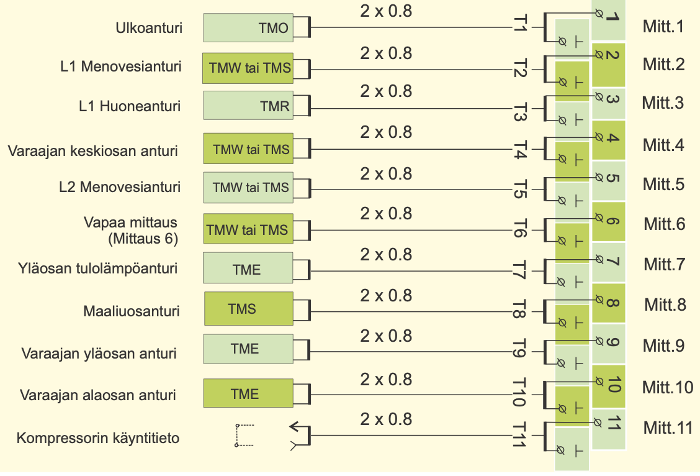

Kuvan kuvaus: kytkentäkaavio. Vasemmalla ovat anturit ja niiden anturityypit, keskellä kaapeli (2 x 0.8) ja oikealla säätimen riviliitinrima. Kaapelin pää on merkitty tunnuksella T1 … T11, ja sen kaksi johdinta kytketään riviliittimeen, jonka numero on sama kuin mittauksen, sekä sen alla olevaan maaliittimeen (⊥). Liittimien oikealla puolella on mittauksen nimi Mitt.1 … Mitt.11.

| Anturi | Anturityyppi | Kaapeli | Merkintä | Riviliittimet | Mittaus |
|---|---|---|---|---|---|
| Ulkoanturi | TMO | 2 x 0.8 | T1 | 1 ja ⊥ | Mitt.1 |
| L1 Menovesianturi | TMW tai TMS | 2 x 0.8 | T2 | 2 ja ⊥ | Mitt.2 |
| L1 Huoneanturi | TMR | 2 x 0.8 | T3 | 3 ja ⊥ | Mitt.3 |
| Varaajan keskiosan anturi | TMW tai TMS | 2 x 0.8 | T4 | 4 ja ⊥ | Mitt.4 |
| L2 Menovesianturi | TMW tai TMS | 2 x 0.8 | T5 | 5 ja ⊥ | Mitt.5 |
| Vapaa mittaus (Mittaus 6) | TMW tai TMS | 2 x 0.8 | T6 | 6 ja ⊥ | Mitt.6 |
| Yläosan tulolämpöanturi | TME | 2 x 0.8 | T7 | 7 ja ⊥ | Mitt.7 |
| Maaliuosanturi | TMS | 2 x 0.8 | T8 | 8 ja ⊥ | Mitt.8 |
| Varaajan yläosan anturi | TME | 2 x 0.8 | T9 | 9 ja ⊥ | Mitt.9 |
| Varaajan alaosan anturi | TME | 2 x 0.8 | T10 | 10 ja ⊥ | Mitt.10 |
| Kompressorin käyntitieto | katkoviivalla piirretty kosketin | 2 x 0.8 | T11 | 11 ja ⊥ | Mitt.11 |

### Vastusarvot

| °C | Ω |
|---|---|
| -30 | 177 100 |
| -25 | 130 400 |
| -20 | 96 890 |
| -15 | 72 830 |
| -10 | 55 340 |
| -5 | 42 340 |
| 0 | 32 660 |
| 5 | 25 400 |
| 10 | 19 900 |
| 15 | 15 710 |
| 20 | 12 490 |
| 25 | 10 000 |
| 30 | 8 064 |
| 35 | 6 531 |
| 40 | 5 330 |
| 45 | 4 368 |
| 50 | 3 602 |
| 55 | 2 987 |
| 60 | 2 490 |
| 65 | 2 084 |
| 70 | 1 753 |
| 75 | 1 482 |
| 80 | 1 259 |
| 90 | 917 |
| 100 | 680 |
| 110 | 511 |

### ANTUREIDEN KÄYTTÖÖNOTTO JA POISTAMINEN KÄYTÖSTÄ:

Jos ulkoanturi ei ole kytketty, säädin olettaa ulkolämmöksi 0°C ja näytössä on anturivika ilmoitus (ulkolämpö err). Kun ulkoanturi kytketään, säädin ottaa sen käyttöön automaattisesti. **Muiden antureiden lisäämisen tai antureiden poistamisen jälkeen täytyy käydä starttitoiminnassa!** (ks. sivu 17)

### AVAINSANA:

- Mittaukset

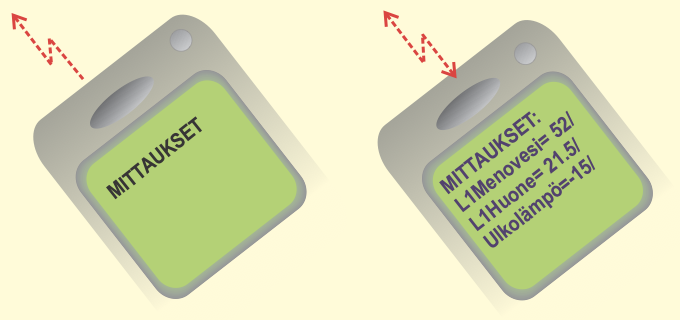

Kuvan kuvaus: kaksi GSM-puhelinta. Vasemman puhelimen salamanuoli osoittaa puhelimesta poispäin, oikean puhelimen nuolessa on kärki kumpaankin suuntaan. Vasemman puhelimen näytössä on viesti "MITTAUKSET", oikean puhelimen näytössä:

```
MITTAUKSET:
L1Menovesi= 52/
L1Huone= 21.5/
Ulkolämpö=-15/
```

---

<a id="s12"></a>

## Sivu 12: MENOVESI-INFO

Menovesi-infossa nähdään, mistä tekijöistä säätimen määräämä menoveden lämpötila tarkasteluhetkellä muodostuu. Lähtökohtana on säätökäyrän mukainen menoveden lämpötila tämänhetkisellä ulkolämpötilalla. Menovesi-infosta havaitaan myös asetusvirheet (esim. virheell. rajoitus).

### TOIMINTAOHJE:

```
L1 Autom.säätö
 Ulkolämpö-15°C
 Menovesi  52°C
▶Valinta
```

Näytön takana on L2:n perusnäyttö, josta näkyy vain ylärivi "L2 Autom.säätö".

Paina **ESC** niin monta kertaa, että näyttö ei enää muutu.
Olet silloin oheisen kuvan mukaisessa "Valinta"-näytössä. Paina **OK**.
Voit siirtyä säätöpiiristä toiseen (L1, L2) [Ryhmänvaihto] -näppäimen avulla.

```
L1 Valitse
 Säätökäyrien as
 Asetusarvot
 Mittaukset
▶Menovesi-info
 Ohjaustavat
```

Näytössä näkyy neljä riviä kerrallaan; muut rivit on piirretty näytön alapuolelle.

Siirrä osoitin kohtaan "Menovesi-info" [Selaus] -näppäimellä. Paina **OK**.

Voit selata [Selaus] -näppäimen avulla, mitkä tekijät vaikuttavat menoveden lämpötilaan. Poistu tilasta **ESC**illä.

```
L1 Menovesi °C
▶Käyrän muk.
 Huonekomp
 Tuulikomp
 Aurinkokomp
 Yö/ Poissa
 Esikorotus
 Syyskuivaus
 Ulkol.hidast.
 Max raj.vaik
 Min raj.vaik
 Alasajo
 Yhteisvaik. =
```

Näytössä näkyy neljä riviä kerrallaan; muut rivit on piirretty näytön alapuolelle. Punaiset viivat yhdistävät kunkin rivin selitteeseen:

| Näytön rivi | Selite |
|---|---|
| Käyrän muk. | Menoveden lämpötila käyrän mukaan tämänhetkisellä ulkolämmöllä |
| Huonekomp | Huonekomp. :Huonekompens. vaikutus menoveteen/ vaihtoehtoisesti Huonek. yö: Huonekomp.vaikutus menoveteen yöalennuksen aikana. |
| Tuulikomp | Tuulikompensoinnin nostava vaikutus menoveteen |
| Aurinkokomp | Aurinkokompensoinnin laskeva vaikutus menoveteen |
| Yö/ Poissa | Kellon ohjaaman yöpudotuksen laskeva vaikutus menoveteen (GSM:llä ohjattu pudotus) |
| Esikorotus | Yöpudotuksen jälkeisen esikorotuksen nostava vaikutus menoveteen |
| Syyskuivaus | Automaattisen syyskuivaustoiminnan nostava vaikutus menoveteen |
| Ulkol.hidast. | Ulkolämpötilan mittauksen hidastustoiminnan vaikutus menoveteen |
| Max raj.vaik | Maksimirajoituksesta johtuva menoveden lämmön pudotus |
| Min raj.vaik | Minimirajoituksesta johtuva menoveden lämmön korotus |
| Alasajo | Vapaan lämpötilan pudotuksen laskeva vaikutus menoveteen |
| Yhteisvaik. = | **Säätimen määräämä menoveden lämpötila tällä hetkellä (°C)** |

### ESIMERKKI

```
L1 Menovesi °C
▶Käyrän muk.  35
 Syyskuivaus   4
 Ulkol.hidast.-2
 Max raj.vaik  0
 Min raj.vaik  0
 Yhteisvaik. =37
```

Näytössä näkyy neljä riviä kerrallaan; muut rivit on piirretty näytön alapuolelle.

Kuvan esimerkissä on käyrän mukainen menoveden lämpötila 35°C. Syysajan kuivaustoiminta nostaa sitä 4°C. Ulkolämmön mittauksen hidastustoiminta pudottaa menoveden lämpötilaa 2°C. Näiden yhteisvaikutuksena säädin määrää menoveden lämpötilaksi +37°C (35+4-2=37).

### AVAINSANAT:

- **L1 Menovesi-info**
- **L2 Menovesi-info**

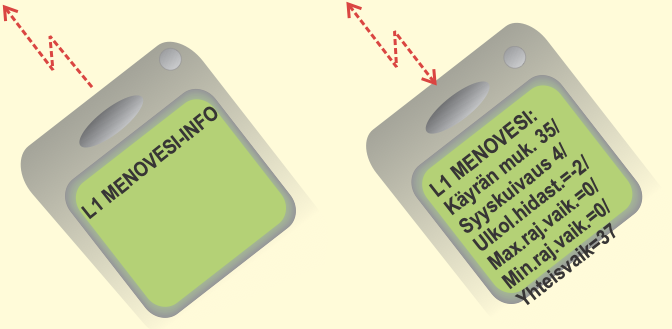

Kuvan kuvaus: kaksi GSM-puhelinta. Vasemman puhelimen salamanuoli osoittaa puhelimesta poispäin, oikean puhelimen nuolessa on kärki kumpaankin suuntaan. Vasemman puhelimen näytössä on viesti "L1 MENOVESI-INFO", oikean puhelimen näytössä viesti, joka jatkuu näytön reunan yli:

```
L1 MENOVESI:
Käyrän muk. 35/
Syyskuivaus 4/
Ulkol.hidast.=-2/
Max.raj.vaik.=0/
Min.raj.vaik.=0/
Yhteisvaik=37
```

---

<a id="s13"></a>

## Sivu 13: OHJAUSTAVAT

Jokaista säätöpiiriä voidaan ohjata alla mainituilla ohjaustavoilla. Tehdasasetuksena oleva automaattisäätö on normaali säätötilanne, jossa myös kello-ohjatut lämpötilan pudotukset ovat mahdolliset.

**Valittu ohjaustapa näkyy aina perusnäytössä ylimmällä rivillä.**

### TOIMINTAOHJE:

```
L1 Autom.säätö
 Ulkolämpö-15°C
 Menovesi  52°C
▶Valinta
```

Näytön takana on pinossa L2:n ja ML:n perusnäytöt, joista näkyvät vain ylärivit "L2 Autom.säätö" ja "ML Kompressori". Keltainen katkoviivanuoli osoittaa lauseesta "Valittu ohjaustapa näkyy aina perusnäytössä ylimmällä rivillä." perusnäytön ylimpään riviin.

Paina **ESC** niin monta kertaa, että näyttö ei enää muutu.
Olet silloin oheisen kuvan mukaisessa "Valinta"-näytössä. Paina **OK**.
Voit siirtyä säätöpiiristä toiseen (L1, L2, ML) [Ryhmänvaihto] -näppäimen avulla.

```
L1 Valitse
 Säätökäyrien as
 Asetusarvot
 Mittaukset
 Menovesi-info
 Ohjaustavat
▶Kellotoiminnat
```

Näytössä näkyy neljä riviä kerrallaan; muut rivit on piirretty näytön alapuolelle.

Siirrä osoitin kohtaan "Ohjaustavat" [Selaus] -näppäimen avulla. Paina **OK**.

> **Repo note:** the screen above has its cursor on Kellotoiminnat, though this step moves it to Ohjaustavat and the next screen is L1 Ohjaustavat.

Voit selata eri ohjaustavat [Selaus] -näppäimellä.

● -merkki osoittaa, mikä ohjaustapa on valittu käyttöön.

```
L1 Ohjaustavat
▶● Autom.säätö
   Jatkuva päivä
   Jatkuva yö
   Alasajo
   Käsiajo mek.
   Käsiajo sähk.
```

Näytössä näkyy neljä riviä kerrallaan; muut rivit on piirretty näytön alapuolelle.

**Ohjaustavan muuttaminen:** Vie osoitin [Selaus] -näppäimellä sen ohjaustavan kohdalle, jonka haluat ottaa käyttöön. Paina **OK**. Poistu tilasta **ESC**illä.

**Venttiilimoottorin mekaaninen käsiajo:**
Moottori on sähkötön.
Vain mekaaninen käsikäyttö on mahdollinen.

**Venttiilimoottorin käsiajo sähköllä:** Paina **OK**.
Muuta venttiilimoottorin asentoa **-** tai **+** -näppäimellä.
Näytössä näkyy, mihin suuntaan venttiilimoottoria ajetaan.
Asennon %-luku osoittaa venttiililmoottorin asennon, mikäli käytetään jänniteohjattua 0 (2) ... 10V venttiilimoottoria (0% = kiinni, 100%=auki).

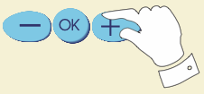

Kuvan kuvaus: näppäimet -, OK ja + rivissä; käsi painaa +-näppäintä.

```
Käsiajo sähk.
▶Ohjaus    --
 Asento: 39%
```

L1 Ohjaustavat -näytön riviltä "Käsiajo sähk." nuoli johtaa tähän näyttöön. Luku 39 on valkoisella.

**Maalämmityksen säätöpiirin (ML) ohjaustavat:**

Voit siirtyä maalämmityksen säätöpiiriin (ML) [Ryhmänvaihto] -näppäimen avulla.

```
ML Ohjaustavat
▶● Kompr.+sähköv.
   Kompressori
   Sähkövastus
```

**Kompressori + sähkövastus:**
Jos maalämmön tuottama lämpö ei riitä, kytkeytyy sähkövastus päälle.

**Kompressori:**
Varaajien lämmitys tapahtuu vain maalämmöllä (ei käytetä sähkövastuksia).

**Sähkövastus:**
Varaajan lämmitys tapahtuu vain sähkövastuksella.

**Jakoventtiilin ohjaustavan valinta on huoltopuolella.**

### LISÄTIETOA LÄMMITYKSEN SÄÄTÖPIIRIEN L1 JA L2 OHJAUSTAVOISTA:

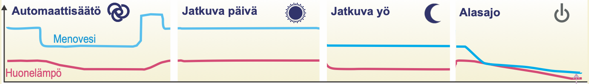

Kuvan kuvaus: neljä vierekkäistä kaaviota ajan funktiona ilman asteikkoja. Sininen käyrä on menoveden lämpötila ("Menovesi"), punainen huonelämpötila ("Huonelämpö"). Kunkin kaavion otsikon vieressä on ohjaustavan kuvake.

- Automaattisäätö (kuvake: kaksi toisiinsa kietoutuvaa kaarta): menovesi laskee portaittain alemmalle tasolle, nousee myöhemmin hetkeksi alkutasoa korkeammalle ja palaa sitten alkutasolle. Huonelämpö laskee hieman menoveden alemman jakson aikana ja nousee sen jälkeen takaisin.
- Jatkuva päivä (kuvake: aurinko): menovesi ja huonelämpö pysyvät tasaisina.
- Jatkuva yö (kuvake: kuu): menovesi pysyy tasaisena, alempana kuin Jatkuva päivä -kaaviossa; huonelämpö laskee alussa ja pysyy sitten tasaisena alemmalla tasolla.
- Alasajo (kuvake: virtakytkin): menovesi laskee ensin jyrkästi ja sitten hitaasti, huonelämpö laskee tasaisesti. Selitetekstin sanasta "jäätymissuojarajaan" lähtee katkoviivanuoli käyrien loppupäähän.

| Automaattisäätö | Jatkuva päivä | Jatkuva yö | Alasajo |
|---|---|---|---|
| Lämpötilan pudotukset tapahtuvat kello-ohjelman mukaisesti. | Kello-ohjelmista riippumaton normaali päivälämpö on päällä. | Kello-ohjelmista riippumaton jatkuva lämpötilan pudotus on päällä. | Vapaa menoveden lämpötilan pudotus aina jäätymissuojarajaan saakka (stand by-toiminta). |

### AVAINSANAT:

- **L1 Ohjaustapa**
- **L2 Ohjaustapa**

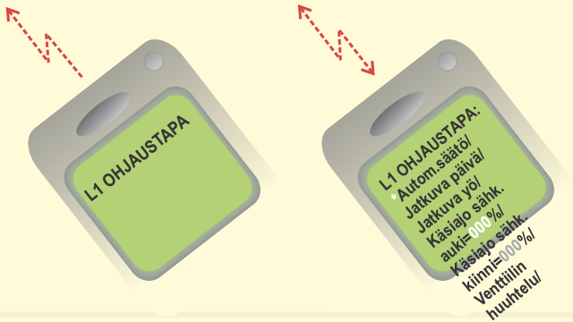

Kuvan kuvaus: kaksi GSM-puhelinta. Vasemman puhelimen salamanuoli osoittaa puhelimesta poispäin, oikean puhelimen nuolessa on kärki kumpaankin suuntaan. Vasemman puhelimen näytössä on viesti "L1 OHJAUSTAPA", oikean puhelimen näytössä viesti, joka jatkuu näytön reunan yli. Tähti ja luvut 000 ovat valkoisia:

```
L1 OHJAUSTAPA:
*Autom.säätö/
Jatkuva päivä/
Jatkuva yö/
Käsiajo sähk.
auki=000%/
Käsiajo sähk.
kiinni=000%/
Venttiilin
huuhtelu/
```

---

<a id="s14"></a>

## Sivu 14: KELLOTOIMINNAT Ajan asetus

Kellon ajan asettaminen tapahtuu seuraavasti:

Geopro 202S säätimen kello huomioi kesä- ja talviajan muutokset ja karkausvuodet. Kellossa on varakäynti lyhytaikaisia sähkökatkoksia vastaan. Pariston kestoikä on noin 10 vuotta.

### TOIMINTAOHJE:

```
L1 Autom.säätö
 Ulkolämpö-15°C
 Menovesi  52°C
▶Valinta
```

Näytön takana on pinossa L2:n ja ML:n perusnäytöt, joista näkyvät vain ylärivit "L2 Autom.säätö" ja "ML Kompressori".

Paina **ESC** niin monta kertaa, että näyttö ei enää muutu.
Olet silloin oheisen kuvan mukaisessa "Valinta"-näytössä. Paina **OK**.

```
L1 Valitse
 Säätökäyrien as
 Asetusarvot
 Mittaukset
 Menovesi-info
 Ohjaustavat
▶Kellotoiminnat
 Kieli/ language
```

Näytössä näkyy neljä riviä kerrallaan; muut rivit on piirretty näytön alapuolelle.

Siirrä osoitin kohtaan "Kellotoiminnat" [Selaus] -näppäimellä. Paina **OK**.

```
Kellotoiminnat
▶Kellonaika/pvm
 L1 Pudotusohj.
 L2 Pudotusohj.
```

Osoitin on kohdassa "Kellonaika/pvm". Paina **OK**.

```
Kellonaika/pvm
▶15:45 tunn/min
 09/11 pv/kk
 2006  Maanantai
```

15:45 on valkoisella.

**Kellonajan asetus:**
Osoitin on kohdassa kellon aika. Paina **OK**.
Tunnit vilkkuvat. Aseta tunnit käyttäen **-** tai **+** -näppäintä. Paina **OK**.
Minuutit vilkkuvat. Aseta minuutit käyttäen **-** tai **+** -näppäintä. Paina **OK**.

```
Kellonaika/pvm
 15:45 tunn/min
▶09/11 pv/kk
 2006  Maanantai
```

09/11 on valkoisella.

**Päivämäärän asetus:** Paina **OK**.
Pvm vilkkuu. Aseta kuukauden päivä **-** tai **+** -näppäimellä. Paina **OK**.
Kuukausi vilkkuu. Aseta kuukausi **-** tai **+** -näppäimellä. Paina **OK**.

```
Kellonaika/pvm
 15:45 tunn/min
 09/11 pv/kk
▶2006  Maanantai
```

2006 ja Maanantai on valkoisella.

**Vuoden ja viikonpäivän asetus:** Paina **OK**.
Vuosi vilkkuu. Aseta vuosi **-** tai **+** -näppäimellä. Paina **OK**.
Viikonpäivä vilkkuu. Aseta viikonpäivä **-** tai **+** -näppäimellä. Paina **OK**.
Poistu tilasta **ESC**illä.

---

<a id="s15"></a>

## Sivu 15: Kello-ohjelmien selaus, lisäys, poisto

Vapaasti ohjelmoitavan vuorokausi-/ viikkokellon avulla voit:
**Pudottaa lämmitystä haluaminasi aikoina (lämmityspiirit L1 ja L2).**

### TOIMINTAOHJE:

```
L1 Autom.säätö
 Ulkolämpö-15°C
 Menovesi  52°C
▶Valinta
```

Näytön takana on pinossa L2:n ja ML:n perusnäytöt, joista näkyvät vain ylärivit "L2 Autom.säätö" ja "ML Kompressori".

Paina **ESC** niin monta kertaa, että näyttö ei enää muutu.
Olet silloin oheisen kuvan mukaisessa "Valinta"-näytössä. Paina **OK**.

```
L1 Valitse
 Säätökäyrien as
 Asetusarvot
 Mittaukset
 Menovesi-info
 Ohjaustavat
▶Kellotoiminnat
 Kieli/ language
```

Näytössä näkyy neljä riviä kerrallaan; muut rivit on piirretty näytön alapuolelle.

Siirrä osoitin kohtaan "Kellotoiminnat" [Selaus] -näppäimellä. Paina **OK**.

```
Kellotoiminnat
 Kellonaika/pvm
▶L1 Pudotusohj.
 L2 Pudotusohj.
```

Siirrä osoitin [Selaus] -näppäimen avulla osoittamaan sitä säätöpiiriä, jonka aikaohjauksia haluat käsitellä (selata, lisätä tai poistaa). Paina **OK**.

### SELAUS/ OHJELMAN LISÄYSPAIKAN HAKEMINEN:

```
▶00:00 PudON L1
 _ _ _ _ _ _ _
 00:00 PudPOIS
 _ _ _ _ _ _ _
```

Ensimmäinen 00:00 on valkoisella ja vilkkuu. Näytön oikeassa reunassa on kaarisulku, joka rajaa ohjelmajakson neljä riviä. Viivat ovat viikonpäivien paikat.

Selaa [Selaus] -näppäimen avulla, mitä kello-ohjelmia on tehty.

Halutessasi ohjelmoida lisää, siirrä osoitin ensimmäiseen ohjelmoimattomaan ohjelmajaksoon.

```
▶19:30 PudON L1
 _ _ _ _ _ _ _
 00:00 PudPOIS
 _ _ _ _ _ _ _
```

19:30 on valkoisella ja vilkkuu.

**Lämpötilan pudotuksen aloitusajan asettaminen:** Paina **OK**.
Pudotuksen aloitusajan tunnit vilkkuvat.
Aseta tunnit **-** tai **+** -näppäimellä. Paina **OK**.
Minuutit vilkkuvat. Aseta minuutit **-** tai **+** -näppäimellä. Paina **OK**.

```
 19:30 PudON L1
▶MaTiKeToPe _ _
 00:00 PudPOIS
 _ _ _ _ _ _ _
```

MaTiKeToPe on valkoisella ja vilkkuu.

**Viikonpäivien asettaminen (em. aloitusajalle):**
Viikonpäivä valitaan käyttöön **+** -näppäimellä.
Päivä jätetään valitsematta/ valinta poistetaan **-** -näppäimellä.
**OK**:lla otetaan käyttöön tarjolla oleva valinta.
Tee valinta päiväkohtaisesti ja lopuksi paina **OK**.

```
 19:30 PudON L1
 MaTiKeToPe _ _
▶04:30 PudPOIS
 _ _ _ _ _ _ _
```

04:30 on valkoisella ja vilkkuu.

**Lämpötilan pudotuksen päättymisajan asettaminen:** Paina **OK**.
Tunnit vilkkuvat. Aseta tunnit **-** tai **+** -näppäimellä. Paina **OK**.
Minuutit vilkkuvat. Aseta minuutit **-** tai **+** -näppäimellä. Paina **OK**.

```
 MaTiKeToPe _ _
 04:30 PudPOIS
▶MaTiKeToPe _ _
 00:00 PudON L1
 _ _ _ _ _ _ _
 00:00 PudPOIS
 _ _ _ _ _ _ _
jne.
```

Näytössä näkyy neljä riviä kerrallaan; muut rivit on piirretty näytön alapuolelle. Kolmannen rivin MaTiKeToPe on valkoisella ja vilkkuu. Ensimmäisen ohjelmajakson kaarisulku päättyy rivillä "00:00 PudON L1", ja siitä alkaa uusi kaarisulku, joka rajaa seuraavan ohjelmajakson (00:00 PudON L1 … 00:00 PudPOIS). Punainen viiva alleviivaa tekstin "Kaaren sisällä" ja päättyy nuolena uuteen kaarisulkuun.

**Viikonpäivien asettaminen (em. lopetusajalle):** Paina **OK**.
Viikonpäivä valitaan käyttöön **+** -näppäimellä.
Päivä jätetään valitsematta/ valinta poistetaan **-** -näppäimellä.
**OK**:lla otetaan käyttöön tarjolla oleva valinta.
Tee valinta päiväkohtaisesti ja lopuksi paina **OK**.
Kaaren sisällä on aina yksi ohjelmajakso (pudotus päälle ja pois päältä).
Osoitin siirtyy seuraavan ohjelmajakson alkuun (uusi kaarisulku).
Jatka ohjelmointia kuten edellä tai poistu ohjelmointitilasta **ESC**illä.
*Kuvan esimerkissä pudotus on päällä työviikon aikana klo 19:30 - 4:30 välisen ajan. Viikonloppuna pudotus alkaa perjantai iltana klo 19:30 ja päättyy maanantaiaamuna kello 4:30.*

### OHJELMAJAKSON POISTO:

```
▶19:30 PudON L1
 _ _ _ _ _ _ _
 04:30 PudPOIS
 _ _ _ _ _ _ _
```

Punainen nuoli osoittaa tekstistä näytön oikeassa reunassa olevaan kaarisulkuun.

Voit poistaa kaarisulun sisällä olevan ohjelmajakson niin, että poistat viikonpäivät kyseisestä ohjelmajaksosta **-** -näppäimellä.

---

<a id="s16"></a>

## Sivu 16: KIELI/ TYYPPITIEDOT

Geopro 202S säädin on kaksikielinen. Säätimessä on yleisimmin käytetty kieliyhdistelmiä suomi- ruotsi (svenska) ja englanti (english) - eesti.

Säätimen kielen vaihtaminen tapahtuu seuraavasti:

### TOIMINTAOHJE:

```
L1 Autom.säätö
 Ulkolämpö-15°C
 Menovesi  52°C
▶Valinta
```

Näytön takana on pinossa L2:n ja ML:n perusnäytöt, joista näkyvät vain ylärivit "L2 Autom.säätö" ja "ML kompressori".

Paina **ESC** niin monta kertaa, että näyttö ei enää muutu.
Olet silloin oheisen kuvan mukaisessa "Valinta"-näytössä. Paina **OK**.

```
L1 Valitse
 Säätökäyrien as
 Asetusarvot
 Mittaukset
 Menovesi-info
 Ohjaustavat
 Kellotoiminnat
▶Kieli/ språk
 Tyyppitiedot
 Starttitoiminta
 Huoltotila
```

Näytössä näkyy neljä riviä kerrallaan; muut rivit on piirretty näytön alapuolelle.

Siirrä osoitin kohtaan "Kieli/ språk" [Selaus] -näppäimen avulla. Paina **OK**.

```
Kieli/ Språk
▶● Suomi
   Svenska
```

Siirrä osoitin [Selaus] -näppäimen avulla sen kielen kohdalle, jonka haluat ottaa käyttöön. Paina **OK**.

> **Repo note:** pp. 14 and 15 show this menu item as "Kieli/ language".

### TYYPPITIEDOT

Tyyppitiedot kertovat, mikä säädin on kyseessä ja mikä ohjelmaversio on käytössä. Geopro 202S säätimessä on kaksi lämmityspiiriä ja maalämpökojeen toiminnan ohjaus.

#### TOIMINTAOHJE:

```
L1 Autom.säätö
 Ulkolämpö-15°C
 Menovesi  52°C
▶Valinta
```

Näytön takana on pinossa L2:n ja ML:n perusnäytöt, joista näkyvät vain ylärivit "L2 Autom.säätö" ja "ML Kompressori".

Paina **ESC** niin monta kertaa, että näyttö ei enää muutu.
Olet silloin oheisen kuvan mukaisessa "Valinta"-näytössä. Paina **OK**.

```
L1 Valitse
 Säätökäyrien as
 Asetusarvot
 Mittaukset
 Menovesi-info
 Ohjaustavat
 Kellotoiminnat
 Kieli/ Språk
▶Tyyppitiedot
 Starttitoiminta
```

Näytössä näkyy neljä riviä kerrallaan; muut rivit on piirretty näytön alapuolelle.

Siirrä osoitin kohtaan "Tyyppitiedot" [Selaus] -näppäimen avulla. Paina **OK**.

```
 Tyyppitiedot
 GEOPRO 202S
  Versio 1.xx
▶  00122611
```

Ouman Finland Oy panostaa voimakkaasti jatkuvaan tuotekehitykseen. Versionumero kertoo valmistajalle, mikä ohjelmaversio on kyseessä.

Sarjanumero liittyy tuotantoprosessiin ja kertoo säätimen valmistajalle täsmällisesti, mistä yksilöstä on kyse.

---

<a id="s17"></a>

## Sivu 17: STARTTITOIMINTA Säätötavan valinta

**Starttitoiminnassa** säädin tunnistaa siihen kytketyt anturit. Menovesiantureiden perusteella säädin ottaa käyttöön säätöpiirit (L1ja L2). Oletuksena on perussäädin jokaisessa säätöpiirissä. Halutessasi voit muuttaa lämmityksen säätöpiirin (L1 ja L2) itseoppivaksi säätimeksi. Starttitoiminta aktivoi käyttöön myös antureiden vikahälytykset.

**Perussäädin** ohjaa menoveden lämpötilaa asetetun säätökäyrän mukaisesti. **Itseoppiva säädin** muokkaa säätökäyrää automaattisesti huoneanturilta saamansa palautteen perusteella. Itseoppivuuden maksimivaikutus on 10%. Säätökäyrän asettelu -näytössä **i**-kirjain kertoo, että itseoppivuus on käytössä.

### TOIMINTAOHJE:

```
L1 Autom.säätö
 Ulkolämpö-15°C
 Menovesi  52°C
▶Valinta
```

Näytön takana on pinossa L2:n ja ML:n perusnäytöt, joiden ylärivit "L2 Automaattiohj" ja "ML Kompressori" jäävät osin kuvan yläreunan taakse.

Paina **ESC** niin monta kertaa, että näyttö ei enää muutu.
Olet silloin oheisen kuvan mukaisessa "Valinta"-näytössä. Paina **OK**.

```
L1 Valitse
 Säätökäyrien as
 Asetusarvot
 Mittaukset
 Menovesi-info
 Ohjaustavat
 Kellotoiminnat
 Kieli/ Språk
 Tyyppitiedot
▶Starttitoiminta
 Huoltotila
```

**Antureiden käyttöönotto ja antureiden poistaminen käytöstä:**
Jos kytket anturin säätimeen tai irrotat anturin säätimeltä, tulee sinun käydä starttitoiminnassa, jolloin säädin ottaa käyttöön tai poistaa anturit käytöstä.
Siirrä osoitin kohtaan "Starttitoiminta" [Selaus] -näppäimen avulla. Paina **OK**.
Säädin tunnistaa siihen kytketyt ja poistetut anturit ja näyttää valittavissa olevat säätötavat. Jos et halua muuttaa säätötapaa, voit poistua säätötapanäytöstä ESC:llä muuttamatta mitään.

Säätimen tehdasasetuksena on perussäädin.

```
Säätötapa
▶● L1 perussäädin
   L1 itseoppiva
   L1 ei käytössä
 ● L2 perussäädin
   L2 itseoppiva
   L2 ei käytössä
```

Näytössä näkyy neljä riviä kerrallaan; muut rivit on piirretty näytön alapuolelle.

**Selaus:**
Selaa valittavissa olevat säädintyypit säätöpiireittäin [Selaus] -näppäimellä.
● -merkki osoittaa, mikä säädintyyppi on valittu käyttöön missäkin säätöpiirissä.

**Säädintyypin muuttaminen:**
Vie osoitin haluamaasi kohtaan [Selaus] -näppäimellä ja paina **OK**.

### TIETOA ITSEOPPIVUUDESTA:

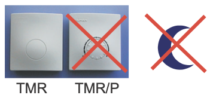

Kuvan kuvaus: valokuva kahdesta huoneanturista, vasemmalla TMR ja oikealla TMR/P, jossa on pyöreä säätöasteikko. TMR/P on yliviivattu punaisella rastilla. Niiden oikealla puolella on kuun kuvake, joka on myös yliviivattu punaisella rastilla.

Itseoppivuutta tapahtuu, mikäli huonelämpö poikkeaa vähintään 1°C asetusarvostaan ulkolämpötilan ollessa vähintään 4 tunnin ajan alueella +5...-5°C tai -15...-25°C.

Säätökäyrän automaattinen korjaus tapahtuu 0°C tai -20°C asettelupisteen kohdalla. Korjauksen nopeus on 1°C 4 tunnin aikana. Korjauksen maksimimäärä on +/- 10% käyrän asetusarvosta. Mikäli säätökäyrän asettelua muutetaan, itseoppivuus alkaa alusta.

Itseoppivuus edellyttää, että käytetään huoneanturiaTMR (ei TMR/P). Lämpötilan pudotusten aikana itseoppivuus ei ole toiminnassa.

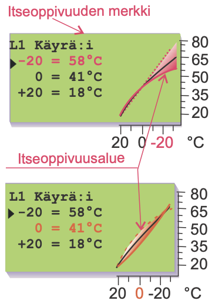

Kuvan kuvaus: kaksi säätökäyrän asettelunäyttöä päällekkäin. Kummankin näytön teksti on:

```
L1 Käyrä:i
▶-20 = 58°C
   0 = 41°C
 +20 = 18°C
```

Näytön oikeassa reunassa on pieni kaavio säätökäyrästä: pystyakselin asteikko 20, 35, 50, 65, 80, vaaka-akselin asteikko 20, 0, -20 ja yksikkö °C. Ylempi näyttö: rivi "-20 = 58°C" ja vaaka-akselin -20 ovat punaisia, ja käyrän -20 °C:n päähän on piirretty punainen viuhka. Selite "Itseoppivuuden merkki" osoittaa nuolella i-kirjaimeen rivillä "L1 Käyrä:i". Alempi näyttö: rivi "0 = 41°C" ja vaaka-akselin 0 ovat oransseja, ja viuhka on käyrän keskellä 0 °C:n kohdalla. Selitteestä "Itseoppivuusalue" lähtevät viivat kumpaankin viuhkaan.

**Esimerkkejä itseoppivan säätimen toiminnasta:**
Jos ulkolämpötila on välillä -15...-25°C, itseoppivuus tapahtuu säätökäyrän asettelupisteessä: -20°C. Esimerkiksi asetusarvon ollessa 58°C, itseoppivuusalue on 52...64°C (+/- 10% asetusarvosta).

Jos ulkolämpötila on välillä -5...+5°C, itseoppivuus tapahtuu säätökäyrän asettelupisteessä: -0°C. Esimerkiksi asetusarvon ollessa 41°C, itseoppivuusalue on 37...45°C (+/- 10% asetusarvosta).

---

<a id="s18"></a>

## Sivu 18: HÄLYTYKSET

Geopro 202S hälyttää poikkeavissa tilanteissa. Hälytystilanteessa säätimestä kuuluu hälytysääni ja näyttöön tulee hälytysilmoitus. Lisäksi hälytysreleen kosketin sulkeutuu. Huom! Vaikka hälytyksen syy on poistunut, jää viimeinen hälytys pysyvästi näyttöön kunnes se kuitataan. Mikäli säätimeen on kytketty GSM-modeemi, välittyy hälytys haluttuun GSM-puhelimeen tekstiviestinä. Geopro 202S:ssa on mahdollista kytkeä myös yksi hälytys mittaukseen 6, mikäli se on vapaana. esim. kosteushälytyksen jatko-ohjaus (hälytysten nimeäminen tapahtuu tekstieditorilla).

### Anturivikahälytykset:

```
Hälytys!

Mittaus 1
Ulkolämpö err
```

Anturivikatapauksessa säätimestä kuuluu hälytysääni ja näyttöön tulee hälytysilmoitus: Hälytys! mittausnumero ja mittausnimi sekä err. Hälytysreleen kosketin sulkeutuu (riviliittimet 31 ja 32).

### Jäätymisvaarahälytys:

```
Jäätymisvaara!

Mittaus 2
L1 Menovesi 11
```

Säädin antaa jäätymisvaarahälytyksen, jos menoveden lämpötila alittaa menoveden vapaan pudotuksen alarajasta tai huonelämpötilan alarajasta lasketun raja-arvon. Näytössä on menoveden lämpötila. (ks. sivu 28).

### Poikkeamahälytys:

```
Poikkeamahälytys

Mittaus 2
L1 Menovesi 25
```

Säädin antaa poikkeamahälytyksen, jos menoveden lämpötila poikkeaa pysyvästi (tehdasasetus 60 min) säätimen määräämästä menoveden lämpötilasta. (Sallittu maksimipoikkeama annetaan erikoishuollon "L1PoikHäl" -asetusarvossa ja hälytyksen edellyttämä poikkeaman kesto "PoikHälHid" -asetusarvossa, sivu 28.)

> **Repo note:** p. 28 is Moottorivalinta. Both "sivu 28" references describe settings on p. 30: the menoveden vapaan pudotuksen alarajat (L1mv.min, L2mv.min), L1 Poikk.häl and PoikHälHid. Page 30 writes "L1 Poikk.häl" where this page has "L1PoikHäl".

### Maalämpökojeen hälytykset:

```
Alilämpöhälytys!

 Mittaus 8
 Maaliuos   -15
```

**Alilämpöhälytys/ Mittaus 8/ Maaliuos** = Maalämpökoneelta palaavan maaliuoksen alilämpö. Hälytysrajan asettaminen: Huoltotila/ asetusarvot/ "maaliuos häl"-asetusarvo.

**Poikkeamahälytys/ Mittaus 11/ Kompr.käynti** = Säädin ei saa käyntitietoa kompressorilta, vaikka kompressorin tulisi käydä. Hälytys estää säätimen kompressorin käyntiyritykset 5 min ajan, jonka jälkeen säädin yrittää käynnistää kompressorin uudelleen.

**Hälytys/ Dig 2/ Kompr. L-rele** = Kompressorin ylivirtaussuojan hälytys. (lämpörele)

**Hälytys/ Dig 3/ Sähköv.ylik** = Sähkövastuksen ylikuumenemissuojan hälytys. Huom! Hälytys voidaan kuitata vain sähkövastuksen käsikuittaus- painikkeella.

### ULKOPUOLISET HÄLYTYKSET:

**Mittaus 6 hälytyskäytössä:**

Mittausta 6 voidaan käyttää myös ulkopuolisten hälytysten ilmaisuun (potentiaalivapaa kosketin). Tällöin tulee kyseisen mittauksen riviliittimille kytkeä 30kΩ vastus. Hälytykset voidaan nimetä (ks. sivu 8).

> **Repo note:** alarms are named with the text editor on p. 11, not p. 8; the index on p. 41 lists Hälytysten nimeäminen on pp. 11 and 18.

Otsikon alla on punaisella vinoon kirjoitettuja esimerkkinimiä: “Kosteusvaara!” ja “Lokasäiliö!”.

**Sulkeutuva hälytys**

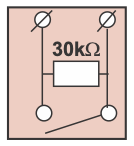

Kuvan kuvaus: kaksi riviliitintä yläreunassa. Niiden välissä on 30kΩ:n vastus, ja vastuksen rinnalla alareunassa on avoin kosketin.

Kun kosketin on auki, näytössä on "1 ". Kun kosketin sulkeutuu, tapahtuu hälytys, ja näytössä näkyy kyseinen hälytys.

**Avautuva hälytys**

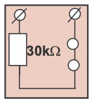

Kuvan kuvaus: kaksi riviliitintä yläreunassa. Vasemmasta liittimestä johdin kulkee 30kΩ:n vastuksen kautta alas ja sieltä oikealle koskettimelle, joka on piirretty kahtena liitäntäpisteenä oikean liittimen alle. Vastus ja kosketin ovat sarjassa.

Kun kosketin on kiinni, näytössä on "1 ". Kun kosketin avautuu, tapahtuu hälytys, ja näytössä näkyy kyseinen hälytys.

### HÄLYTYSRELEEN KYTKENTÄ:

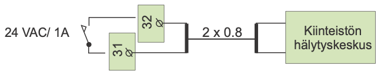

Kuvan kuvaus: hälytysreleen kosketin, jonka vieressä on merkintä "24 VAC/ 1A", on kytketty riviliittimiin 31 ja 32. Liittimiltä kaapeli 2 x 0.8 kulkee laatikkoon "Kiinteistön hälytyskeskus".

### HÄLYTYKSEN KUITTAUS:

Hälytysääni vaiennetaan painamalla mitä tahansa näppäintä. Samalla näyttö palaa siihen tilaan, jossa se oli vian ilmetessä tai jos on muita hälytyksiä, näyttöön tulee niistä hälytystiedot. Jos näppäimiin ei kosketa 20 sekuntiin, hälytysilmoitus palaa näyttöön ellei vikaa ole korjattu.

GSM-control ominaisuus tarjoaa edullisen "minivalvomo-ratkaisun". Hälytystieto ohjataan haluttuihin GSM-numeroihin (1 ja 2). Ks. s. 33). Hälytystilanteessa säädin lähettää ensin GSM 1:een tekstiviestin, jossa ilmenee hälytyksen syy. Hälytys kuitataan GSM:llä lähettämällä sama viesti takaisin säätimelle. Mikäli hälytystä ei kuitata GSM 1:stä 5 min sisällä, säädin lähettää uudelleen tekstiviestin molempiin GSM-numeroihin.

> **Repo note:** the GSM numbers (Häl.nro GSM 1 and Häl.nro GSM 2) are set on p. 35; p. 33 is LON-käyttöönotto.

---

<a id="s19"></a>

## Sivu 19: GSM-TOIMINNOT

Geopro 202S:n kytkettävä GSM-modeemi mahdollistaa käyttäjän kommunikoinnin säätimen kanssa GSM-puhelimella tekstiviestien välityksellä (käyttöönotto s. 35). GSM- puhelimella voidaan tehdä lähes kaikki tässä ohjekirjassa mainitut käyttäjätason asiat, kuten mittaukset, asetusarvot, säätökäyrän asetukset, menovesi-info ja säätimen ohjaustapa. Kellojen voimassaoleva aikaohjelma voidaan ohittaa joko pysyvästi tai määräaikaisesti. GSM-puhelimeen välittyy myös hälytykset, jotka voidaan kuitata lähettämällä hälytysviesti takaisin säätimelle.

### KOMMUNIKOINTI SÄÄTIMEN KANSSA GSM:N VÄLITYKSELLÄ:

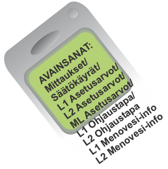

Kuvan kuvaus: GSM-puhelin, jonka näytössä on viesti. Viestin loppu jatkuu näytön reunan yli:

```
AVAINSANAT:
Mittaukset/
Säätökäyrät/
L1 Asetusarvot/
L2 Asetusarvot/
ML Asetusarvot/
L1 Ohjaustapa/
L2 Ohjaustapa
L1 Menovesi-info
L2 Menovesi-info
```

Lähetä seuraava tekstiviesti säätimelle: **AVAINSANAT**

Mikäli säätimellä on käytössä laitetunnus (s. 35, 36), kirjoita aina laitetunnus avainsanan eteen (esim. TC1 AVAINSANAT). Säädin lähettää tekstiviestinä listan avainsanoista, joiden avulla saat tietoja säätimen toiminnasta. Jokainen avainsana on erotettu toisistaan /-merkillä.

### Tietojen saanti säätimeltä GSM:llä:

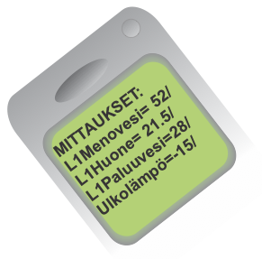

Kuvan kuvaus: GSM-puhelin, jonka näytössä on viesti:

```
MITTAUKSET:
L1Menovesi= 52/
L1Huone= 21.5/
L1Paluuvesi=28/
Ulkolämpö=-15/
```

Lähetä tekstiviesti säätimelle käyttäen säätimen antamia avainsanoja. Säädin tunnistaa vain yhden pyynnön kerrallaan, joten kirjoita vain yksi avainsana/viesti. Voit kirjoittaa avainsanan isoilla tai pienillä kirjaimilla. (Mikäli säätimellä on käytössä laitetunnus (ks.s. 35, 36), kirjoita laitetunnus avainsanan eteen.)

Säädin vastaa pyyntösi lähettämällä pyytämäsi tiedot.

### Säätimen ohjaus GSM:llä:

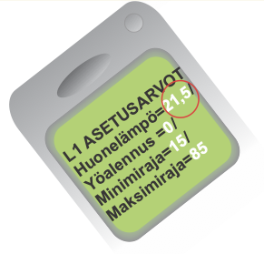

Kuvan kuvaus: GSM-puhelin, jonka näytössä on viesti alla. Luvut 21,5, 0, 15 ja 85 ovat valkoisia, ja luvun 21,5 ympärillä on punainen ympyrä:

```
L1 ASETUSARVOT
Huonelämpö=21,5/
Yöalennus =0/
Minimiraja=15/
Maksimiraja=85
```

Voit muuttaa GSM-puhelimella säätökäyrän asetuksia, käyttäjätason asetusarvoja, säätimen ohjaustapaa.
Lähetä tekstiviesti säätimelle, jossa pyydät avainsanalla tietoja siitä toiminnosta, jonka asetuksia haluat muuttaa (tai ota tieto esille puhelimesi muistista). **Muokkaa säätimen lähettämän tekstiviestin lukuarvoja ja lähetä muokattu viesti säätimelle**. Säädin tekee pyydetyt muutokset ja lähettää kuittauksena tekstiviestin, jossa näkyy uudet asetukset.

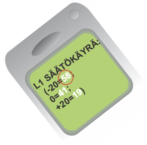

Kuvan kuvaus: GSM-puhelin taulukon Säätökäyrät-rivin vieressä. Näytössä on viesti alla. Luvut 58, 41 ja 19 ovat valkoisia, ja luvun 58 ympärillä on punainen ympyrä:

```
L1 SÄÄTÖKÄYRÄ:
(-20=58;
0=41;
+20=19)
```

| Avainsana: | Toimintaohje, jos haluat muuttaa asetusta |
|---|---|
| Säätökäyrät | Kirjoita haluttu menoveden lämpötila entisen asetusarvon paikalle tekstiviestin “muokkaa” tilassa. |
| L1 Asetusarvot | Kirjoita asetusarvo entisen asetusarvon paikalle |
| L1 Ohjaustapa | Vaihda tähti (\*) sen ohjaustavan eteen, jonka haluat ottaa käyttöön. Käsiajon kuittaussanomassa säädin lähettää myös tiedon menoveden lämpötilasta ja venttiilin asennosta (0-10V ohjatut moottorit).<br><br>**Huom!** Sähköistä käsiajoa käytettäessä on oltava erityisen varovainen jäätymisvaaran ja ylilämpövaaran vuoksi.<br><br>Venttiilin huuhtelutoiminnassa säädin ajaa venttiilin auki ja sitten kiinni, jonka jälkeen säätö palautuu automaatille. Toiminnalla voidaan yrittää puhdistaa tukkeentunut venttiili roskista. |

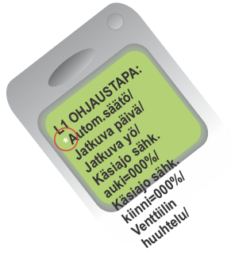

Kuvan kuvaus: GSM-puhelin taulukon L1 Ohjaustapa -rivin vieressä. Näytössä on viesti, joka jatkuu näytön reunan yli. Tähti on valkoinen, ja sen ympärillä on punainen ympyrä:

```
L1 OHJAUSTAPA:
*Autom.säätö/
Jatkuva päivä/
Jatkuva yö/
Käsiajo sähk.
auki=000%/
Käsiajo sähk.
kiinni=000%/
Venttiilin
huuhtelu/
```

### Hälytysten kuittaus:

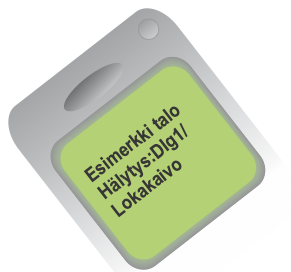

Kuvan kuvaus: GSM-puhelin, jonka näytössä on viesti:

```
Esimerkki talo
Hälytys:DIg1/
Lokakaivo
```

Voit kuitata hälytyksen GSM:n avulla lähettämällä saman viestin takaisin säätimelle.

---

<a id="s20"></a>

## Sivu 20: MAALÄMMITYSTOIMINNOT

### KIINTEISTÖN JA KÄYTTÖVEDEN LÄMMITTÄMINEN

Geopro 202S säätimessä on 2 lämmityksen säätöpiiriä (L1 ja L2). Niiden asettelut on esitetty sivuilla 4-7. Lämmitysvaraajan alaosaa lämmitetään kompressorilla ja tarvittaessa sähkövastuksella S1 niin, että lämmitysverkostoon riittää lämpöä lämmitystarpeen aikana ja yläosaa kompressorilla sekä tarvittaessa sähkövastuksen S1 avulla niin, että saadaan lämmintä käyttövettä.

> **Repo note:** p. 4 is blank. The contents on p. 5 put the säätökäyrien asetukset on pp. 6–7 and the asetusarvot on pp. 8–9.

**Lämpimän käyttöveden suureen kulutukseen varautuminen:**
Kun on odotettavissa tavanomaista suurempi lämpimän käyttöveden tarve, voidaan käyttöveden lämmitystä tehostaa lisälämmityksellä. Käyttöveden lisälämmityksen ohjaus tapahtuu painamalla erillistä lisälämpöpainiketta (lisävaruste). Kun painiketta painetaan, muuttuu alaosan minimilämpötilan asetusarvo “VaraajaAlaMin” “Lisälämmitys”-asetusarvoksi (esim. 45°C) asetusarvon “Lisäläm.aika” pituiseksi ajaksi. Tällä toiminnalla saadaan myös LV-varaajan alaosa kuumemmaksi, jolloin lämpimän käyttöveden kapasiteetti kasvaa.

### MAALÄMPÖKOJEEN HÄLYTYKSET

**Alilämpöhälytys/ Mittaus 8/ Maaliuos** = Alilämpöhälytys, jos maalämpökoneelta palaavan maaliuoksen lämpötila laskee alle asetellun hälytysrajan. Hälytysrajan asettaminen: Huoltotila/ Asetusarvot/ "Maaliuos häl"-asetusarvo.

**Poikkeamahälytys/ Mittaus 11/ Kompr.käynti** = Poikkeamahälytys, jos kompressoria ohjataan päälle ja käyntitietoa ei tule takaisinkytkennän kautta. **Huom!** Tämän hälytyksen tullessa katkaistaan kompressorin ohjaus. Hälytys kuittaantuu automaattisesti 5 minuutin päästä, jolloin kompressorin päällemeno sallitaan uudelleen.

**Hälytys/ Dig 2/ Kompr. L-rele** = Hälytys, jos kompressorin ylivirtasuoja on lauennut. (Lämpörele, sulkeutuva kosketin).

**Hälytys/ Dig 3/ Sähköv.ylik** = Hälytys, jos sähkövastuksen ylikuumenemissuoja on lauennut. Huom! Hälytys voidaan kuitata vain sähkövastuksen käsikuittauspainikkeella. (Hälytys sulkeutuvalta koskettimelta).

---

<a id="s21"></a>

## Sivu 21: MAALÄMMITYSTOIMINNOT

### ASETUSARVOT, käyttäjätaso

| Asetusarvo: | Tehdasasetus: | Asettelualue: | Merkitys: |
|---|---|---|---|
| VaraajaAlaMin | 30°C | 30...55°C | Varaajan alaosan minimilämpötila (Maalämpökojeelta lähtevän lämmitysveden minimilämpötila) |
| SV_viiveaika | 30m | 0...120min | Varaajan keskiosa (mittaus 4) voi kytkeä lämpötilan mukaan sähkövastuksen päälle vasta, kun kompressori on ollut käynnissä tässä asetetun ajan (min) |
| Var.ylä kesä | 55°C | 30...75°C | Varaajan yläosan asetusarvo ulkolämpötilan ollessa ≥ +20°C. |
| Var.ylä talvi | 65°C | 30...75°C | Varaajan yläosan asetusarvo ulkolämpötilan ollessa ≤ -20°C. |
| VaraajaYlä: | Laskennallinen | | "Var.ylä kesä" ja "Var.ylä talvi" asetusarvojen mukaan määraytyvä varaajan yläosan lämpötila (ks. kuva). |
| Lisälämmitys | 50°C | 40...55°C | Lisälämpöpainikkeen painaminen asettaa varaajan alaosan minimin asetusarvoksi ko. asetusarvon |
| Lisäläm.aika | 2h | 0...6h | "Lisälämmitys"- asetusarvo on voimassa tässä aseteltavan ajan |

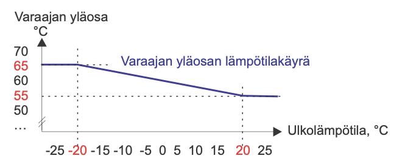

Kuvan kuvaus: kaavio "Varaajan yläosan lämpötilakäyrä". Pystyakseli on varaajan yläosan lämpötila, °C (asteikko 50, 55, 60, 65, 70), vaaka-akseli ulkolämpötila, °C (asteikko -25 … 25). Käyrä on vaakasuora 65 °C:ssa ulkolämpötilan ollessa -20 °C tai alle, laskee suorana viivana -20 °C:sta +20 °C:seen ja on vaakasuora 55 °C:ssa +20 °C:sta ylöspäin. Lukemat 65, 55, -20 ja 20 on merkitty punaisella ja katkoviivoilla, eli kuva käyttää Var.ylä talvi- ja Var.ylä kesä -tehdasasetuksia.

### ASETUSARVOT, huoltotila

| Asetusarvo: | Tehdasasetus: | Asettelualue: | Merkitys: |
|---|---|---|---|
| Kompr.esto | 55°C | 45...55°C | Lämmitysvaraajan alaosan lämpötilan (mittaus 10) ylittäessä tämän asetusarvon pysäytetään kompressori aina, vaikka varaajan yläosa käskisi kompressoria käyntiin. |
| VarYläEroSv | 3 °C | 0...10°C | Sähkövastus käynnistyy, kun varaajan yläosan lämpötila laskee ["VaraajaYläEro" + "VaraajaYläEroSv"] lämpötilan verran alle laskennallisen "VaraajaYlä " asetusarvon. |
| VaraajaAlaEro | 5 °C | 3...7 °C | Varaajan alaosan lämmityksen ohjauksen eroalue |
| VaraajaYläEro | 3°C | 3...10°C | Varaajan yläosan lämmityksen ohjauksen eroalue |
| JV Esiavaus | 40% | 25...100% | Jakoventtiilin esiavauksen määrä. Esiavaus suoritetaan ennen sähkövastuksen päällekytkemistä |
| JV Esto | 60s | 30...240s | Jakoventtiilin kiinniajon eston kestoaika. Kiinniajon esto aloitetaan sähkövastuksen päällekytkemisestä |
| Maaliuos häl | -6 | -10...0°C | Hälytys maalämpökoneelta palaavan maaliuoksen alilämmöstä |

> **Repo note:** the Merkitys text of VarYläEroSv calls the setting "VaraajaYläEroSv"; the menu label is VarYläEroSv. Maaliuos häl's factory value has no unit; its range is in °C.

> **Repo note:** p. 26 swaps the factory values of VaraajaAlaEro and VaraajaYläEro (3 °C and 5 °C). The factory-reset list on p. 29 agrees with this page. [`docs/controller.md`](../docs/controller.md#factory-values-that-contradict-each-other) has what the Controller held.

### OHJAUSTAVAT:

```
ML Ohjaustavat
▶● Kompr.+sähköv.
   Kompressori
   Sähkövastus
```

**Maalämmityksen säätöpiirin (ML) ohjaustavat:**

Voit siirtyä maalämmityksen säätöpiiriin (ML) [Ryhmänvaihto] -näppäimen avulla.

**Kompressori + sähkövastus:**
Jos maalämpö ei riitä, kytkeytyy sähkövastus päälle.

**Kompressori:**
Varaajan lämmitys tapahtuu vain maalämmöllä (ei käytetä sähkövastuksia).

**Sähkövastus:**
Varaajan lämmitys tapahtuu ainoastaan sähkövastuksella.

---

<a id="s22"></a>

## Sivu 22: MAALÄMMITYSTOIMINNOT

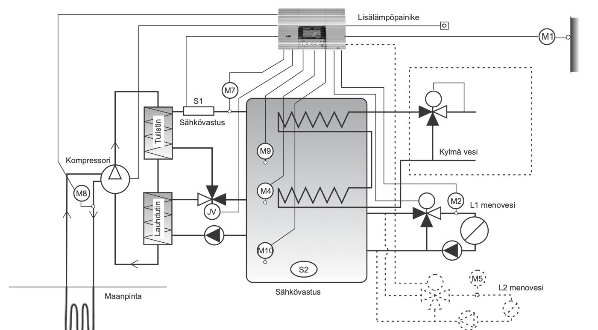

Kuvan kuvaus: periaatekuva maalämpöjärjestelmästä. Säädin on ylhäällä, ja siitä lähtee johdot antureille, venttiileille ja laitteille. Katkoviivalla piirretyt osat ovat valinnaisia.

- Lisälämpöpainike on kytketty säätimeen. Ulkoanturi M1 on talon seinässä.
- Maapiiri: maanpinnan alla oleva maaputkisto nousee kompressorin luo. Anturi M8 on maapiirin putkessa kompressorin vieressä.
- Kylmäainepiiri: kompressorilta piiri kulkee tulistimen (Tulistin) ja lauhduttimen (Lauhdutin) kautta takaisin kompressorille.
- Lauhduttimen vesipuoli: pumppu ottaa vettä varaajan alaosasta ja syöttää sen lauhduttimeen. Lauhduttimen yhde on yhdistetty jakoventtiiliin JV. JV:n kaksi muuta yhdettä ovat tulistimelle ja varaajan keskiosaan. Tulistimelta linja kulkee sähkövastuksen S1 ("Sähkövastus") ja anturin M7 kautta varaajan yläosaan.
- Varaaja: anturit M9 (yläosa), M4 (keskiosa) ja M10 (alaosa). Sähkövastus S2 on varaajan alaosassa ("Sähkövastus" varaajan alla).
- Varaajan läpi kulkee kaksiosainen kierukka. Kylmä vesi -linja tulee alempaan kierukkaan M4:n korkeudelle, ja kierukka jatkuu ylempään kierukkaan varaajan yläosassa. Ylemmän kierukan lähtö menee katkoviivalla rajatun alueen kolmitieventtiiliin, johon tulee myös kylmä vesi.
- L1 menovesi: varaajan oikealta sivulta lähtevä linja kulkee moottoroidun kolmitieventtiilin ja anturin M2 kautta lämmitysverkostoon. Paluulinja tulee lämmitysverkostosta pumpun kautta varaajan alaosaan, ja kolmitieventtiilin kolmas yhde on yhdistetty paluulinjaan.
- L2 menovesi on piirretty katkoviivalla samalla tavalla, anturina M5.

Huom! Varaajan keskianturin (M4) rikkoontuessa säädin käyttää ohjaavana anturina varaajan alaosan anturia (M10) ja päinvastoin.

> **Repo note:** the figure shows no flow direction on the JV's ports. [`docs/controller.md`](../docs/controller.md#jv) has the flow the owner confirmed for this unit.

### Esimerkki 1.

Maalämpökojeen ohjaus varaajan yläosan lämpötilan (mittaus 9) mukaan, kun "VaraajaYlä" asetusarvoksi on asetettu + 70°C ja ohjauksen eroalueeksi 5°C (VaraajaYläEro).

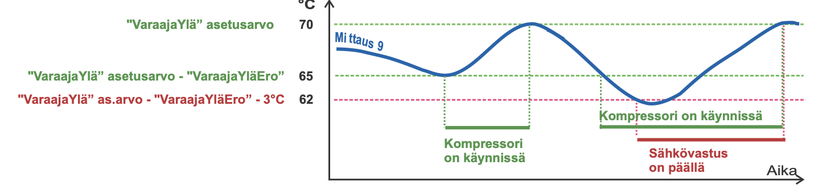

Kuvan kuvaus: kaavio, jossa on mittaus 9 (sininen käyrä) ajan funktiona. Vaakaviivat ovat 70 °C ("VaraajaYlä" asetusarvo, vihreä), 65 °C ("VaraajaYlä" asetusarvo - "VaraajaYläEro", vihreä) ja 62 °C ("VaraajaYlä" as.arvo - "VaraajaYläEro" - 3°C, punainen). Ensin mittaus 9 laskee 65 °C:seen: kompressori käynnistyy ("Kompressori on käynnissä") ja pysähtyy, kun mittaus 9 nousee 70 °C:seen. Toisella kerralla kompressori käynnistyy taas 65 °C:ssa, mutta mittaus 9 laskee edelleen alle 62 °C:n, jolloin sähkövastus menee päälle ("Sähkövastus on päällä"). Kompressori ja sähkövastus pysähtyvät yhtä aikaa, kun mittaus 9 nousee 70 °C:seen.

### Esimerkki 2.

Maalämpökojeen ohjaus varaajan alaosan lämpötilan mukaan (mittaus 10) ja varaajan keskiosan lämpötilan mukaan (mittaus 4), kun säätimen määräämä L1 menoveden lämpötila on +28 °C ja ohjauksen eroalueeksi (VaraajaAlaEro) on asetettu 3°C. (Käyntikäskyt annetaan mittauksen 4 perusteella ja poistetaan mittauksen 10 perusteella).

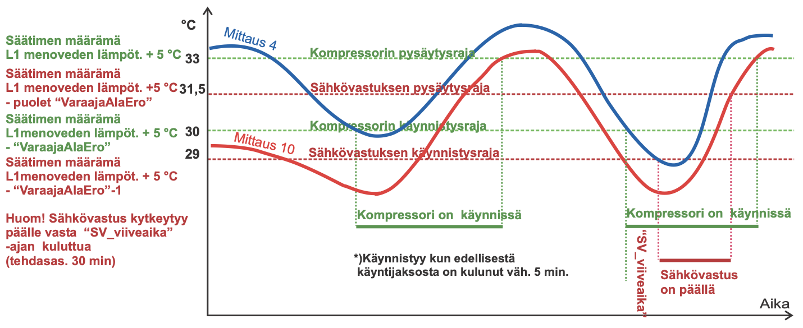

Kuvan kuvaus: kaavio, jossa on mittaus 4 (sininen käyrä) ja mittaus 10 (punainen käyrä) ajan funktiona. Vaakaviivat ja niiden selitteet:

| °C | Selite vasemmalla | Selite viivalla |
|---|---|---|
| 33 | Säätimen määrämä L1 menoveden lämpöt. + 5 °C | Kompressorin pysäytysraja |
| 31,5 | Säätimen määrämä L1 menoveden lämpöt. +5 °C - puolet "VaraajaAlaEro" | Sähkövastuksen pysäytysraja |
| 30 | Säätimen määrämä L1menoveden lämpöt. + 5 °C - "VaraajaAlaEro" | Kompressorin käynnistysraja |
| 29 | Säätimen määrämä L1menoveden lämpöt. + 5 °C - "VaraajaAlaEro"-1 | Sähkövastuksen käynnistysraja |

Ensimmäisellä kerralla mittaus 4 laskee 30 °C:seen ja kompressori käynnistyy ("Kompressori on käynnissä"). Mittaus 4 ei laske 29 °C:seen, joten sähkövastus ei mene päälle. Kompressori pysähtyy, kun mittaus 10 nousee 33 °C:seen. Toisella kerralla kompressori käynnistyy taas, kun mittaus 4 laskee 30 °C:seen, ja mittaus 4 laskee edelleen alle 29 °C:n. Sähkövastus menee päälle vasta, kun kompressorin käynnistyksestä on kulunut "SV_viiveaika" (merkitty pystysuoraan kompressorin käynnistyksen ja sähkövastuksen käynnistyksen väliin). Sähkövastus menee pois, kun mittaus 10 nousee 31,5 °C:seen, ja kompressori pysähtyy, kun mittaus 10 nousee 33 °C:seen.

Kaavion tekstit:

Huom! Sähkövastus kytkeytyy päälle vasta "SV_viiveaika" -ajan kuluttua (tehdasas. 30 min)

\*)Käynnistyy kun edellisestä käyntijaksosta on kulunut väh. 5 min.

Huom! Esimerkissä oletetaan, että säätöpiiri L1 pyytää ylintä lämpötilaa, jolloin ohjaus on esitetty L1:n mukaan. Jos L2 tai "VaraajaAlaMin" edellyttävät ylempää lämpötilaa kuin L1, tapahtuu ohjaus niiden perusteella.

> **Repo note:** VaraajaYläEro 5 °C and VaraajaAlaEro 3 °C are the examples' own settings; [`docs/controller.md`](../docs/controller.md#factory-values-that-contradict-each-other) has the factory values. The asterisk of the 5-minute footnote isn't attached to anything in the chart; p. 23 states the same wait for a start on mittaus 4.

---

<a id="s23"></a>

## Sivu 23: MAALÄMMITYSTOIMINNOT

### KOMPRESSORIN KÄYNNIN OHJAUS:

- **Kompressori käynnistyy varaajan yläosan perusteella, kun:**
  **mittaus 9** alittaa asetusarvon "VaraajaYlä" - "VaraajaYläEro".

- **Kompressori pysähtyy varaajan yläosan perusteella, kun:**
  **mittaus 9** ylittää asetusarvon "VaraajaYlä".

- **Kompressori käynnistyy varaajan alaosan perusteella, kun:**
  edellisestä kompressorin käyntijaksosta on kulunut vähintään 5 minuuttia **ja mittaus 4** alittaa jonkin seuraavista asetusarvoista:
  - säätimen määräämä menoveden lämpötila L1 + 5°C - "VaraajaAlaEro" tai
  - säätimen määräämä menoveden lämpötila L2 + 5°C - "VaraajaAlaEro" tai
  - "VaraajaAlaMin" tai
  - "Lisälämmitys", mikäli lisälämmityspainiketta on painettu.

- **Lisälämpöpainike:** painikkeen painaminen vaihtaa varaajan alaosan asetusarvon "VaraajaAlaMin" asetusarvoksi "Lisälämmitys". Lisälämmitysasetusarvo on voimassa määriteltävän ajan "Lisäläm.aika".

- **Kompressori pysähtyy varaajan alaosan perusteella, kun:**
  **mittaus 10** ylittää seuraavat asetusarvot:
  - säätimen määräämä menoveden lämpötila L1 + 5°C ja
  - säätimen määräämä menoveden lämpötila L2 + 5°C ja
  - "VaraajaAlaMin" + "VaraajaAlaEro" ja
  - "Lisälämmitys" + "VaraajaAlaEro", mikäli lisälämmityspainiketta on painettu.

- **Kompressori pysäytetään aina, kun:**
  **mittauksen 10 lämpötila nousee "Kompr.esto" lämpötilaan.** (Tämän pysäytyksen jälkeen kompressori voi käynnistyä uudelleen vasta kun mittaus 10:n lämpötila on laskenut asetusarvon "VaraajaAlaEro" verran alle "Kompr.esto" lämpötilan).

- **Kompressori ei voi käynnistyä, jos:**
  - mittaus 10 on yli "Kompr.esto" lämpötilan tai
  - valikosta on valittu maalämmityksen ohjaustavaksi "Sähkövastus", tällöin kompressorin ohjaus muutetaan sähkövastuksen ohjaukseksi tai
  - kompressorin käyntitietohälytys (pressostaattihälytys) on aktiivinen.

### SÄHKÖVASTUKSEN OHJAUS:

- **Sähkövastus menee päälle varaajan yläosan perusteella, kun:**
  **mittaus 9** alittaa asetusarvon "VaraajaYlä" - "VaraajaYläEro" - "VarYläEroSv".

- **Sähkövastus kytkeytyy pois päältä varaajan yläosan perusteella, kun:**
  **mittaus 9** ylittää asetusarvon "VaraajaYlä".

- **Sähkövastus menee päälle varaajan alaosan perusteella, kun:**
  kompressorin ohjaus on ollut päällä "SV-viiveaika"-asetusarvon ajan ja **mittaus 4** alittaa jonkin seuraavista asetusarvoista:
  - säätimen määräämä menoveden lämpötila L1 + 5°C - "VaraajaAlaEro" - 1°C tai
  - säätimen määräämä menoveden lämpötila L2 + 5°C - "VaraajaAlaEro" - 1°C tai
  - "VaraajaAlaMin" - 1°C tai
  - "Lisälämmitys"- 1°C, mikäli lisälämmityspainiketta on painettu.

- **Sähkövastuksen päällekytkemisen ennakointi:**
  Ennakointi suoritetaan **aina** ennen sähkövastuksen päällekytkemistä. Sähkövastus kytketään päälle vasta kun ennakointi on suoritettu loppuun. Kun sähkövastus halutaan päälle:
  - jakoventtiiliä JV ajetaan pakkoajolla auki asetusarvon "JV Esiavaus" verran, jotta saadaan suurempi vesivirtaama sähkövastukselle ja estetään sähkövastuksen ylikuumeneminen
  - sähkövastus kytketään päälle
  - estetään jakoventtiilin ajo kiinni-suuntaan asetusarvolla "JV esto" määriteltäväksi ajaksi.

- **Huom! Jakoventtiilin JV ohjaus tapahtuu mittauksen 7 perusteella; asetusarvo on "VaraajaYlä" + 5°C.**

- **Sähkövastus kytkeytyy pois päältä varaajan alaosan perusteella, kun:**
  **mittaus 10** ylittää seuraavat asetusarvot:
  - säätimen määräämä menoveden lämpötila L1 + 5°C - 1/2 \* "VaraajaAlaEro" ja
  - säätimen määräämä menoveden lämpötila L2 + 5°C - 1/2 \* "VaraajaAlaEro" ja
  - "VaraajaAlaMin" + 1/2 \* "VaraajaAlaEro" ja
  - "Lisälämmitys" + 1/2 \* "VaraajaAlaEro", mikäli lisälämmityspainiketta on painettu

- **Sähkövastus ei voi mennä päälle, jos:**
  - sähkövastuksen ennakointia ei ole suoritettu loppuun tai
  - valikosta on valittu maalämmityksen ohjaustavaksi "Kompressori", tällöin sähkövastuksen ohjaus muutetaan kompressorin ohjaukseksi.

> **Repo note:** this page writes SV_viiveaika (p. 21) as "SV-viiveaika" and JV Esto as "JV esto".
